# Bulk RNA-seq comparison

[Learning path](index.md) · [Mixed-species QC](mix-species-workflow.md) · [Multi-plate comparison](multi-plate-comparison.md) · [API reference](api-reference.md)

> **Before you start:** complete [Getting started](getting-started.md) and review [input preparation](input-preparation.md). This chapter compares **Sample 3 and Sample 4** against biologically matched bulk references. “Study” and “Reference” labels are anonymous identifiers. The worked figures and tables are fixed interpretation examples; the separate synthetic practice references produce different numbers.


Compare local Drug-seq expression with compatible bulk RNA-seq at well, plate × compound, and compound/cell-line levels while controlling batch structure without erasing biological or method effects.

<a id="overview"></a>

## Workflow overview

This reusable workflow compares one or more `drugseqpy` objects with compatible public or in-house bulk RNA-seq data. It moves from individual wells to plate × compound profiles and finally to a study-aware compound-level conclusion, while preserving species, biological condition, plate, and reference-study structure.

Use it to answer three general questions: whether individual wells agree with a bulk reference, whether plate-level compound profiles reproduce the same expression pattern, and whether the conclusion remains stable across independent RNA-seq studies. Sample 3 and Sample 4 are the worked example used to show every operation and output.

### Worked example result

MDA-MB-231: **inconclusive**. NIH/3T3: **Sample 3 more similar**. Each decision requires the reference-study and matched-well intervals to support the same direction.

**Historical human mean Δz (Sample 4 − Sample 3): −0.0006**, with a reference-resampling interval of −0.0089 to 0.0078.

**Define direction before analysis.** For any two objects A and B, state that negative `Δz = z(B) − z(A)` favors A and positive values favor B. In this example A is Sample 3 and B is Sample 4. “Inconclusive” is not evidence that the objects are equivalent.

<a id="design"></a>

## Comparison design

Drug-seq and bulk RNA-seq do not produce identical measurement units. Compare their *relative gene-expression structure*; do not treat UMI and FPKM values as interchangeable measurements.

| Property | Local drugseqpy object(s) | Bulk RNA-seq reference |
| --- | --- | --- |
| Observation unit | One retained plate well | One population RNA-seq library |
| Expression value | Raw gene-level UMI count with normalized views | Documented gene-level FPKM or another frozen common scale |
| Replicates used | Retained wells nested within plate and compound | Eligible samples nested within study |
| Primary gene set | Bulk-expressed protein-coding genes in the species-specific Ensembl-ID intersection | |
| Primary similarity | Spearman rank correlation, calculated separately for every object/reference pair | |
| Guardrails | Never pool species, objects, plates, or validation studies before their independent similarities are available | |

### Three analysis resolutions

| Resolution | Drug-seq profile | Question answered | Uncertainty / batch handling |
| --- | --- | --- | --- |
| **Well** | One retained well | Does the result depend on a small subset of wells? | Correlate every well independently; resample matched well positions when available. |
| **Plate × compound** | Mean UMI profile for one compound or cell line on one plate | How closely does each local plate profile match each bulk sample? | Keep objects and plates separate; pair their similarities against the same reference. |
| **Compound / cell line** | Plate-level correlations summarized within biological condition | Is one object or method consistently closer across studies? | Bootstrap studies first and samples within study; combine with local well/plate uncertainty. |


<a id="run"></a>

## Run a portable practice comparison

The bundled bulk-reference files are **entirely synthetic**, generated independently of the local practice matrices. They contain eight mock references across two simulation studies per species. They are supplied to test matching, gene alignment, and calculations, not to recreate the historical results below.

Run from the tutorial repository root in the drugseqpy environment:

```bash
python scripts/compare_bulk_rnaseq.py --data-dir data --bulk-expression data/bulk_practice/expression.tsv --bulk-metadata data/bulk_practice/metadata.tsv --output-dir results/bulk-comparison
```

The helper loads Sample 3 and Sample 4 and keeps human and mouse comparisons separate. It computes well- and plate-profile correlations, pairs the same reference across the two samples, averages differences within each study, and then gives each study equal weight. It does not remove batch effects, assign a winning method, calculate confidence intervals, or perform the pseudogene audit. Those historical analyses are explained later as extensions with additional design and annotation requirements.

```python
from pathlib import Path
import pandas as pd

output = Path("results/bulk-comparison")
profiles = pd.read_csv(output / "profile_correlations.csv")
paired = pd.read_csv(output / "paired_reference_differences.csv")
study_summary = pd.read_csv(output / "study_equal_summary.csv")
print(profiles[["species", "compound", "plate_id", "reference_id", "spearman_rho"]])
print(study_summary)
```

Review the individual wells and use `--exclude-samples reviewed_exclusions.csv` only for an explicit list of Sample 3/4 `sample_id` values, optionally with a `reason` column. The default retains wells, including deliberately mixed and low-depth practice wells; compare the [species-QC results](mix-species-workflow.md) before deciding which observations are suitable. Changing the well set changes the mean profile and must be recorded.

To generate a fresh independent-format practice copy without overwriting an existing directory:

```bash
python scripts/make_bulk_practice_data.py --output bulk-practice-copy
```

### Bring your own reference tables

Provide a tab-delimited expression table with `feature_id` followed by one column per reference, and a metadata table with the fields below. A blank expression cell means **not measured**; an explicit zero is an observed zero. The script rejects duplicate stable gene IDs after stripping version suffixes. It keeps a fixed intersection measured in both local samples and every reference for the same species/condition; it never fills annotation gaps with zeros.

| Metadata field | Meaning |
| --- | --- |
| `reference_id` | Unique reference library identifier, matching exactly one expression column. |
| `study_id` | Independent study or reference-batch label; repeated libraries from one study remain grouped. |
| `species` | `human` or `mouse` for this helper. |
| `compound` | Exact local condition label, such as `231` or `3T3`; review cell identity, treatment, dose, and time before declaring a match. |
| `unit` | `counts` or `FPKM`; one declared unit per study. Counts must be nonnegative integers; FPKM can be nonnegative real values. |
| `primary` | `true` or `false`; primary and sensitivity summaries are kept separate. |

Both expression scales are accepted to demonstrate the input contract; the script does not convert one into the other. Gene-length normalization can change cross-gene ranks, so counts and FPKM are not equivalent reference choices. Prespecify a comparable scale and report scale sensitivity in a real study.

The practice helper uses all measured shared genes and has no gene-biotype annotation. It therefore does not reproduce the historical **expressed protein-coding** filter. For research use, construct and document your intended gene universe first, including the annotation version, expression rule, and eligible reference set. A broad intersection may shrink when a sensitivity study uses an older annotation; record that change explicitly.


<a id="inputs"></a>

## Inputs and inclusion rules

A reusable run needs one or more QC-complete `drugseqpy` objects, explicit plate and compound metadata, a species-resolved gene annotation, and a reviewed manifest of biologically compatible bulk RNA-seq samples. Conditions used for primary inference must be declared before correlations are inspected.

### Worked example: local Sample 3/Sample 4 data after QC

| Method | Species | Cell line | Wells | Median UMI | Median genes | Median purity |
| --- | --- | --- | --- | --- | --- | --- |
| Sample 3 | human | MDA-MB-231 | 46 | 896,562.5000 | 15,669 | 0.9961 |
| Sample 4 | human | MDA-MB-231 | 46 | 1,012,717 | 15,573 | 0.9974 |
| Sample 3 | mouse | NIH/3T3 | 46 | 353,986.5000 | 13,960.5000 | 0.9812 |
| Sample 4 | mouse | NIH/3T3 | 46 | 348,988.5000 | 13,299 | 0.9874 |

The retained local design is balanced: 46 human and 46 mouse wells in each method. Species purity is used for QC, but human and mouse counts are separated before comparison.

### Worked example: bulk references

| Species | Cell line | Study | Role | Condition | Samples |
| --- | --- | --- | --- | --- | --- |
| human | MDA-MB-231 | Study 2 | primary | parental | 3 |
| human | MDA-MB-231 | Study 3 | validation | untreated | 3 |
| human | MDA-MB-231 | Study 1 | primary | baseline | 2 |
| mouse | NIH/3T3 | Study 5 | validation | DMSO | 3 |
| mouse | NIH/3T3 | Study 4 | primary | wild\_type | 3 |

Primary datasets drive the formal decision. Study 3 is three-prime-focused human RNA-seq and Study 5 contains mouse DMSO controls, so both remain validation evidence. A further candidate study was excluded because the requested gene-level expression scale was unavailable.

**Experimental identity check.** Local metadata labels mouse wells as `3T3`; this workflow assumes NIH/3T3. Confirm the subline before treating the mouse result as definitive.

<a id="harmonize"></a>

## Harmonize unlike assays

Harmonization defines comparable features and transformations; it does not force the two assays onto identical numerical values. Apply the same documented rules to every local object and every reference.

1. Strip Ensembl version suffixes and join by stable gene ID, never by gene symbol. Detect duplicate stable IDs after stripping; do not silently duplicate or arbitrarily discard rows.
2. Restrict every comparison to the expected species and keep annotation-missing genes out of the measured-zero category.
3. Average raw UMI per retained well for the group-level Drug-seq profile; retain wells individually for the local uncertainty analysis.
4. Use bulk FPKM as requested, with study/sample provenance retained in every row.
5. Define the primary universe before looking at agreement, using species annotation and expression in the eligible primary bulk references. Use exactly the same genes for both local profiles in each paired comparison. Save the gene list and report intersection sizes; a gene absent from an annotation is not a measured zero.

`ρ(method, reference) = Spearman[ log10(FPKM + 1), log10(mean UMI + 1) ]`

Spearman correlation is invariant to a strictly monotone log transform (ties remain ties), but the explicit transformed quantities keep the computation aligned with the diagnostic scatter plots. Pearson correlation on the transformed values is retained as a sensitivity view. The practice helper uses natural-log `log1p` for display; changing the log base rescales each axis by a positive constant and does not change these Pearson or Spearman coefficients.

<a id="batch"></a>

## Handle batch effects without erasing method effects

Start by asking whether the nuisance batch is statistically separable from the biological object, method, compound, dose, and time point. The design—not the availability of a correction algorithm—determines whether direct adjustment is valid.

| Design | Recommended handling | Validation |
| --- | --- | --- |
| One plate per object or method | Do not directly remove plate; use paired-reference contrasts and hierarchical uncertainty. | Matched wells, independent reference studies, and sensitivity datasets. |
| Technical batch genuinely crossed with method and condition | Check full design rank, then estimate batch while retaining estimable biological terms. | Held-out-batch concordance plus pre/post diagnostics. |
| Replicate plates nested within method | Analyze independent plates as the experimental units or use a justified hierarchical model. | Replicate-plate uncertainty; fixed plate and method terms remain confounded. |
| Compound occurs on only one plate | Treat compound and plate as confounded; report the limitation. | Add a balanced replicate plate before making a general claim. |

**Worked example identifiability limit.** Sample 3 is one plate and Sample 4 is one plate. Therefore `plate_id` and method are perfectly confounded. ComBat, Harmony, mean-centering, or regression across these two plates would remove an inseparable mixture of plate and method signal—and could manufacture agreement with bulk RNA-seq.

For a confounded design such as Sample 3/Sample 4, use design- and inference-based batch control:

1. **Normalize locally before comparison:** retain raw UMI for provenance and use the same log-expression/rank-correlation definition for every well, plate, and object.
2. **Pair on the bulk reference:** calculate each object's similarity to the *same* bulk sample before taking a difference. Pairing holds the reference identity fixed, but study-by-assay interactions and biological mismatch can remain.
3. **Respect the study hierarchy:** summarize samples within study and resample studies as the top-level unit. Do not treat every reference library as an independent study.
4. **Keep validation batches separate:** three-prime-focused human RNA-seq and mouse DMSO controls are sensitivity evidence, not pooled into the primary call.
5. **Use matched local wells:** when matching metadata verify that positions represent corresponding experimental units, resample those verified pairs together so the decision must survive local plate heterogeneity.

### Check the full design before correcting

Two or more plates per method improve replication, but do **not** by themselves make a fixed-effect `plate_id + method` design identifiable. If each plate contains only one method, method remains nested within the plate factor. The same concern applies to a compound, donor, or time point that occurs in only one batch.

For a future experiment with a technical batch genuinely crossed with method and condition, check the full design matrix for rank deficiency before calling `correct_batch()`. For methods assigned to independent replicate plates, use an analysis that treats plate as the experimental unit (or a justified hierarchical model); do not subtract a fixed plate effect and assume the method contrast has been preserved. The [multi-plate chapter](multi-plate-comparison.md#design) shows the simpler case in which treatments and controls occur across plates.

No batch correction is applied to Sample 3 versus Sample 4 in this chapter or in the practice script. Reference pairing, study summaries, and matched-well sensitivity checks describe the available data; they do not eliminate plate–method confounding.

<a id="similarity"></a>

## Plate × compound comparison

Within each plate, average wells for the same compound or cell line into one gene profile. Keep every object × plate × compound profile independent, correlate it with every compatible bulk sample, and only then form paired differences.

In the worked example, Sample 3–MDA-MB-231, Sample 4–MDA-MB-231, Sample 3–NIH/3T3, and Sample 4–NIH/3T3 are the four separately computed local profiles. Profiles derived from one plate share its technical context and are not independent method replicates:

| Compound / cell line | Study | Reference | Sample 3 plate ρ | Sample 4 plate ρ | Δz Sample 4−Sample 3 |
| --- | --- | --- | --- | --- | --- |
| MDA-MB-231 | Study 2 | Study 2\_Reference 3 | 0.5198 | 0.5131 | -0.0092 |
| MDA-MB-231 | Study 2 | Study 2\_Reference 4 | 0.5257 | 0.5192 | -0.0090 |
| MDA-MB-231 | Study 2 | Study 2\_Reference 5 | 0.5213 | 0.5154 | -0.0080 |
| MDA-MB-231 | Study 1 | Study 1\_Reference 1 | 0.7416 | 0.7447 | 0.0070 |
| MDA-MB-231 | Study 1 | Study 1\_Reference 2 | 0.7409 | 0.7445 | 0.0081 |
| NIH/3T3 | Study 4 | Study 4\_Reference 9 | 0.7051 | 0.6976 | -0.0147 |
| NIH/3T3 | Study 4 | Study 4\_Reference 10 | 0.6940 | 0.6888 | -0.0100 |
| NIH/3T3 | Study 4 | Study 4\_Reference 11 | 0.7040 | 0.6969 | -0.0140 |

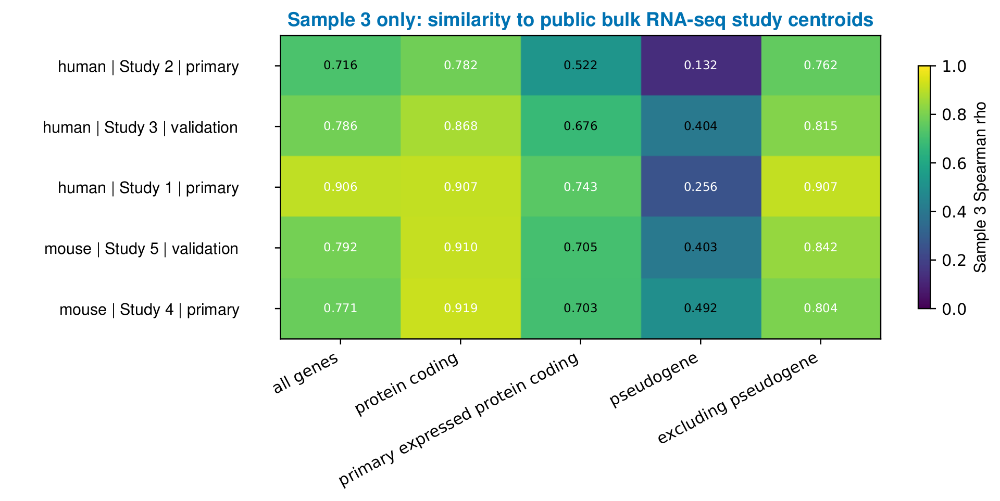

**Sample 3 similarity to bulk RNA-seq.** Sample 3 is summarized independently for human and mouse references. Values are native Spearman correlations; no cross-panel rescaling is applied.

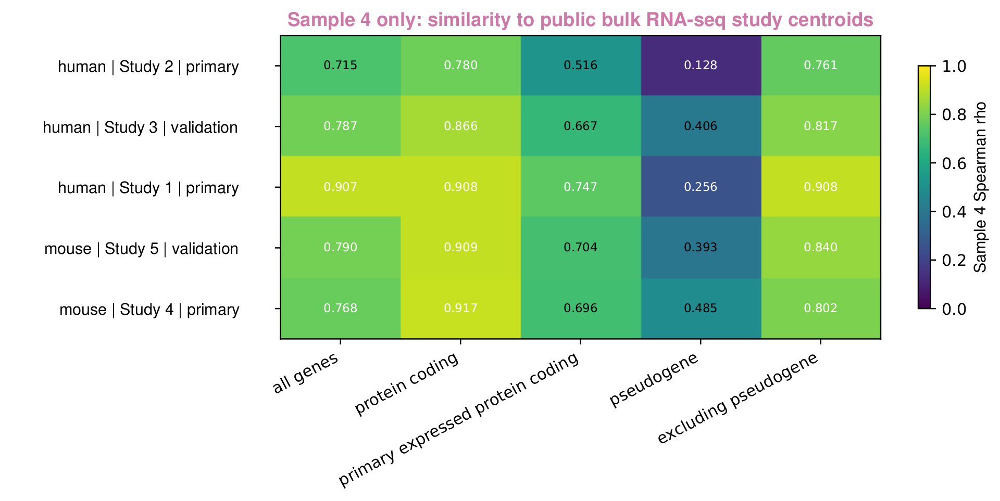

**Sample 4 similarity to bulk RNA-seq.** Sample 4 uses the same gene-set definition and visual scale as Sample 3. The two methods are compared only after both independent correlation matrices exist.

**Batch-aware pairing.** Each row in the table compares Sample 3 and Sample 4 to the same bulk sample. This paired structure is more defensible than globally batch-correcting one Sample 3 plate against one Sample 4 plate. The heatmaps also use identical scales and retain their numeric source matrices.

<a id="wells"></a>

## Inspect well-level similarity

Plate means can hide failed wells, spatial structure, or heterogeneous response. Correlate each retained well independently with each compatible bulk sample, then summarize by object, plate, compound, study, and evidence role.

The Sample 3/Sample 4 example yields 230 human and 138 mouse primary correlations per method:

| Cell line | Method | Bulk samples | Wells | Mean Spearman ρ | Mean Pearson r |
| --- | --- | --- | --- | --- | --- |
| MDA-MB-231 | Sample 3 | 5 | 46 | 0.5965 | 0.6321 |
| MDA-MB-231 | Sample 4 | 5 | 46 | 0.5950 | 0.6288 |
| NIH/3T3 | Sample 3 | 3 | 46 | 0.6654 | 0.7090 |
| NIH/3T3 | Sample 4 | 3 | 46 | 0.6584 | 0.7030 |

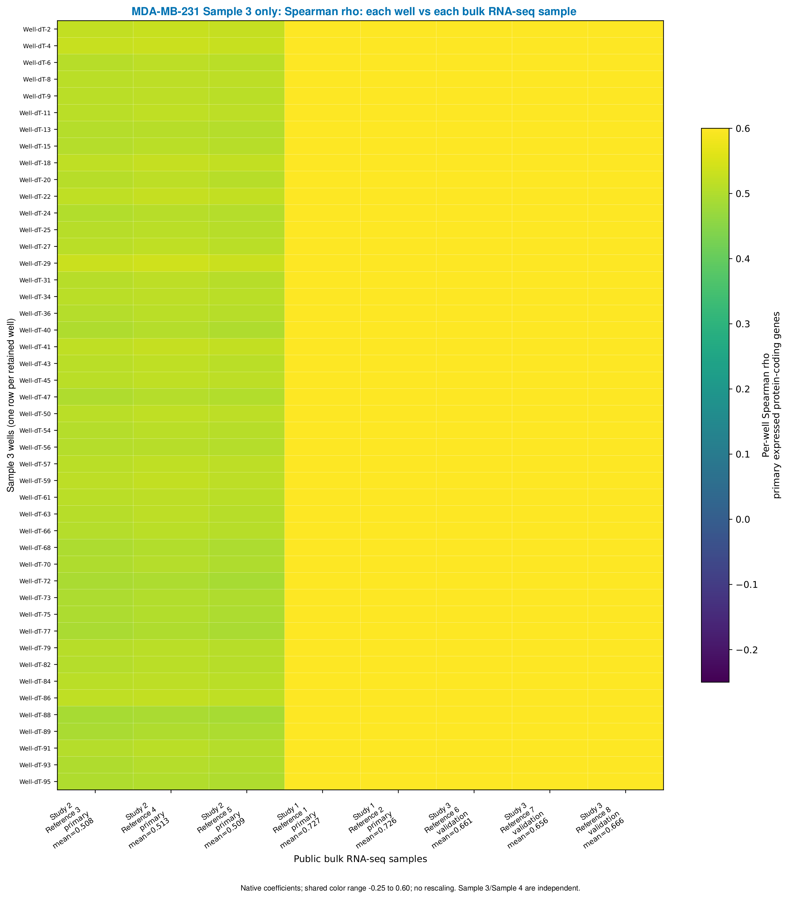

**Human Sample 3 wells.** Each row is one retained MDA-MB-231 well; each column is a matching bulk sample.

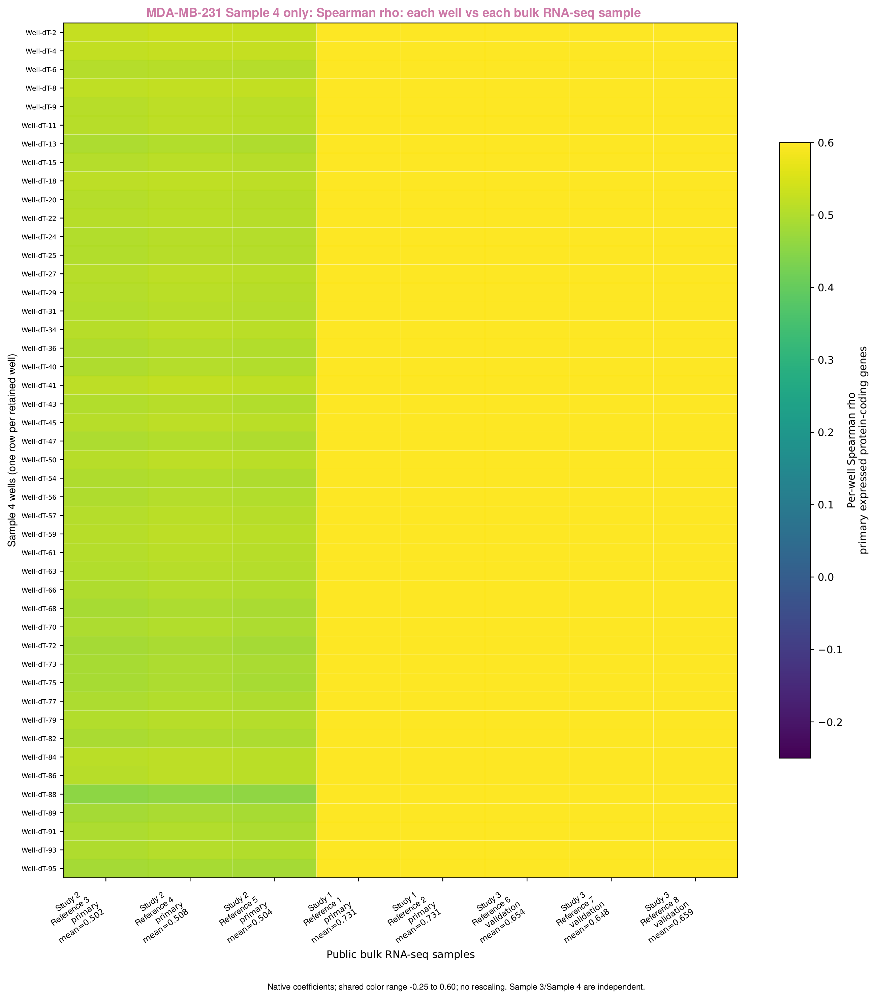

**Human Sample 4 wells.** The independent Sample 4 matrix makes well heterogeneity visible before any Sample 4-minus-Sample 3 contrast.

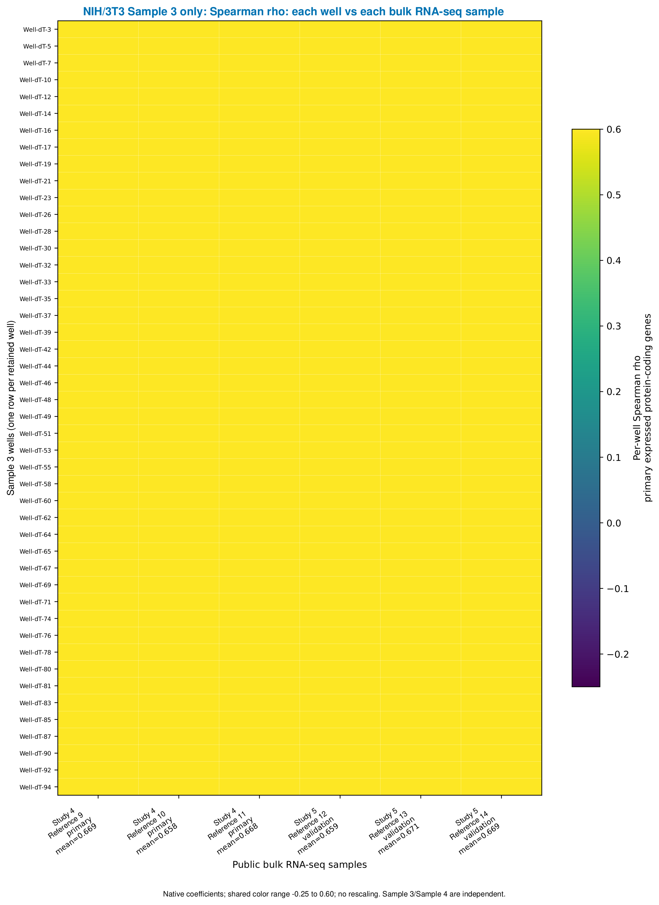

**Mouse Sample 3 wells.** NIH/3T3 primary references are evaluated without mixing human genes or samples.

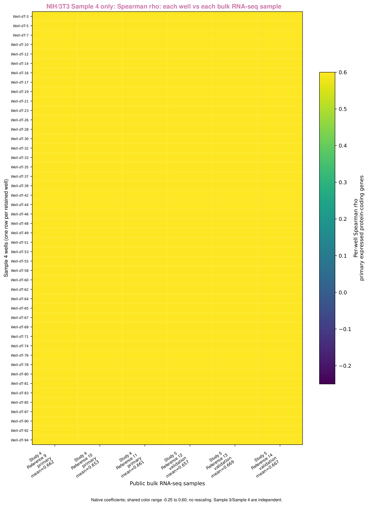

**Mouse Sample 4 wells.** All four panels share the fixed −0.25 to 0.60 correlation scale.

The Spearman heatmaps include both primary and validation-reference columns (eight human and six mouse references); the summary table above uses only the primary references. The historical workflow also generated Pearson sensitivity views on log-transformed expression.

The fixed well-heatmap color range ends at 0.60, so larger correlations saturate at the top color. Use the printed/table values to distinguish strong similarities.

The well-level averages are descriptive because wells from a plate and samples from one reference study are not independent biological replicates. They diagnose within-plate variability and feed the matched-well bootstrap; they do not replace the study-aware compound-level decision.

<a id="scatter"></a>

## Check gene-level agreement

For every object/reference pair, plot `log10(population RNA-seq FPKM + 1)` on x and `log10(mean raw UMI per retained well + 1)` on y. Freeze identical, nonnegative axis limits and integer ticks across the complete figure set. Four representative centroid panels from the worked analysis are shown below.

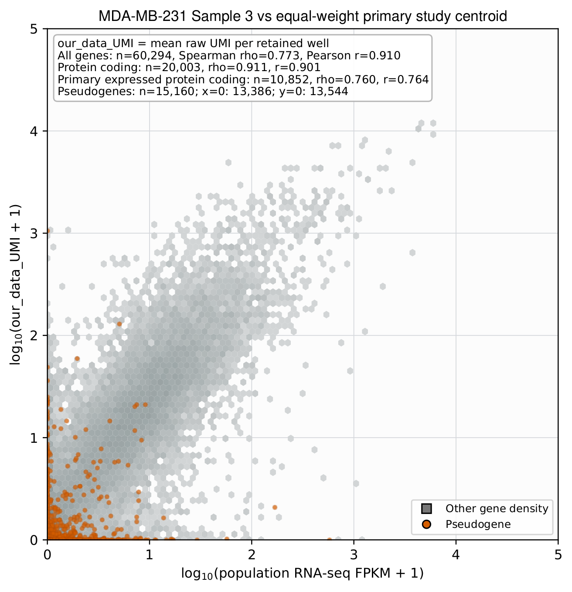

**Human primary centroid · Sample 3.** Gray hexagons show ordinary-gene density; orange points are Ensembl-annotated pseudogenes.

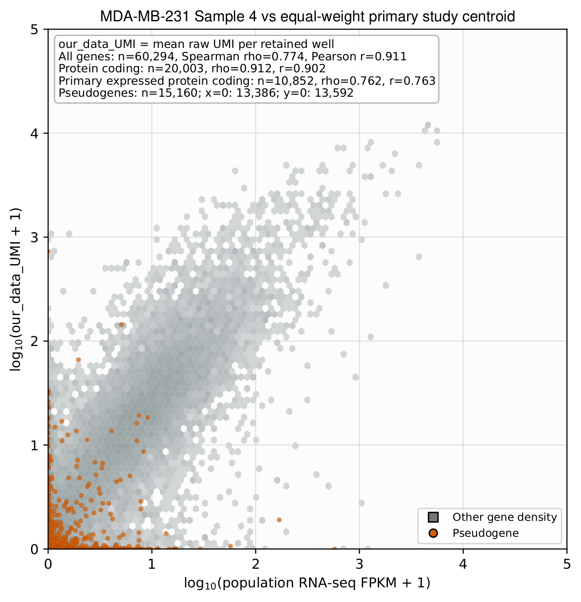

**Human primary centroid · Sample 4.** The axis limits and integer ticks exactly match the Sample 3 panel.


**Mouse primary centroid · Sample 3.** The mouse comparison uses only mouse Ensembl genes and the NIH/3T3 reference centroid.

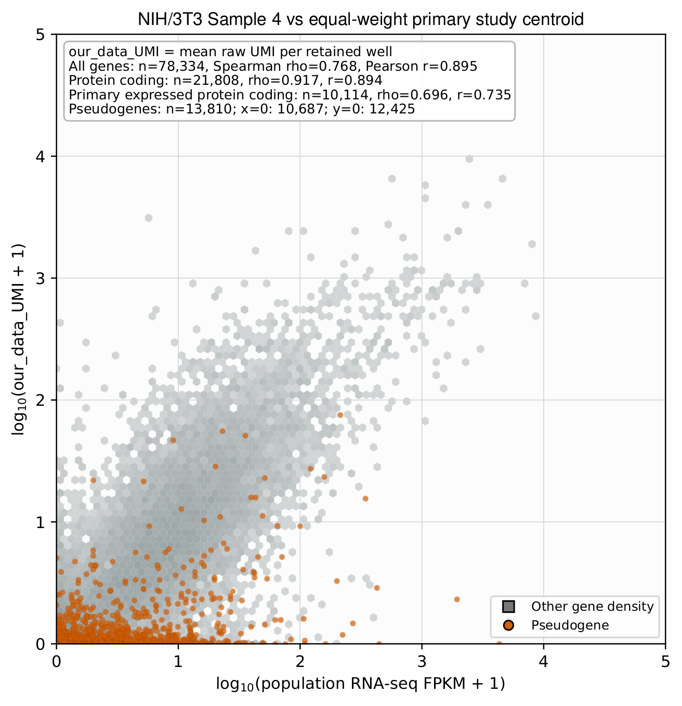

**Mouse primary centroid · Sample 4.** Shared axes make detection-range differences visible without changing the scale.

Use these plots to detect range compression, zero inflation, and unusual gene classes. Do not use the visible slope as the decision statistic—the paired Spearman analysis below remains primary.

<a id="decision"></a>

## Apply the paired decision rule

`Δz = atanh(ρ object B ) − atanh(ρ object A )   ;   Δz < 0 favors object A`

At the compound/cell-line level, each bulk sample supplies one paired object contrast. Bootstrap reference studies as the top-level unit with samples nested within study. Independently resample matched wells or replicate plates for local uncertainty. The historical rule makes a directional call only when both 95% intervals exclude zero in the same direction. This is a prespecified decision heuristic, not one joint confidence interval or a formal guarantee of method superiority.

The reference interval uses study-level resampling with samples nested within study. The local well interval instead compares resampled local profiles to a primary-reference centroid. These target related but different summaries; they are not interchangeable estimates of a single pooled effect. With only one primary mouse study, that bootstrap cannot estimate between-study variability.

For the worked example, object A is Sample 3 and object B is Sample 4:

| Cell line | Studies | Samples | Δz Sample 4−Sample 3 | Reference CI low | Reference CI high | Well CI low | Well CI high | Decision |
| --- | --- | --- | --- | --- | --- | --- | --- | --- |
| MDA-MB-231 | 2 | 5 | -0.0006 | -0.0089 | 0.0078 | 0.0001 | 0.0055 | inconclusive |
| NIH/3T3 | 1 | 3 | -0.0129 | -0.0147 | -0.0100 | -0.0171 | -0.0085 | Sample 3 more similar |

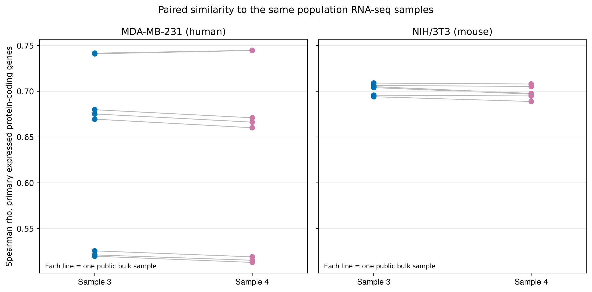

**Paired Sample 3/Sample 4 public-reference similarity.** Lines connect the two method estimates for the same bulk reference, preserving the paired design.

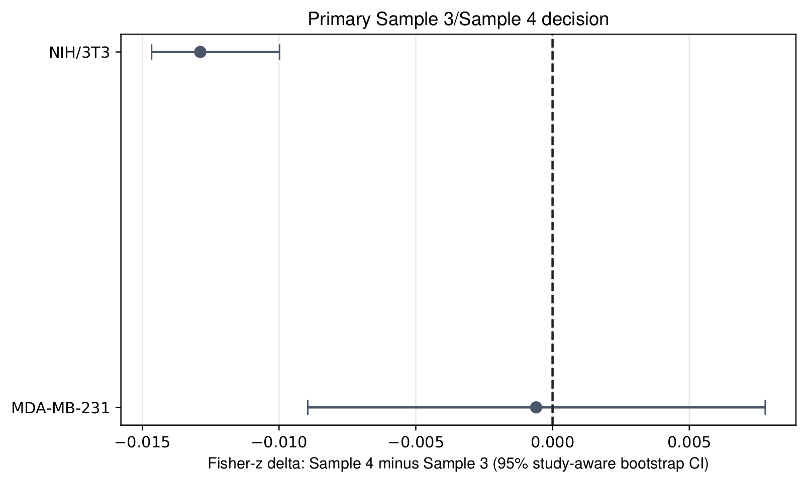

**Primary Sample 4-minus-Sample 3 decision contrast.** Negative values favor Sample 3. A call requires both the reference-sample and matched-well uncertainty analyses to agree.

**Historical interpretation.** Human agreement is inconclusive under the worked rule. Mouse agreement favors Sample 3 within the selected references, with a matched-well interval of (−0.0171, −0.0085). This remains conditional on one primary mouse study and verified local pair identities; it does not isolate a general method advantage.

<a id="pseudogene"></a>

## Audit pseudogene-specific bias

When library construction or alignment may treat gene classes differently, add a prespecified bias audit. Assign pseudogenes from the frozen annotation's `gene_biotype`, never from symbol patterns. Match each pseudogene to a protein-coding gene using bulk expression and gene length, then compare object-level detection and residual effects against material-effect thresholds.

The Sample 3/Sample 4 example uses Ensembl release 115 and reports:

| Cell line | Matched pseudogenes | Adjusted Sample 4−Sample 3 effect | CI low | CI high | Bias flagged |
| --- | --- | --- | --- | --- | --- |
| MDA-MB-231 | 15,160 | -0.0008 | -0.0013 | -0.0003 | False |
| NIH/3T3 | 13,810 | -0.0003 | -0.0008 | 0.0002 | False |

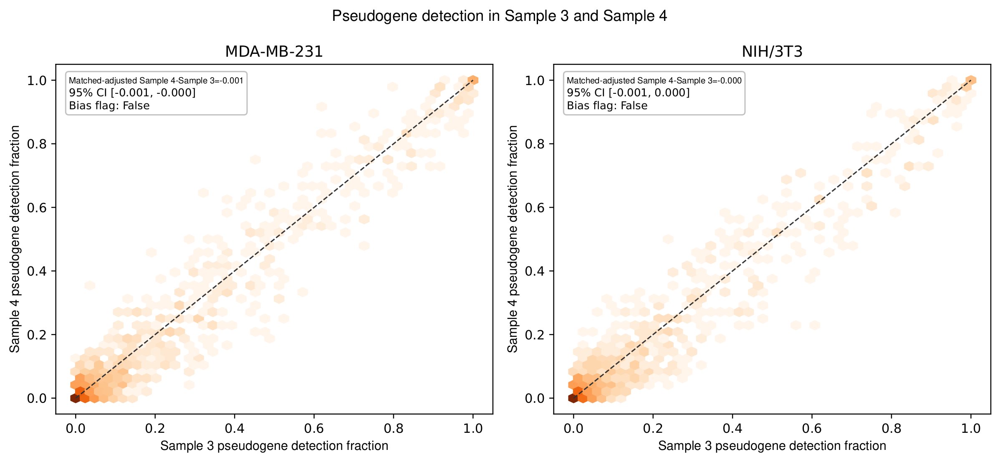

**Pseudogene detection in Sample 3 and Sample 4.** Raw detection differences are shown by cell line before expression/length matching.

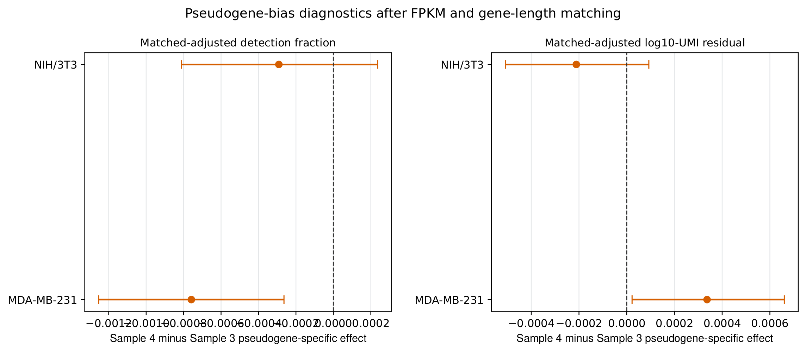

**Matched pseudogene-bias effects.** Pseudogenes are matched to protein-coding genes on bulk expression and gene length. Neither cell line crosses the worked material-effect threshold.

The worked rule flags an effect only when its interval excludes zero and the absolute adjusted detection-fraction difference is at least 0.01, or the absolute adjusted log10-UMI residual difference is at least 0.02. These are example-specific thresholds.

No material pseudogene bias is flagged under that rule. Small nonzero effects should be reported numerically; they are technical diagnostics and do not prove a mapping mechanism.

<a id="interpret"></a>

## Interpret without overclaiming

A reusable report separates the observation, the supported inference, and the boundary of generalization. State the analysis level, eligible studies, uncertainty criteria, and confounded factors before presenting a preferred object or method.

### Worked example interpretation

- **Primary human decision:** inconclusive under the prespecified analysis of the selected human bulk references.
- **Not supported:** a universal claim that Sample 3 is better for every species, cell line, treatment, or downstream task.
- **Mouse limitation:** one primary mouse study and uncertainty in the exact 3T3 subline reduce generalizability.
- **Cross-study limitation:** culture, library preparation, annotation, and quantification differ among public datasets.
- **Metric limitation:** correlation measures relative profile agreement, not absolute calibration or differential-expression performance.

<a id="outputs"></a>

## Saved outputs and audit trail

The portable practice script exports well-level correlations, plate-profile correlations, paired reference differences, study summaries, and a descriptive summary. Keep input checksums, stable feature identifiers, study roles, matching conditions, units, and all exclusions with a real analysis. The figures and historical decision intervals in this chapter were computed separately and are not recreated by the practice runner.

| Output | What to inspect |
| --- | --- |
| `profile_correlations.csv` | One comparison per plate profile and matching reference, with units, well count, feature count, and both correlation metrics. |
| `well_correlations.csv` | Each retained well compared with each matching reference; constant vectors have an explicit undefined status. |
| `included_wells.csv` | Exact local well IDs contributing to each profile. |
| `shared_features.csv` | The fixed measured feature universe for each species and condition. |
| `paired_reference_differences.csv` | Sample 4 minus Sample 3 Fisher-z differences against the same references. |
| `study_differences.csv` | Means of paired differences within each study. |
| `study_equal_summary.csv` | Equal-weight study means, separated by species, condition, and evidence role; descriptive, without confidence intervals. |
| `comparison_settings.json` | Transformation, feature-matching, and weighting rules. |
| `scatter_human_231.png`, `scatter_mouse_3T3.png` | The practice profile comparisons with shared axes within each species. |

All files are written beneath `results/bulk-comparison/` by default. The exact scatter filenames follow the species and condition labels. Reviewed exclusions, when supplied, are also exported.


Use tables for numerical checks and figures for interpretation. An empty, undefined, or unsupported comparison should be recorded explicitly instead of silently filled with zeros.

<a id="troubleshooting"></a>

## Troubleshooting

These checks apply to any `drugseqpy`-to-bulk comparison; Sample 3/Sample 4-specific examples are labeled explicitly.

### A bulk sample is missing or has the wrong condition

Update and re-review your bulk metadata table. Do not silently substitute a treated sample, derivative cell line, or normalized-count matrix for an eligible FPKM reference.

### Human and mouse genes appear in one correlation

Stop the run. Species separation is a hard invariant. Confirm Ensembl prefixes, annotation species, and the species filter applied before the join.

### Sample 3 and Sample 4 have different gene counts

Build the comparison-specific intersection after species and annotation filters. Never fill a feature missing from one assay annotation as a biological zero.

### Should I run ComBat on Sample 3 and Sample 4?

Not for this worked example: one Sample 3 plate and one Sample 4 plate make method and plate indistinguishable. Use paired reference contrasts and hierarchical uncertainty. Adding replicate plates per method is not enough for a fixed-effect correction if plates remain nested within method. Review the full design as described above.

### Plate mixing improves, but compound separation disappears

The correction is over-aggressive or the design is confounded. Restore method/compound covariates, reduce correction strength, and validate on a held-out plate. Good batch handling removes technical plate predictability without removing biological structure.

### The conclusion changes with all genes or pseudogenes

Keep the primary expressed protein-coding analysis primary, then report gene-set sensitivity explicitly. A sensitivity result should not silently replace the prespecified decision rule.

### A heatmap looks stronger because its colors are darker

Confirm every panel uses the same native-correlation limits and inspect the numeric values for color saturation. Never autoscale panels that are meant for visual comparison.

<a id="glossary"></a>

## Glossary

**FPKM** — Fragments per kilobase of transcript per million mapped fragments; the requested bulk RNA-seq scale in this workflow.

**UMI** — Unique molecular identifier count; the local Drug-seq expression measure.

**Spearman ρ** — Rank correlation used as the primary cross-assay similarity statistic.

**Fisher z** — The atanh transformation applied before taking the paired Sample 4-minus-Sample 3 correlation difference.

**Study-aware bootstrap** — A resampling design that preserves reference study structure instead of treating every sample as exchangeable.

**Matched-well bootstrap** — Joint resampling of verified corresponding well positions from two local objects to represent local uncertainty; Sample 3/Sample 4 supply the worked example.

**Plate × compound profile** — The mean gene-expression profile for one compound or cell line within one physical plate; the intermediate unit between wells and the final compound-level inference.

**Confounding** — A design in which two effects cannot be separately estimated—for Sample 3/Sample 4 here, method and plate are the same two labels.

**Batch correction** — Adjustment for unwanted technical variation; valid only when the batch effect is identifiable without removing the biological factor of interest.

**Primary evidence** — Eligible parental/baseline or wild-type bulk datasets used for the formal decision.

**Validation evidence** — Biologically relevant but non-primary datasets retained as sensitivity checks.

**Pseudogene bias** — A prespecified check for pseudogene-specific Sample 4-minus-Sample 3 detection or residual shifts after matching.

**Inconclusive** — The uncertainty criteria do not support a directional call; this is not an equivalence conclusion.

---

[← Previous chapter](drugseq-case-study.md) · [Next chapter →](api-reference.md)
