# Drug-seq worked case: one plate to three plates

[Learning path](index.md) · [Single-plate workflow](single-plate-comparison.md) · [Multi-plate workflow](multi-plate-comparison.md)

> This is a separate Drug-seq case study using measured UMI counts. Sample 1–3 are labels within this case; they do not identify the earlier worked datasets or bundled synthetic practice plates. The case illustrates one plate first and then the same selected conditions on three plates. Source identities and raw study inputs are not distributed with the tutorial.

## Define a compact experiment before examining results

The subset was chosen from plate and treatment metadata before inspecting differential-expression results. It uses three replicate plates from one processing batch, three compounds, two recorded doses, and all DMSO controls on the selected plates. The compound labels are anonymized as Drug1–Drug3. The first plate is selected by its recorded replicate order, not by its apparent signal or QC rank.

| Design feature | Selected case |
| --- | --- |
| Cell model | Human U2OS |
| Exposure | 24 hours |
| Plates | Sample 1, Sample 2, Sample 3; one processing batch |
| Physical layout | 384-well format, 16 rows × 24 columns |
| Treatment panel | Drug1–Drug3 at 0.10029 and 1.00144 µM |
| Wells per treatment–dose group | Three per plate |
| DMSO controls | 24 per plate |
| Selected wells | 42 per plate; 126 total |
| Contrasts | Six treatment–dose conditions versus DMSO |

Each plate contains other experimental wells outside this teaching subset. They are not counted as failed wells and do not enter the selected analysis. The displayed plate maps therefore show deliberate gaps. The three plates use the same layout: repeating it does not eliminate spatial confounding. Dose groups occupy different rows, and control wells have a structured placement. Interpret spatial maps together with the modeled treatment effects.

The metadata identify plate replicates and matched well conditions, but do not establish that each well represents an independently prepared biological replicate. Inference is conditional on the replicate assumptions. This case evaluates within-plate repeatability and between-plate treatment-effect consistency within a single cell-preparation batch. It does not establish experimental reproducibility under changed conditions, independent-batch validation, or a universal statement about Drug-seq performance. See the [terminology guide](input-preparation.md#repeatability-and-concordance).

## Keep raw counts and align features explicitly

The input matrices are nonnegative integer UMI counts, arranged as genes × wells. Their column order differs from metadata order; matching uses both the source plate identifier and the well barcode before assigning neutral labels. Metadata row order is never used as an implicit join.

Feature IDs are composite annotation identifiers, not Ensembl IDs. They are retained exactly as stable row keys for this case. The gene-symbol column is kept separately for plotting; duplicated symbols are not silently collapsed. The three input feature sets differ slightly, so preparation uses their explicit shared-feature intersection and reorders every plate to that same list. A feature missing from an input annotation is not filled as a measured zero.

The shared input contains 58,777 rows, including 86 ERCC spike-ins. Spike-ins are recorded during input auditing and excluded before biological filtering, normalization, and differential expression. The remaining 58,691 feature rows are then assessed by a common documented gene-filtering rule. QC descriptions distinguish all-input UMI totals from the biological-gene counts used for inference.

The prepared folder uses the same portable contract as the other chapters, in its own directory:

```text
private-case-data/
├── sample_1/
│   ├── metadata.csv
│   └── matrix/{matrix.mtx.gz,features.tsv.gz,barcodes.tsv.gz}
├── sample_2/…
├── sample_3/…
└── preparation_summary.json
```

The preparation helper accepts a gene-by-well count table per plate and a metadata CSV, including compressed `.gz` files. It joins each original matrix column using `plate_barcode + "_" + well_index`, then substitutes neutral plate and well identifiers. Physical positions are taken from `plate_well` and validated as A01–P24, not reconstructed from barcode order.

| Metadata field | Interpretation |
| --- | --- |
| `plate_barcode` | Input plate identifier used to find the corresponding count file. |
| `well_index` | Well barcode used with the plate identifier to match a count column. |
| `plate_well` | Verified physical A01–P24 position on a 384-well plate. |
| `compound` | Input treatment label, mapped to Drug1–Drug3 by your private selection file. |
| `treatment_dose`, `treatment_dose_unit` | Numeric concentration and its explicit unit. |
| `timepoint` | Exposure duration in hours. |
| `cell.line.name` | If present, must be complete and identify one cell model across the selected wells. |

Download the generic [plate-manifest example](assets/examples/drugseq-case-plates.example.csv) and [condition-selection example](assets/examples/drugseq-case-selection.example.json), or copy them locally:

```bash
mkdir -p private-case-config
cp docs/assets/examples/drugseq-case-plates.example.csv private-case-config/plates.csv
cp docs/assets/examples/drugseq-case-selection.example.json private-case-config/selection.json
```

Replace the example input plate IDs, file locations, and compound names with your own reviewed values. The manifest maps input plates to Sample 1–3; relative count-file paths resolve against the manifest's folder. The selection names the recorded DMSO control label, the compounds to include, doses, dose unit, and exposure. Other control chemistries require corresponding changes to the analysis rather than simply calling them DMSO.

```bash
python scripts/prepare_drugseq_case.py \
  --metadata private-inputs/metadata.csv.gz \
  --manifest private-case-config/plates.csv \
  --selection private-case-config/selection.json \
  --output-dir private-case-data
```

The helper validates full plate-to-metadata identities before selecting wells. It refuses an existing output directory, aligns the shared feature IDs, exports compressed sparse matrices and neutral metadata, and records the selection counts and checksums. No QC exclusion or count normalization occurs during preparation. If you request `--private-audit`, keep that source-to-alias audit outside a public repository.

The actual study inputs are not included here. The published figures and summary tables below are from the measured case, while these generic templates let readers prepare their own compatible inputs. The original synthetic `data/sample_1/` and `data/sample_2/` remain separate and should not be substituted when trying to reproduce these exact numbers.


## Inspect QC and well repeatability

All 126 prespecified wells are retained. The lowest-depth selected well is the same DMSO position, L24, on each plate. That recurring spatial pattern merits review; it is not a reason to remove a different well from each plate until the comparison looks favorable.

| Case plate | Wells | Median total UMI | Minimum total UMI | Median detected features | Median mitochondrial % |
| --- | --- | --- | --- | --- | --- |
| Sample 1 | 42 | 290,930.0 | 108,000 | 11,658.5 | 1.51 |
| Sample 2 | 42 | 338,538.0 | 119,972 | 11,581.5 | 2.09 |
| Sample 3 | 42 | 361,092.5 | 133,028 | 12,256.5 | 2.04 |

The total-UMI and detected-feature summaries include the ERCC rows present in the shared input. Biological-UMI medians after subtracting spike counts are 290,923.5, 338,527.5, and 361,078.5 for Samples 1–3. Mitochondrial percentages use the `MT-` symbol prefix. The `RPL`/`RPS` prefix-associated fractions are about 34.30%, 32.54%, and 30.26%; this definition includes associated/pseudogene features and is **not an rRNA contamination estimate**.

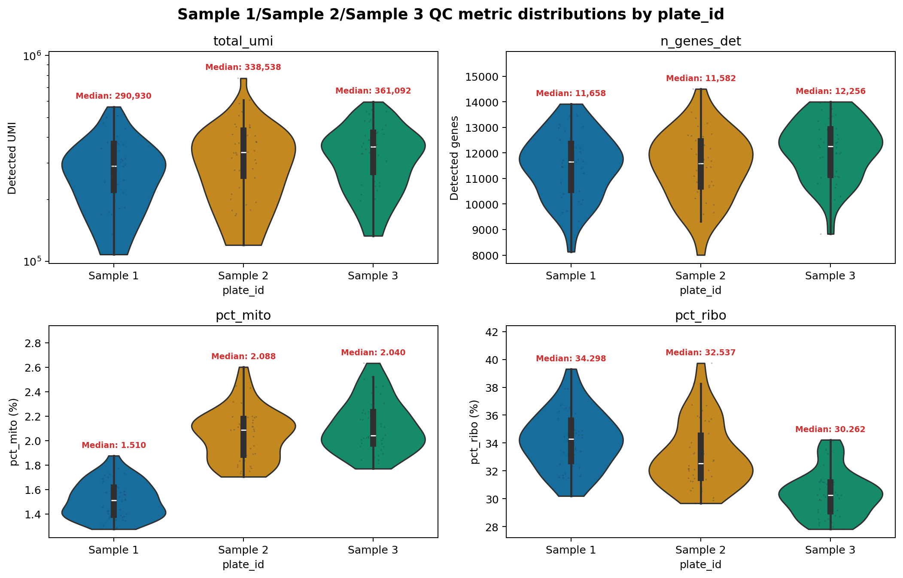

**Selected-well QC distributions.** Compare variation within each plate as well as differences in its median. These summaries describe the selected case subset, not every well in the original experiment.
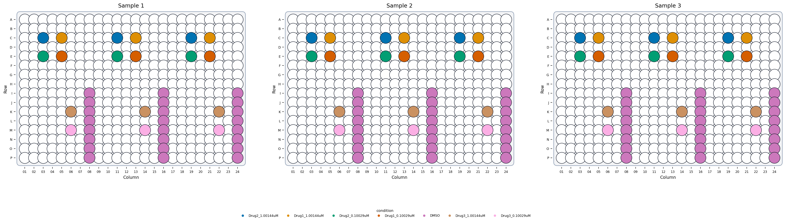

**Physical design.** The selected conditions occupy the same well positions across plates. Blank positions here are outside the teaching subset; they are not automatically missing measurements or failed wells. Open the image at full size to inspect positions.
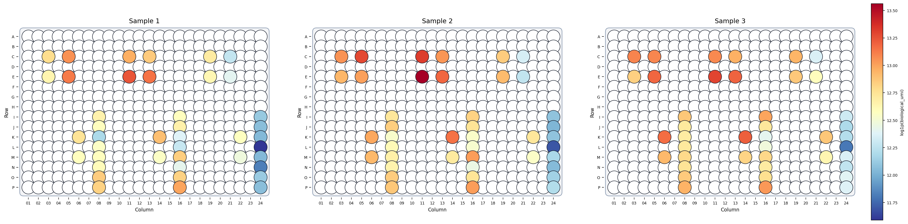

**Biological UMI layout.** Color uses log-transformed UMI totals after excluding ERCC spikes. Inspect location and condition together; plate adjustment alone cannot separate a repeated row-associated effect from a treatment placed in that row.
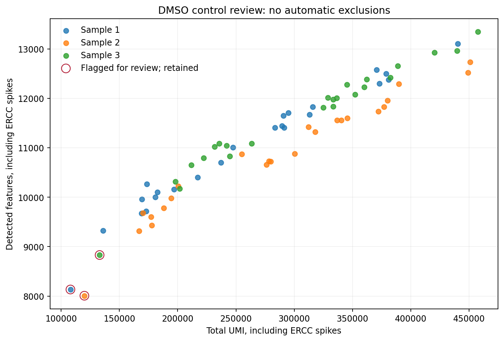

**Control review.** One DMSO well per plate exceeds the illustrative outlier-score cutoff of 5; all controls remain in the models. Scores are computed across all 126 selected wells, including treatments, so the flags depend on the selected analysis set and are not validated exclusion decisions.

### Check matched-well agreement

For model comparison, the shared gene filter retains features with at least five counts in at least three wells of a condition somewhere in the selected three-plate set. This yields **9,839 modeled features**, representing 9,835 distinct symbols. Distinct composite IDs for duplicated symbols are retained; a significant-feature count is not necessarily a count of unique gene symbols.

The following repeatability plots use Pearson correlation on `log10(raw UMI + 1)` across all 9,839 retained features, including pairwise shared zeros. This is the package repeatability convention. The [dedicated well-to-well chapter](well-to-well-repeatability.md#method) also explains a pair-specific detected-gene convention; its coefficients will differ if the gene sets differ.

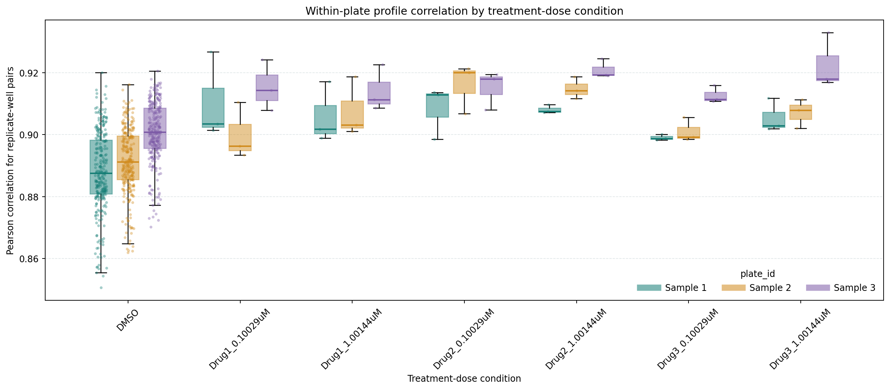

**Repeatability by condition.** Each three-well treatment condition contributes three pairs per plate; the 24 DMSO controls contribute 276 pairs. These pairs share wells and are not independent biological replicates. Median DMSO correlations are 0.888, 0.891, and 0.901.
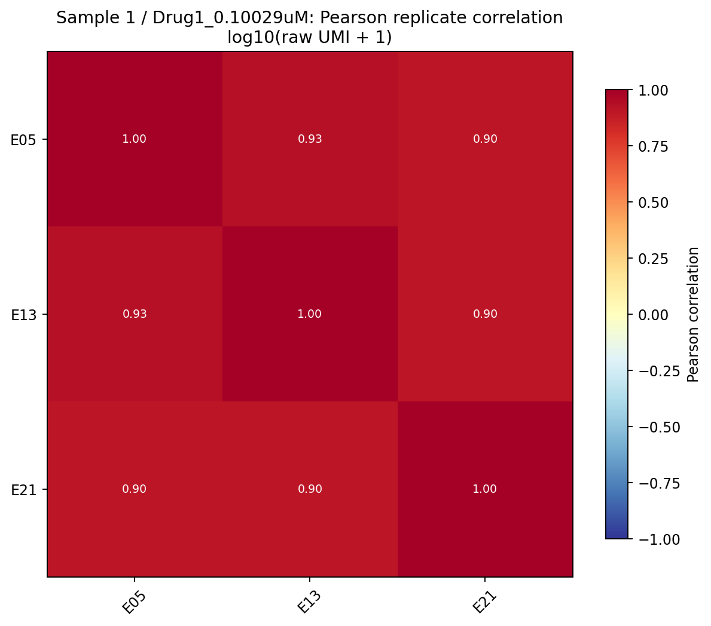

**A condition-specific heatmap.** This view shows Sample 1 and Drug1 at 0.10029 µM, selected by condition-name order before looking at the correlations.
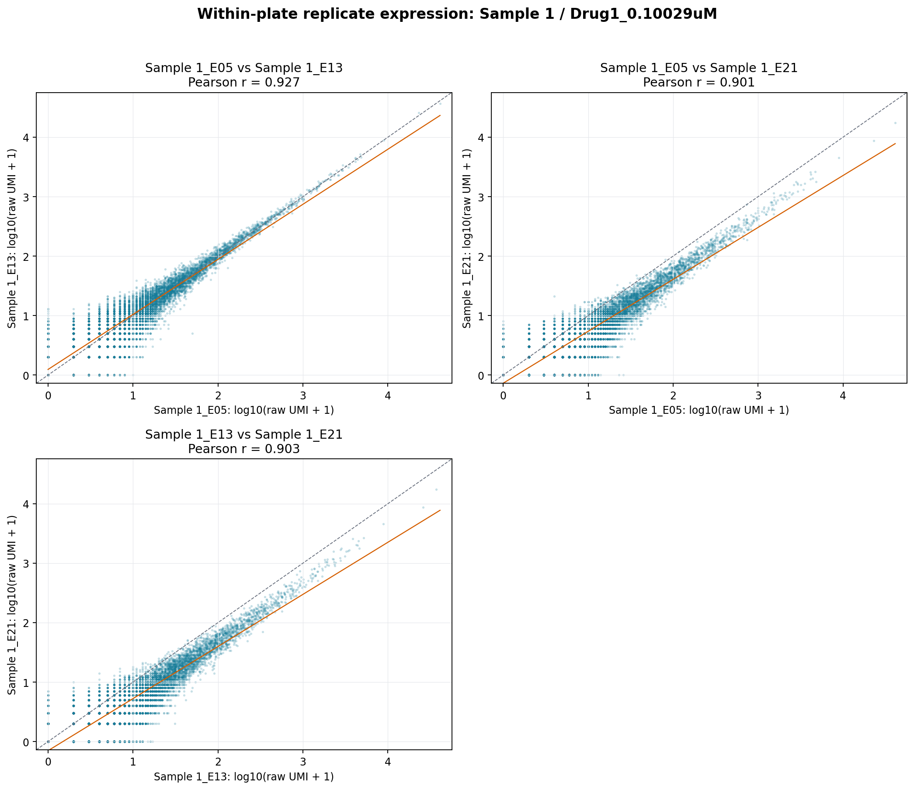

**Gene-expression scatter plots.** The three matched-well comparisons use the same retained-feature universe as the heatmap. A high profile correlation does not establish that a treatment effect reproduces; treatment-effect agreement is evaluated separately below.


## Analyze Sample 1 on its own

The one-plate analysis uses only Sample 1: 42 wells, 24 DMSO controls, and three wells for each of six treatment–dose conditions. The `condition` column distinguishes dose groups; grouping by compound alone would incorrectly pool the two concentrations.

The model compares each condition with DMSO using raw UMI counts, the Python `limma_voom` implementation, and no plate covariate. Normalized expression is used for plots, while `layers['counts']` supplies the inferential models. A separate plate effect cannot be estimated from this one plate.

The common feature filter was established on all three selected plates and then reused for every fit. This makes the feature universe comparable, but the one-plate branch is not an independently selected or held-out dataset. A workflow that filtered Sample 1 alone could retain a different feature list.

Across both one-plate and combined analyses, a feature is called significant when its adjusted p-value is below 0.05 and its absolute log2 fold change is at least 0.5. FDR adjustment is performed across features within each contrast; these thresholds do not describe one multiplicity-adjusted test over all six conditions.

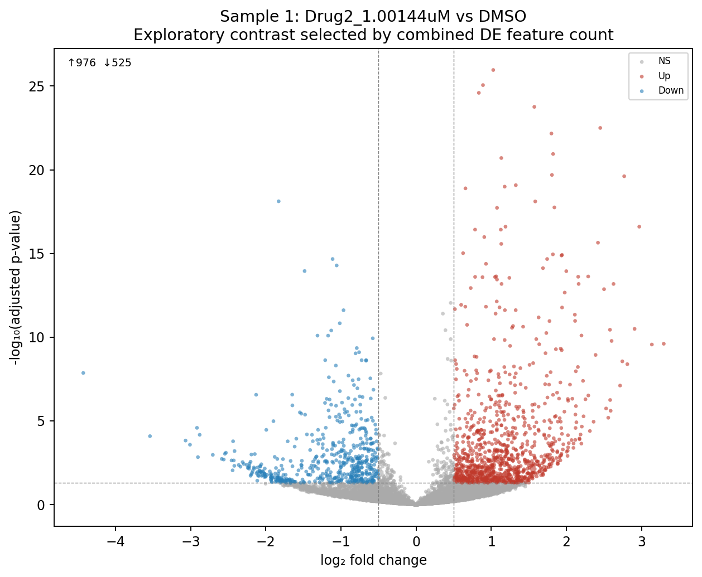

**Sample 1 example.** Drug2 at 1.00144 µM has 1,501 significant features on Sample 1. The illustrated contrast was chosen by the combined analysis's DEG count for presentation, so it is exploratory rather than an independently chosen validation target.


## Extend the same conditions to three plates

Merge the three aligned plates using globally unique well IDs. Each condition has nine wells across the plates, and the combined control set has 72 DMSO wells. The adjusted expression model includes both condition and plate:

`expression ~ plate_id + condition`

The actual design has 126 rows, nine columns including the intercept, and rank nine. Treatment and plate can therefore be estimated in this model. Adding row as a further fixed effect would make the selected design rank deficient because of the repeated layouts; it is not a valid automatic fix for spatial confounding.

### Diagnose plate structure on comparable expression scales

The before and after views use the same normalized log-expression transformation. The before matrix is copied from `batch_uncorrected` after `correct_batch(..., covariate_cols=['condition'])`, and PCA is fitted again for each view. Raw counts are verified unchanged.

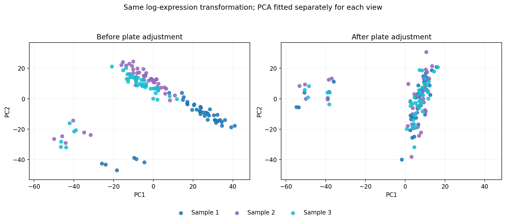

**Plate-colored views.** Plate silhouette decreases from 0.223 to −0.053 in these exploratory embeddings. PCA axes are fitted separately, so an apparent rotation or displacement is not a literal well trajectory.
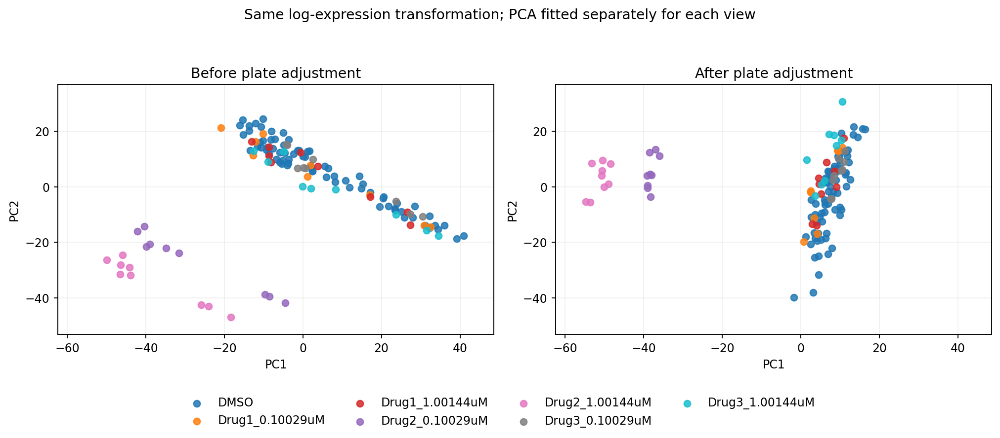

**Condition-colored views.** Inspect biological structure alongside plate mixing. Condition is explicitly preserved in the correction model; apparent preservation on this same dataset is not independent evidence that correction improves future experiments.

The raw-count combined DE model includes plate directly. It does not run DE on the corrected visualization matrix. All six adjusted contrasts succeed and retain the same 9,839 modeled feature IDs as the separate plate fits.

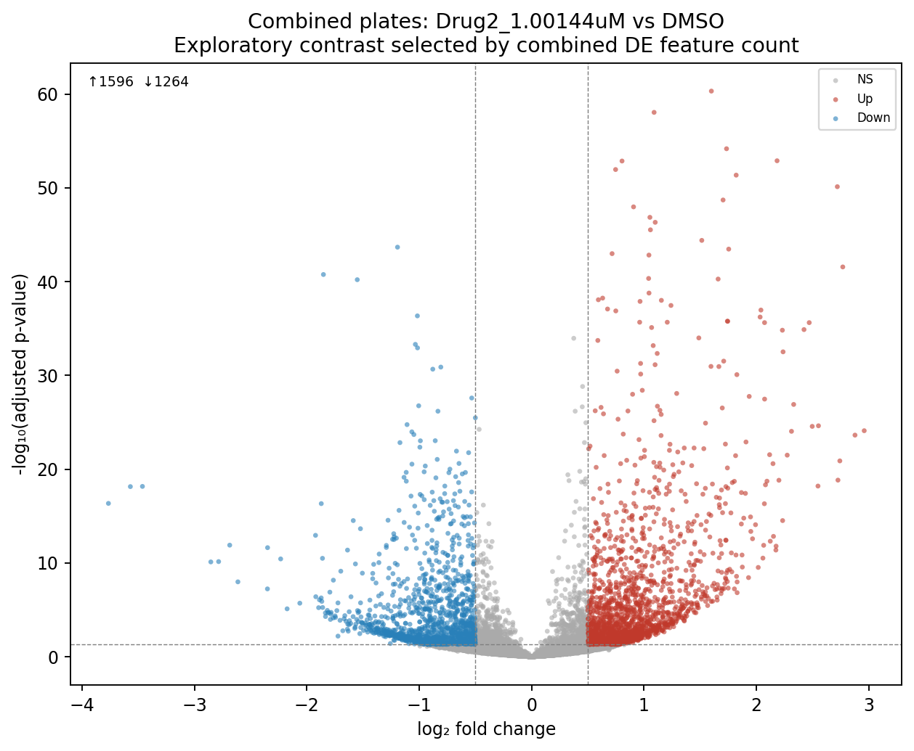

**Combined example.** Drug2 at 1.00144 µM has 2,860 significant features in the plate-adjusted fit. This model contains Sample 1 as part of its input; the larger count is not an external confirmation of the Sample 1 result.


<a id="compare-estimates-without-treating-the-pooled-model-as-independent-validation"></a>

## Compare treatment-effect concordance without treating the pooled model as independent validation

The significant-feature totals below use the same thresholds and feature universe. Counts can increase in the combined model because it has more well observations and a different fitted variance structure. The repeated layout and shared cell-preparation batch remain limitations.

| Treatment–dose condition | Sample 1 | Sample 2 | Sample 3 | Combined, plate-adjusted |
| --- | --- | --- | --- | --- |
| Drug1_0.10029uM | 0 | 2 | 0 | 0 |
| Drug1_1.00144uM | 0 | 0 | 0 | 0 |
| Drug2_0.10029uM | 830 | 980 | 1,032 | 1,975 |
| Drug2_1.00144uM | 1,501 | 1,558 | 1,682 | 2,860 |
| Drug3_0.10029uM | 0 | 0 | 0 | 1 |
| Drug3_1.00144uM | 9 | 15 | 34 | 191 |

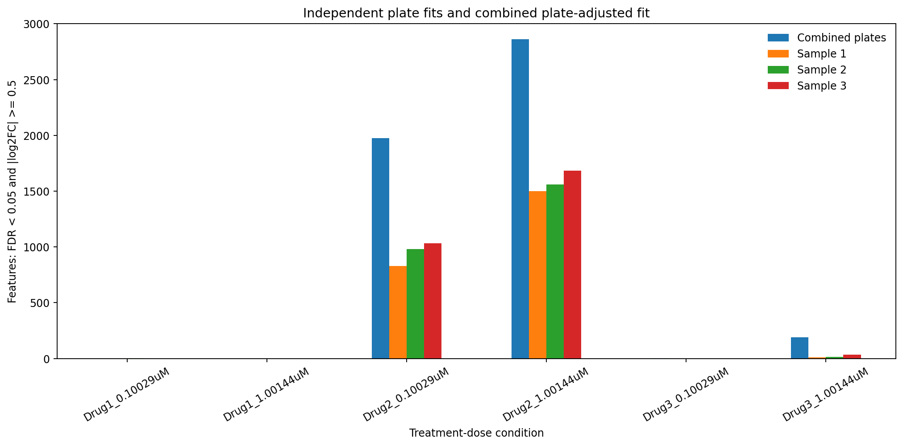

**Compare all conditions.** Drug2 has a large modeled response at both concentrations. Drug1 has little evidence at the declared combined threshold, and Drug3 varies by dose. Do not change the thresholds solely to obtain a nonempty list.

### Fit each plate separately to compare effect vectors

The three plate-specific models are fitted separately, then each pair of plates is compared using its full vector of treatment-versus-DMSO log2 fold changes. We call this **cross-plate treatment-effect concordance**. Separate model fitting does not make the wells or plates independent biological preparations. The separately refitted Sample 1 coefficients and adjusted p-values agree with the one-plate branch. The table reports Pearson correlation across the retained features, not a correlation of raw well profiles.

| Condition | Sample 1 / 2 | Sample 1 / 3 | Sample 2 / 3 |
| --- | --- | --- | --- |
| Drug1_0.10029uM | 0.058 | 0.024 | 0.049 |
| Drug1_1.00144uM | 0.045 | 0.031 | 0.006 |
| Drug2_0.10029uM | 0.521 | 0.511 | 0.520 |
| Drug2_1.00144uM | 0.617 | 0.624 | 0.634 |
| Drug3_0.10029uM | 0.013 | 0.016 | 0.039 |
| Drug3_1.00144uM | 0.158 | 0.140 | 0.160 |

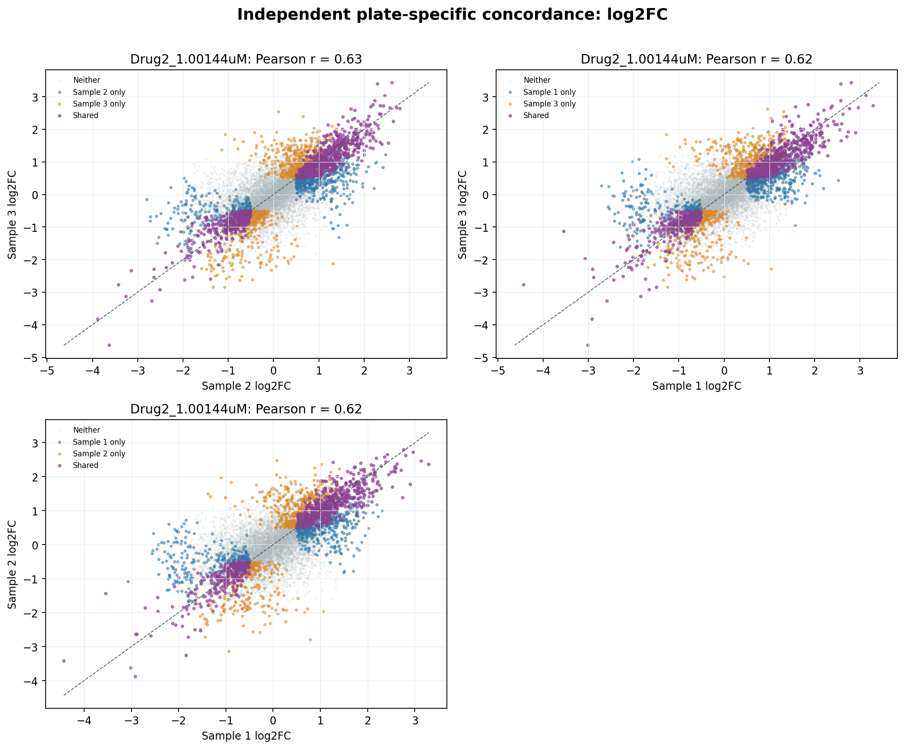

**Effect-vector concordance.** The illustrated Drug2 high-dose condition has cross-plate Pearson correlations of 0.617–0.634. Read effect sizes and direction as well as whether a feature crosses a significance cutoff.
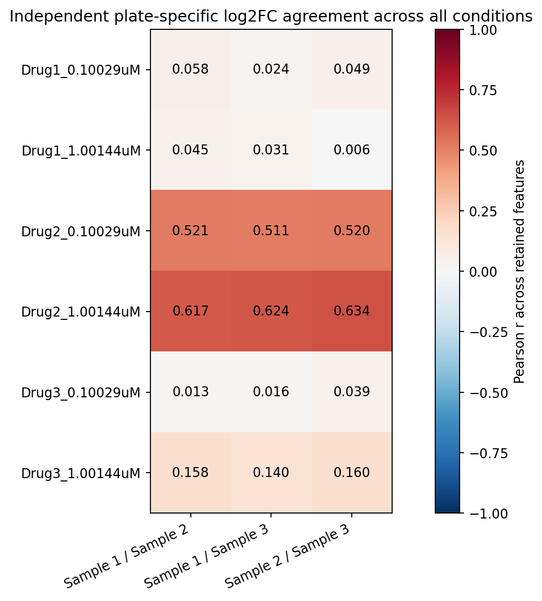

**Agreement across all six conditions.** Strong modeled responses give clearer effect-vector agreement. Near-null contrasts can have unstable, near-zero correlations even when their raw expression profiles correlate well. This does not by itself show technical failure or equivalence.

These are three plates from one cell-preparation batch with a repeated layout. Their agreement shows that the estimated signatures recur under those shared conditions; it does not separate drug action from every spatial or shared-preparation influence. Wells and genes are not independent replications of a new cell batch.


## Run the case on prepared inputs

Run the portable case helper after preparing your own compatible neutral input bundles:

```bash
python scripts/run_drugseq_case.py \
  --data-dir private-case-data \
  --sample-numbers 1 2 3 \
  --output-dir results/drugseq-case
```

The first sample number selects the one-plate branch. The same command then runs the combined analysis, separate per-plate estimates, QC, within-plate repeatability, cross-plate treatment-effect concordance, PCA diagnostics, and result export. `--sample-numbers` can select a different prepared set with at least two plates. The case helper expects one shared exposure, consistent dose units, DMSO controls, a full-rank matched condition design, and explicit 16 × 24 physical coordinates.

The script retains all wells by default. To apply an independently reviewed exclusion list, add `--exclude-samples reviewed_exclusions.csv`; that file must contain unique `sample_id` values and may include a reason. The helper records the exclusions and rechecks the condition design. Reruns overwrite matching output filenames, so use a fresh directory for any analysis you need to retain.

No pathway enrichment is run in this case because no gene-set collection was supplied to the case helper. To extend the fitted results, use the [single-plate enrichment section](single-plate-comparison.md#enrichment) or [multi-plate enrichment section](multi-plate-comparison.md#enrichment) with compatible gene symbols and an explicit tested-feature background. Do not assume the composite IDs are Ensembl IDs.


## Saved results and interpretation limits

The runner writes detailed well-level QC and review tables, the retained feature list, gene-level contrast results, figures, and analysis settings to the chosen result directory. The public tutorial includes compact summaries and figures, without the study's raw matrices or original identifiers.

| Download | Contents |
| --- | --- |
| [Design counts](assets/tables/drugseq-case-design-counts.csv) | Wells per condition and plate. |
| [QC summary](assets/tables/drugseq-case-qc-summary.csv) | Plate-level UMI, feature, and composition summaries. |
| [Control review](assets/tables/drugseq-case-control-review-summary.csv) | Review flags and retained control counts. |
| [Repeatability summary](assets/tables/drugseq-case-repeatability-summary.csv) | Within-condition pair counts and descriptive correlations. |
| [DE summary](assets/tables/drugseq-case-de-summary.csv) | Every separate-plate and combined contrast at the same thresholds. |
| [Cross-plate summary](assets/tables/drugseq-case-cross-plate-summary.csv) | Paired logFC correlations, significant-feature overlap, and direction agreement. |
| [Batch diagnostics](assets/tables/drugseq-case-batch-diagnostics.csv) | Exploratory before/after metrics on the same selected dataset. |
| [Spatial design](assets/tables/drugseq-case-spatial-design.csv) | Condition-by-row counts for checking the repeated layout. |
| [Analysis settings](assets/tables/drugseq-case-analysis-settings.json) | Filters, model configuration, software versions, and scope limits. |

You can inspect the distributed summaries without access to the raw case inputs:

```python
from pathlib import Path
import pandas as pd

root = Path("docs/assets/tables")
summary = pd.read_csv(root / "drugseq-case-de-summary.csv")
print(summary.pivot(index="contrast", columns="analysis", values="n_sig_total"))
concordance = pd.read_csv(root / "drugseq-case-cross-plate-summary.csv")
print(concordance[["plate_a", "plate_b", "compound", "pearson_logfc"]])
```

Keep the central interpretation boundaries visible: same cell batch; repeated physical layout; unknown biological independence of wells; shared feature filtering; exploratory contrast selection; and a pooled model that includes the one-plate example. These do not prevent a useful workflow demonstration, but they determine which biological claims the results can support.


[← Multi-plate workflow](multi-plate-comparison.md) · [Bulk RNA-seq comparison →](bulk-rnaseq-comparison.md)
