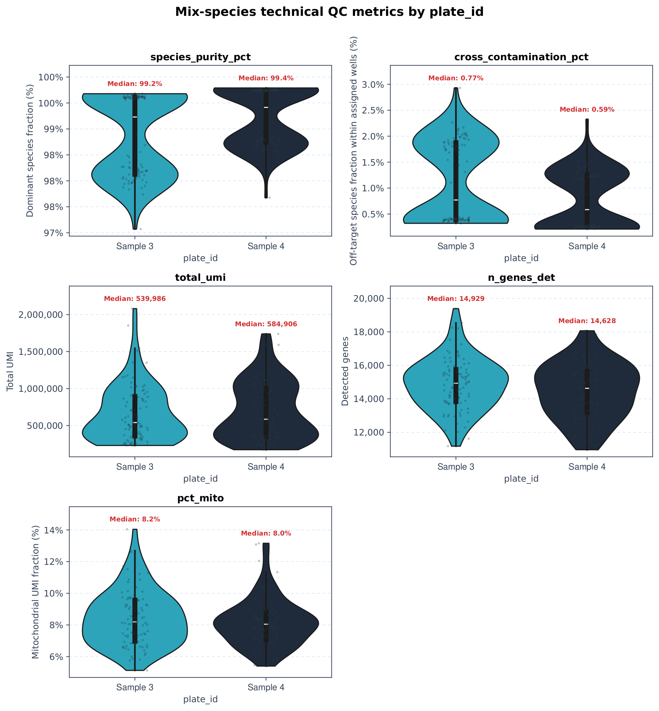
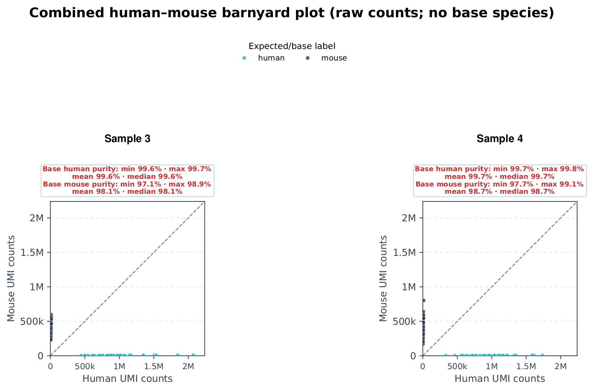
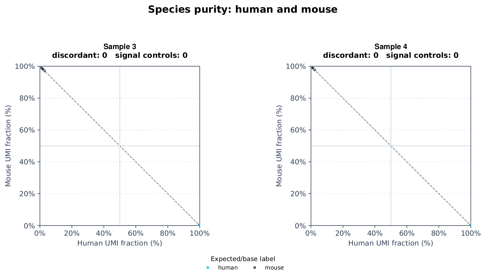
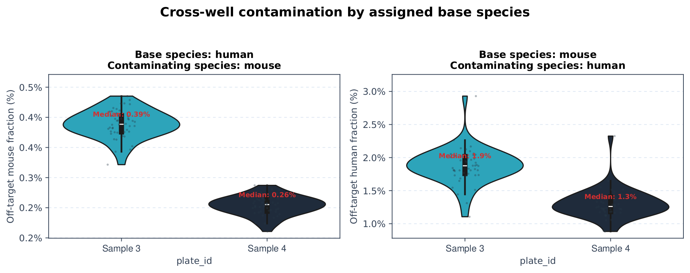
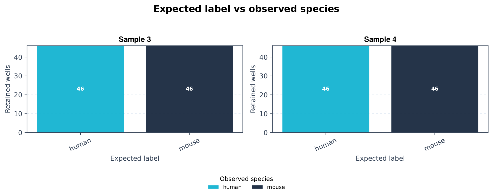
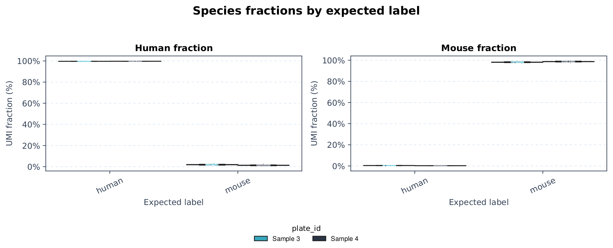
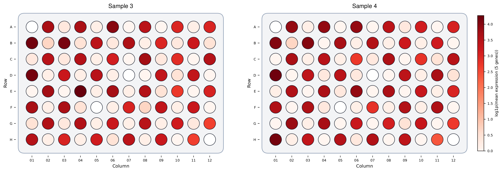
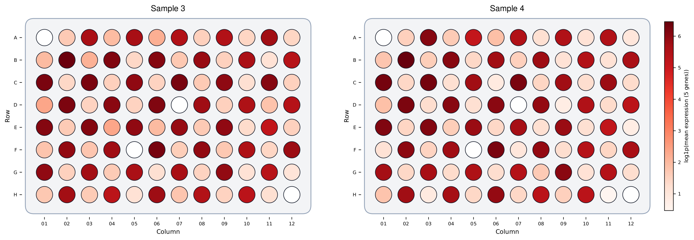
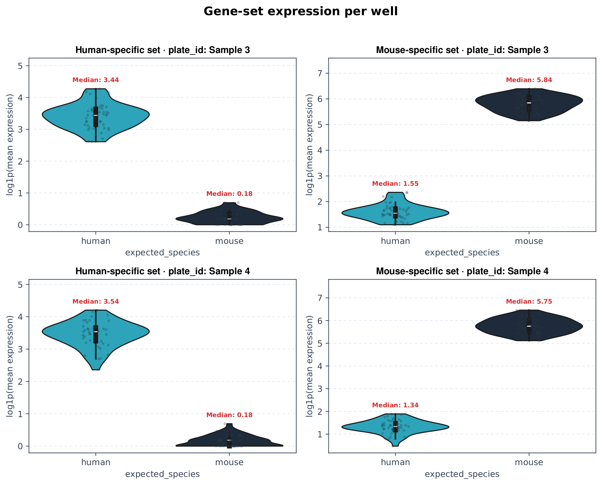

# Mix-species workflow

[Learning path](index.md) · [Prepare inputs](input-preparation.md) · [API reference](api-reference.md)

> **Before you start:** complete [Getting started](getting-started.md). Run code blocks in order from the repository root. “Sample 1–4” identify example plate datasets; each observation is one well. This chapter uses **Sample 3 and Sample 4**. Worked results are shown for interpretation. The separately supplied synthetic practice inputs will produce different numbers.

Configure any two species, assign the intended base species of every well, quantify contamination in both directions, and audit cross-well signal. Human–mouse Sample 3/Sample 4 data provide the real worked example.

<a id="overview"></a>

## Overview

After species review, use [well-to-well repeatability](well-to-well-repeatability.md) to inspect matched wells, or [bulk RNA-seq comparison](bulk-rnaseq-comparison.md) to compare species-separated profiles with independent references.

This is a universal two-species workflow for evaluating cross-contamination across wells. You choose the two species names and feature-ID prefixes, assign the intended base species of every well, and measure off-target signal in both directions. Human and mouse are the Sample 3/Sample 4 worked example—not a restriction of the workflow.

| Historical worked result | Value |
| --- | --- |
| Retained wells across Sample 3 and Sample 4 | 184 |
| Discordant expected-versus-observed assignments | 0 |
| Mixed, low-UMI, or undetermined calls | 0 |
| Retained water/blank wells flagged with signal | 0 |

The final row describes the retained well set. Missing or filtered blank wells cannot establish the absence of background signal.

Worked figures and result tables illustrate an analyzed example with standardized sample labels. The synthetic practice dataset produces different values; compare the interpretation and output structure, not exact numbers.

**QC scope.** Section 3 performs mix-species-specific technical QC before interpreting purity. The broader library and plate QC workflow remains independent and is available in the [QC tutorial](qc-workflow.md).

<a id="load-data"></a>

## 1. Load and merge the data

Start by creating a `DrugSeqData` object for every plate, then merge those objects into one aligned dataset. The expression input may be a 10x-style folder—as in this example—or another format accepted by `create_drugseq_from_files()`. Metadata must contain the well identifiers and the design label that will be mapped to a base species.

```python
from pathlib import Path
import pandas as pd
import drugseqpy as ds

# Run from the tutorial repository root.
objects = []
for number in (3, 4):
    folder = Path("data") / f"sample_{number}"
    obj = ds.create_drugseq_from_files(
        folder / "matrix", folder / "metadata.csv",
        metadata_key="barcode", min_overlap=1.0,
    )
    obj.adata.obs_names = obj.obs["sample_id"].astype(str)
    assert obj.obs_names.is_unique
    objects.append(obj)

dsd = ds.merge_drugseq_objects(*objects, batch_key="source_plate")
assert dsd.obs_names.is_unique
for folder in ("qc", "species", "batch", "concordance", "comparison"):
    (Path("results") / folder).mkdir(parents=True, exist_ok=True)
print(dsd)
```

**Continuity.** The resulting object is named `dsd`. Every subsequent code cell on this page uses that same loaded and merged object.

<a id="biology"></a>

## 2. Configure species and assign wells

Keep stable feature IDs as `var_names` while matching species prefixes. `compute_mix_species_qc()` returns a table; it does not attach species metrics to `obs`. Save the returned table explicitly. The worked settings (`assignment_threshold=0.5`, `min_species_umi=0`) make a dominant-species call and are not a stringent purity filter. Set a justified threshold and minimum depth for your experiment, and pass the same settings to every figure/report function.

**Species A/B UMIs** — Counts summed over the features matching `species_a_prefix` and `species_b_prefix`. The prefixes can describe any pair of species present in the combined reference.

**Species fractions** — `species_a_umi / (species_a_umi + species_b_umi)` and the reciprocal species-B fraction. Other features do not enter this denominator.

**Observed call** — The measured call is one configured species name, `mixed`, `low_umi`, or `undetermined`, according to the configured threshold.

**Base species** — The species intentionally placed in a well, stored here in `obs['expected_species']`. A relative contamination metric is meaningful only after this base is explicit.

**Cross-contamination** — For a species-A-base well, contamination is `species_b_umi / (species_a_umi + species_b_umi)`. For a species-B-base well, the numerator switches to species A. The report draws both directions.

### Assign the intended species of each well

The source column can be a cell line, sample class, treatment, or any design label. Mapping it explicitly avoids relying on human/mouse-specific text inference.

```python
ds.assign_well_species(
    dsd,
    source_col="compound",
    mapping={
        "231": "human",
        "3T3": "mouse",
        "water": "control",
    },
    output_col="expected_species",
)

# For another experiment, the values and species names can differ:
# mapping={"cell_line_A": "rat", "cell_line_B": "hamster", "blank": "control"}
```

**Control interpretation.** A water/blank well is not expected to be human or mouse. Any positive species-assigned UMI total is marked `signal_control` for review; this label does not by itself prove contamination.

<a id="quality-control"></a>

## 3. Check mix-species technical QC

Calculate the per-well table and inspect library size, detected genes, mitochondrial signal, dominant-species purity, and assigned-base cross-contamination before interpreting the barnyard or purity plots. This keeps technical-quality review as its own step.

```python
species_qc = ds.compute_mix_species_qc(
    dsd,
    species_a_prefix="ENSG", species_b_prefix="ENSMUSG",
    species_a_name="human", species_b_name="mouse",
    expected_col="expected_species",
    assignment_threshold=0.5,
    min_species_umi=0,
)

species_qc[[
    "sample_id", "plate_id", "total_umi", "n_genes_det", "pct_mito",
    "observed_species", "base_species", "cross_contamination_fraction",
]].head()
```

```python
qc_metric_files = ds.generate_mix_species_qc_metrics_figure(
    dsd,
    output_dir="results/species",
    formats=("png",),
    expected_col="expected_species",
    species_a_prefix="ENSG", species_b_prefix="ENSMUSG",
    species_a_name="human", species_b_name="mouse",
    plate_palette={"Sample 3": "#16B4D1", "Sample 4": "#1B2A40"},
)
```



**Mix-species technical QC metrics.** Separate violin panels compare species purity, assigned-base cross-contamination, total UMI, detected genes, and mitochondrial percentage by plate\_id. Red median labels sit above their respective violins so they do not cover the distributions.

**Review before interpretation.** Extremely low-depth or high-mitochondrial wells can have unstable species fractions. Decide whether they are technically usable before interpreting cross-contamination or purity.

<a id="figures"></a>

## 4. Read the species-purity figures

After technical QC, use the focused functions below to inspect species separation, purity, reciprocal contamination, and expected-versus-observed agreement. Each code cell calls one function and produces the single figure immediately following it.

**Barnyard metric selection.** `metric_species="base"` is the default and annotates every assigned base species present in the data. Supply one configured name such as `"human"` or `"mouse"`, pass both names as a sequence, or use `None` to hide the annotations. Every selected summary shows purity minimum, mean, median, and maximum.

```python
barnyard_files = ds.generate_mix_species_barnyard_figure(
    dsd,
    output_dir="results/species",
    formats=("png",),
    expected_col="expected_species",
    species_a_prefix="ENSG", species_b_prefix="ENSMUSG",
    species_a_name="human", species_b_name="mouse",
    nrow_plate=2,
    metric_species="base",  # "human", "mouse", both names, or None
    expected_palette={"human": "#16B4D1", "mouse": "#1B2A40", "control": "#64748B"},
    show_observed_style=False,
)
```



**Two-species barnyard plot (human–mouse example).** Each point is one well; axes show raw species-A and species-B UMI counts. The scatter itself has no base species. The optional annotation uses assigned base species and reports purity minimum, mean, median, and maximum. Every coordinate panel has an enforced 1:1 width-to-height ratio and identical axis limits.

```python
purity_files = ds.generate_mix_species_purity_figure(
    dsd,
    output_dir="results/species",
    formats=("png",),
    expected_col="expected_species",
    species_a_prefix="ENSG", species_b_prefix="ENSMUSG",
    species_a_name="human", species_b_name="mouse",
    nrow_plate=2,
    expected_palette={"human": "#16B4D1", "mouse": "#1B2A40", "control": "#64748B"},
    show_observed_style=False,
)
```



**Species-purity plot.** Species-A and species-B percentages sum to approximately 100% among the configured species counts. In this example, pure human and mouse wells approach opposite corners. Every panel uses identical 0–100% limits and a square 1:1 plotting box.

```python
contamination_files = ds.generate_mix_species_contamination_figure(
    dsd,
    output_dir="results/species",
    formats=("png",),
    expected_col="expected_species",
    species_a_prefix="ENSG", species_b_prefix="ENSMUSG",
    species_a_name="human", species_b_name="mouse",
    plate_palette={"Sample 3": "#16B4D1", "Sample 4": "#1B2A40"},
)
```



**Cross-contamination in both directions.** The left panel uses human as the assigned base and measures off-target mouse signal. The right panel reverses the calculation: mouse is the base and off-target human signal is measured. Thus neither direction is hidden behind an implicit human denominator.

```python
concordance_files = ds.generate_mix_species_concordance_figure(
    dsd,
    output_dir="results/species",
    formats=("png",),
    expected_col="expected_species",
    species_a_prefix="ENSG", species_b_prefix="ENSMUSG",
    species_a_name="human", species_b_name="mouse",
    nrow_plate=2,
    observed_palette={
        "human": "#16B4D1", "mouse": "#1B2A40", "mixed": "#F59E0B",
        "low_umi": "#94A3B8", "undetermined": "#CBD5E1",
    },
)
```



**Expected versus observed species.** Stacked bars count observed calls within each assigned base-species label and plate. Segment labels are exact retained-well counts.

```python
fraction_files = ds.generate_mix_species_fraction_figure(
    dsd,
    output_dir="results/species",
    formats=("png",),
    expected_col="expected_species",
    species_a_prefix="ENSG", species_b_prefix="ENSMUSG",
    species_a_name="human", species_b_name="mouse",
    plate_palette={"Sample 3": "#16B4D1", "Sample 4": "#1B2A40"},
)
```



**Species fractions by expected label.** Boxplots and individual wells show both configured species fractions for each assigned base species, with Sample 3/Sample 4 separated by color.

<a id="gene-set-expression"></a>

## 5. Species-specific gene-set expression

Species-level UMI fractions summarize the whole reference. These complementary figures inspect explicit biological gene sets. The plate maps follow the spatial-QC pattern in the main QC tutorial, while the violin plot shows the same aggregated values as per-well distributions.

Both plate maps use the same sequential red colormap so higher expression always has the same visual direction. Each map retains its labeled colorbar because the two gene sets have different observed ranges.

**Exact species resolution.** Gene symbols are matched exactly and case-sensitively. In this combined reference, uppercase `FN1` resolves to the human feature, whereas title-case `Fn1` resolves to the mouse feature. Every resolution is saved for auditing.

### Human-specific gene-set plate map

```python
human_gene_set = ["ITGB1", "FN1", "TGFB1", "EPCAM", "EGFR"]
human_plate_files = ds.generate_plate_layout_figures(
    dsd,
    output_dir="results/species",
    formats=("png",),
    plate_gene=human_gene_set,
    gene_aggregation="mean",
    continuous=True,
    log_values=True,
    nrow=8, ncol=12, nrow_plate=2,
    output_name="plate_layout_human_gene_set_expression",
    cmap="Reds",
)
```



**Human-specific gene-set expression by well.** Mean per-well expression across ITGB1, FN1, TGFB1, EPCAM, and EGFR. Exact uppercase symbols resolve to human-reference features; color uses log1p scaling while source tables retain raw expression.

### Mouse-specific gene-set plate map

```python
mouse_gene_set = ["Vim", "Fn1", "Col1a1", "Col1a2", "Acta2"]
mouse_plate_files = ds.generate_plate_layout_figures(
    dsd,
    output_dir="results/species",
    formats=("png",),
    plate_gene=mouse_gene_set,
    gene_aggregation="mean",
    continuous=True,
    log_values=True,
    nrow=8, ncol=12, nrow_plate=2,
    output_name="plate_layout_mouse_gene_set_expression",
    cmap="Reds",
)
```



**Mouse-specific gene-set expression by well.** Mean per-well expression across Vim, Fn1, Col1a1, Col1a2, and Acta2. Exact mouse-style symbols prevent the corresponding uppercase human features from being included.

### Gene-set expression violin plots

```python
gene_set_violin_files = ds.generate_gene_set_violin_figure(
    dsd,
    output_dir="results/species",
    gene_sets={
        "Human-specific set": human_gene_set,
        "Mouse-specific set": mouse_gene_set,
    },
    gene_aggregation="mean",
    formats=("png",),
    groupby="expected_species",
    split_by="plate_id",
    nrow_plate=2,
    palette={"human": "#16B4D1", "mouse": "#1B2A40"},
    log_values=True,
    output_name="species_gene_set_expression_violin",
)
```



**Species-specific gene-set expression distributions.** Each panel shows per-well mean gene-set expression, grouped by assigned base species and split by plate. Individual wells remain visible, and median labels sit above the violins.

<a id="tables"></a>

## 6. Saved result and audit tables

### Per-sample species QC

| sample\_id | plate\_id | well\_id | species\_a\_name | species\_b\_name | species\_a\_umi | species\_b\_umi | base\_species | cross\_contamination\_pct | observed\_species | concordance |
| --- | --- | --- | --- | --- | --- | --- | --- | --- | --- | --- |
| Sample 3\_AAGATCAATT | Sample 3 | Well-dT-34 | human | mouse | 8.8e+05 | 3.31e+03 | human | 0.375 | human | concordant |
| Sample 3\_AAGATTAACC | Sample 3 | Well-dT-19 | human | mouse | 9.36e+03 | 5.09e+05 | mouse | 1.81 | mouse | concordant |
| Sample 3\_AAGTAAGCGT | Sample 3 | Well-dT-58 | human | mouse | 8.41e+03 | 4.56e+05 | mouse | 1.81 | mouse | concordant |
| Sample 3\_AATACTCGAT | Sample 3 | Well-dT-71 | human | mouse | 6.68e+03 | 5.03e+05 | mouse | 1.31 | mouse | concordant |
| Sample 3\_AATCAGTGGA | Sample 3 | Well-dT-39 | human | mouse | 6.67e+03 | 3.39e+05 | mouse | 1.93 | mouse | concordant |
| Sample 3\_AATCTACAAG | Sample 3 | Well-dT-12 | human | mouse | 9.26e+03 | 5.26e+05 | mouse | 1.73 | mouse | concordant |

Showing 6 of 184 rows from `per_sample_species_qc.csv`.

### Species summary

| plate\_id | expected\_label | expected\_species | n\_retained | species\_a\_majority | species\_b\_majority | mixed\_or\_undetermined | discordant | signal\_controls | median\_species\_a\_pct | median\_species\_b\_pct | median\_cross\_contamination\_pct | median\_total\_umi | median\_n\_genes | human\_majority | median\_human\_pct | mouse\_majority | median\_mouse\_pct |
| --- | --- | --- | --- | --- | --- | --- | --- | --- | --- | --- | --- | --- | --- | --- | --- | --- | --- |
| Sample 3 | human | human | 46 | 46 | 0 | 0 | 0 | 0 | 99.6 | 0.388 | 0.388 | 8.97e+05 | 1.57e+04 | 46 | 99.6 | 0 | 0.388 |
| Sample 3 | mouse | mouse | 46 | 0 | 46 | 0 | 0 | 0 | 1.88 | 98.1 | 1.88 | 3.54e+05 | 1.4e+04 | 0 | 1.88 | 46 | 98.1 |
| Sample 4 | human | human | 46 | 46 | 0 | 0 | 0 | 0 | 99.7 | 0.255 | 0.255 | 1.01e+06 | 1.56e+04 | 46 | 99.7 | 0 | 0.255 |
| Sample 4 | mouse | mouse | 46 | 0 | 46 | 0 | 0 | 0 | 1.26 | 98.7 | 1.26 | 3.49e+05 | 1.33e+04 | 0 | 1.26 | 46 | 98.7 |

Showing 4 of 4 rows from `species_summary.csv`.

### Concordance counts

| plate\_id | expected\_label | observed\_species | concordance | n\_samples |
| --- | --- | --- | --- | --- |
| Sample 3 | human | human | concordant | 46 |
| Sample 3 | mouse | mouse | concordant | 46 |
| Sample 4 | human | human | concordant | 46 |
| Sample 4 | mouse | mouse | concordant | 46 |

Showing 4 of 4 rows from `species_concordance.csv`.

### Outlier/control audit candidates

| sample\_id | plate\_id | well\_id | barcode | expected\_label | expected\_species | base\_species | observed\_species | concordance | species\_a\_name | species\_b\_name | species\_a\_pct | species\_b\_pct | species\_a\_umi | species\_b\_umi | on\_target\_umi | off\_target\_umi | cross\_contamination\_pct | total\_umi |
| --- | --- | --- | --- | --- | --- | --- | --- | --- | --- | --- | --- | --- | --- | --- | --- | --- | --- | --- |

Showing 0 of 0 rows from `mix_species_outlier_audit.csv`.

### Barnyard base-species metrics

| plate\_id | base\_species | n\_wells | minimum | mean | median | maximum |
| --- | --- | --- | --- | --- | --- | --- |
| Sample 3 | human | 46 | 99.6 | 99.6 | 99.6 | 99.7 |
| Sample 3 | mouse | 46 | 97.1 | 98.1 | 98.1 | 98.9 |
| Sample 4 | human | 46 | 99.7 | 99.7 | 99.7 | 99.8 |
| Sample 4 | mouse | 46 | 97.7 | 98.7 | 98.7 | 99.1 |

Showing 4 of 4 rows from `species_barnyard_metric_summary.csv`.

### Species gene-set violin values

| sample\_id | expected\_species | plate\_id | gene\_set | expression | plot\_expression | aggregation |
| --- | --- | --- | --- | --- | --- | --- |
| Sample 3\_AAGATCAATT | human | Sample 3 | Human-specific set | 29.8 | 3.43 | mean |
| Sample 3\_AAGATTAACC | mouse | Sample 3 | Human-specific set | 0.4 | 0.336 | mean |
| Sample 3\_AAGTAAGCGT | mouse | Sample 3 | Human-specific set | 0.2 | 0.182 | mean |
| Sample 3\_AATACTCGAT | mouse | Sample 3 | Human-specific set | 0.2 | 0.182 | mean |
| Sample 3\_AATCAGTGGA | mouse | Sample 3 | Human-specific set | 0.2 | 0.182 | mean |
| Sample 3\_AATCTACAAG | mouse | Sample 3 | Human-specific set | 0.2 | 0.182 | mean |

Showing 6 of 368 rows from `species_gene_set_expression_violin_plot_table.csv`.

### Species gene-set resolution

| gene\_set | requested\_gene | feature\_id | gene\_symbol | matched\_by | aggregation |
| --- | --- | --- | --- | --- | --- |
| Human-specific set | ITGB1 | ENSG00000150093 | ITGB1 | gene\_symbol | mean |
| Human-specific set | FN1 | ENSG00000115414 | FN1 | gene\_symbol | mean |
| Human-specific set | TGFB1 | ENSG00000105329 | TGFB1 | gene\_symbol | mean |
| Human-specific set | EPCAM | ENSG00000119888 | EPCAM | gene\_symbol | mean |
| Human-specific set | EGFR | ENSG00000146648 | EGFR | gene\_symbol | mean |
| Mouse-specific set | Vim | ENSMUSG00000026728 | Vim | gene\_symbol | mean |

Showing 6 of 10 rows from `species_gene_set_expression_violin_gene_resolution.csv`.

**Audit, not deletion.** `mix_species_outlier_audit.csv` collects mixed, low-UMI, undetermined, discordant, and signal-control wells. The workflow does not automatically remove them; a user must review metadata and technical context.

```text
Example output directory
results/species/
├── species_barnyard.png
├── species_purity.png
├── species_concordance_counts.png
├── mix_species_qc_metrics.png
├── species_fraction_by_expected.png
├── species_cross_contamination_by_base.png
├── plate_layout_human_gene_set_expression.png
├── plate_layout_mouse_gene_set_expression.png
├── species_gene_set_expression_violin.png
├── per_sample_species_qc.csv
├── species_summary.csv
├── species_concordance.csv
├── mix_species_outlier_audit.csv
├── species_barnyard_metric_summary.csv
├── species_gene_set_expression_violin_plot_table.csv
├── species_gene_set_expression_violin_gene_resolution.csv
├── species_fraction_plot_table.csv
├── species_cross_contamination_by_base_plot_table.csv
└── mix_species_figure_manifest.csv
```

<a id="run"></a>

## 7. Run the complete workflow

After reviewing the figure-specific calls and their saved source tables, use the report function to reproduce the complete set in one batch. The report accepts the same species names, prefixes, assignment threshold, and low-count threshold used by the direct calculation. `nrow_plate` sets the maximum number of plate panels in one row for plate-faceted figures.

**Configurable color roles.** `expected_palette` controls cell-type colors in barnyard and purity points, `observed_palette` controls concordance fills, and `plate_palette` controls plate fills and points. Reference/guide lines, annotations, edges, grids, panel borders, individual points, in-bar labels, and alpha values each have separate parameters. The older `palette` parameter remains a fallback for all three categorical roles.

```python
from pathlib import Path
import pandas as pd
import drugseqpy as ds

# Run from the tutorial repository root.
objects = []
for number in (3, 4):
    folder = Path("data") / f"sample_{number}"
    obj = ds.create_drugseq_from_files(
        folder / "matrix", folder / "metadata.csv",
        metadata_key="barcode", min_overlap=1.0,
    )
    obj.adata.obs_names = obj.obs["sample_id"].astype(str)
    assert obj.obs_names.is_unique
    objects.append(obj)

dsd = ds.merge_drugseq_objects(*objects, batch_key="source_plate")
assert dsd.obs_names.is_unique
for folder in ("qc", "species", "batch", "concordance", "comparison"):
    (Path("results") / folder).mkdir(parents=True, exist_ok=True)
print(dsd)

output_dir = Path("results/species")

# Assign the designed base species of every well from experiment metadata.
ds.assign_well_species(
    dsd,
    source_col="compound",
    mapping={"231": "human", "3T3": "mouse", "water": "control"},
)

# Species A and B are configurable; human/mouse are only this worked example.
species_qc = ds.compute_mix_species_qc(
    dsd,
    species_a_prefix="ENSG",
    species_b_prefix="ENSMUSG",
    species_a_name="human",
    species_b_name="mouse",
    expected_col="expected_species",
    assignment_threshold=0.5,
    min_species_umi=0,
)

# Generate the independent report with the same explicit configuration.
base_species_colors = {
    "human": "#16B4D1", "mouse": "#1B2A40", "control": "#64748B",
}
observed_species_colors = {
    "human": "#16B4D1",
    "mouse": "#1B2A40",
    "mixed": "#F59E0B",
    "low_umi": "#94A3B8",
    "undetermined": "#CBD5E1",
}
plate_colors = {"Sample 3": "#16B4D1", "Sample 4": "#1B2A40"}

files = ds.generate_mix_species_report(
    dsd,
    output_dir="results/species",
    formats=("png",),
    expected_col="expected_species",
    species_a_prefix="ENSG",
    species_b_prefix="ENSMUSG",
    species_a_name="human",
    species_b_name="mouse",
    assignment_threshold=0.5,
    min_species_umi=0,
    nrow_plate=2,       # maximum plate panels per figure row
    barnyard_metric_species="base",  # default: every assigned base present
    expected_palette=base_species_colors,
    observed_palette=observed_species_colors,
    plate_palette=plate_colors,
    reference_line_color="#7F7F7F",
    guide_line_color="#CBD5E1",
    annotation_color="#D32F2F",
    edge_color="white",
    grid_color="#DCE6F2",
    panel_border_color="#334155",
    point_color="#253746",
    label_color="white",
    point_alpha=0.72,
    fill_alpha=0.95,
    show_observed_style=False,  # clean reference-dashboard point style
)

# Optional species-specific biological gene-set views.
species_gene_sets = {
    "Human-specific set": ["ITGB1", "FN1", "TGFB1", "EPCAM", "EGFR"],
    "Mouse-specific set": ["Vim", "Fn1", "Col1a1", "Col1a2", "Acta2"],
}
for set_name, genes, cmap in (
    ("human", species_gene_sets["Human-specific set"], "Reds"),
    ("mouse", species_gene_sets["Mouse-specific set"], "Blues"),
):
    files += ds.generate_plate_layout_figures(
        dsd,
        output_dir="results/species",
        formats=("png",),
        plate_gene=genes,
        gene_aggregation="mean",
        continuous=True,
        log_values=True,
        nrow=8, ncol=12, nrow_plate=2,
        output_name=f"plate_layout_{set_name}_gene_set_expression",
        cmap=cmap,
    )
files += ds.generate_gene_set_violin_figure(
    dsd,
    output_dir="results/species",
    gene_sets=species_gene_sets,
    gene_aggregation="mean",
    formats=("png",),
    groupby="expected_species",
    split_by="plate_id",
    nrow_plate=2,
    palette=base_species_colors,
    log_values=True,
    output_name="species_gene_set_expression_violin",
)
```

<a id="related-functions"></a>

## 8. Related functions

The loading, merging, computation, and reporting functions used here are listed below. Follow a function name for its complete entry in the separate API reference.

| Function | Description |
| --- | --- |
| [`drugseqpy.load_expression_matrix()`](api-reference.md#api-load-expression-matrix) | Read either a gene-by-sample table or a STARsolo filtered matrix bundle. |
| [`drugseqpy.load_metadata()`](api-reference.md#api-load-metadata) | Read sample metadata from CSV, TSV/TXT, or Excel. |
| [`drugseqpy.create_drugseq_from_files()`](api-reference.md#api-create-drugseq-from-files) | Load, normalize barcode identifiers, align counts to metadata, and construct a DrugSeqData object. |
| [`drugseqpy.activate_gene_names()`](api-reference.md#api-activate-gene-names) | Activate a gene-annotation column as the AnnData variable names without changing matrix values or gene order. |
| [`drugseqpy.merge_drugseq_objects()`](api-reference.md#api-merge-drugseq-objects) | Combine separately loaded plates along the sample axis while retaining the union of genes. |
| [`drugseqpy.generate_plate_layout_figures()`](api-reference.md#api-generate-plate-layout-figures) | Generate one universal plate-layout figure and save its resolved plotting table. |
| [`drugseqpy.generate_gene_set_violin_figure()`](api-reference.md#api-generate-gene-set-violin-figure) | Generate grouped violin distributions for aggregated per-well gene-set expression. |
| [`drugseqpy.assign_well_species()`](api-reference.md#api-assign-well-species) | Assign the designed base species of each well from an existing metadata column. |
| [`drugseqpy.compute_mix_species_qc()`](api-reference.md#api-compute-mix-species-qc) | Count any two configured species, classify wells, and quantify cross-well contamination relative to the assigned base species. |
| [`drugseqpy.generate_mix_species_barnyard_figure()`](api-reference.md#api-generate-mix-species-barnyard-figure) | Generate only the plate-faceted species-A-versus-species-B UMI barnyard figure with square 1:1 coordinate panels. |
| [`drugseqpy.generate_mix_species_purity_figure()`](api-reference.md#api-generate-mix-species-purity-figure) | Generate only the plate-faceted two-species purity figure. |
| [`drugseqpy.generate_mix_species_concordance_figure()`](api-reference.md#api-generate-mix-species-concordance-figure) | Generate only the expected-label versus observed-species stacked-bar figure. |
| [`drugseqpy.generate_mix_species_qc_metrics_figure()`](api-reference.md#api-generate-mix-species-qc-metrics-figure) | Generate only the plate-level mix-species technical-QC violin panel. |
| [`drugseqpy.generate_mix_species_fraction_figure()`](api-reference.md#api-generate-mix-species-fraction-figure) | Generate only the two-species fraction-by-expected-label figure. |
| [`drugseqpy.generate_mix_species_contamination_figure()`](api-reference.md#api-generate-mix-species-contamination-figure) | Plot off-target fractions separately with species A and species B as the assigned base. |
| [`drugseqpy.generate_mix_species_report()`](api-reference.md#api-generate-mix-species-report) | Generate the independent mix-species figure set and all plot source/audit tables. |

<a id="notes"></a>

## 9. Important notes

- The method supports any two distinguishable species. Gene prefixes must match the combined reference annotation; configure `species_a_prefix` and `species_b_prefix` accordingly.
- `species_umi` includes only species-A- and species-B-prefixed features; `total_umi` includes every feature. These values can differ.
- A 50% threshold always chooses a dominant species when species UMIs are present. Increase the threshold (for example, 0.9) when the classification should require a stronger majority, and pass that threshold to every calculation and figure/report call. At exactly 50:50 with a 0.5 threshold, the implementation selects species A because it checks that branch first.
- Very low count wells can show unstable fractions. Set `min_species_umi` above zero to identify them as `low_umi`.
- Always report the base species for a relative contamination value. Off-target species B in an A-base well and off-target species A in a B-base well are reciprocal directions, not the same metric.
- Expected-versus-observed discordance can arise from swaps, cross-contamination, annotation problems, ambient signal, or incorrect expected labels. Review source tables before exclusion.
- Plate-aware facets and palettes adapt to additional plates and sample counts; compact tick labels prevent large raw UMI values from overlapping.
<a id="glossary"></a>

## Glossary

**Barnyard plot** — Scatter plot of species-A versus species-B UMI counts per well. Species-pure wells lie near one axis; mixtures move toward the diagonal. Raw counts have no base species.

**Species A fraction** — Species-A UMIs divided by species-A plus species-B UMIs. It is undefined when neither configured species has counts.

**Species B fraction** — Species-B UMIs divided by species-A plus species-B UMIs.

**Species purity** — The larger of the two configured species percentages. At 100%, all species-assigned UMIs come from one species.

**Base species** — The species intentionally assigned to a well; it determines which signal is on target and which is contamination.

**Cross-contamination fraction** — Off-target-species UMIs divided by species-A plus species-B UMIs, with the off-target species selected relative to the assigned base.

**Expected label** — Metadata value supplied in `expected_col`. The recommended value is the explicit well assignment created by `assign_well_species()`.

**Expected species** — Species A, species B, control, or unknown assignment used to define the well base.

**Observed species** — Classification derived from measured two-species fractions and thresholds.

**Concordant** — Observed species call matches the assigned base species.

**Discordant** — Observed call differs from the assigned base species.

**Signal control** — A control-labeled well with a positive configured-species UMI total. It is queued for review.

**Mixed** — Neither species reaches its configured fraction threshold.

**Low UMI** — Species-assigned UMI total falls below `min_species_umi`.

**Undetermined** — No usable two-species fraction can be computed, normally because both configured species counts are zero.

**ENSG** — Prefix used by Ensembl human gene identifiers in the worked example.

**ENSMUSG** — Prefix used by Ensembl mouse gene identifiers in the worked example.

**Concordance table** — Tidy count table stratified by plate, expected label, observed species, and concordance status.

<a id="troubleshooting"></a>

## Troubleshooting

All wells are undetermined

Inspect feature IDs and configure prefixes matching the two species in the combined reference. The defaults recognize human ENSG and mouse ENSMUSG IDs only.

Almost every well is called species A

Confirm species-B IDs are recognized and that the two references were combined correctly. Compare raw `species_a_umi`/`species_b_umi` in the per-sample table.

Water controls are all marked signal\_control

The default criterion is deliberately sensitive: any species UMI is signal. Use raw counts, background distributions, and experimental controls to define a practical follow-up threshold.

Contamination direction looks reversed

Inspect `base_species`. In species-A-base wells, species B is off target; in species-B-base wells, species A is off target. Use the paired contamination-by-base figure rather than assuming species A is always the denominator target.

---

[← Previous chapter](qc-workflow.md) · [Next chapter →](well-to-well-repeatability.md)
