# Multi-plate comparison workflow

[Learning path](index.md) · [Prepare inputs](input-preparation.md) · [API reference](api-reference.md)

> **Before you start:** complete [Getting started](getting-started.md). Run code blocks in order from the repository root. “Sample 1–4” identify example plate datasets; each observation is one well. This chapter uses **Sample 1 and Sample 2**. Worked results are shown for interpretation. The separately supplied synthetic practice inputs will produce different numbers.

Analyze two or more plates with explicit batch diagnosis, validated embedding correction, within-plate repeatability, cross-plate treatment-effect reproducibility, plate-adjusted differential expression, and enrichment.

<a id="overview"></a>

## Overview

Use this workflow when the same treatment panel is measured on two or more plates. It adds three requirements to the [single-plate analysis](single-plate-comparison.md): diagnose batch structure, correct exploratory embeddings without corrupting counts, and quantify whether independently estimated treatment effects reproduce across plates.

**Historical worked example:** 186 input wells; 184 analysis wells; 13,415 tested genes; 16 cross-plate treatment checks.

**Universal method, worked data.** Sample 1/Sample 2 demonstrate the procedure. For three or more plates, batch regression receives every plate label, the DE design includes the full plate factor, and reproducibility is summarized over all plate pairs or with leave-one-plate-out estimates.

<a id="input"></a>

## 1. Load and merge plates

Every plate uses the same expression/metadata contract. Observation names must be globally unique and features must be aligned before concatenation.

```python
from pathlib import Path
import pandas as pd
import drugseqpy as ds

# Run from the tutorial repository root.
objects = []
for number in (1, 2):
    folder = Path("data") / f"sample_{number}"
    obj = ds.create_drugseq_from_files(
        folder / "matrix", folder / "metadata.csv",
        metadata_key="barcode", min_overlap=1.0,
    )
    obj.adata.obs_names = obj.obs["sample_id"].astype(str)
    assert obj.obs_names.is_unique
    objects.append(obj)

dsd = ds.merge_drugseq_objects(*objects, batch_key="source_plate")
assert dsd.obs_names.is_unique
for folder in ("qc", "species", "batch", "reproducibility", "comparison"):
    (Path("results") / folder).mkdir(parents=True, exist_ok=True)
print(dsd)
```

<a id="design"></a>

## 2. Check design identifiability

A batch algorithm cannot separate variables that encode the same split. Each treatment and its control must occur on more than one plate, ideally with comparable replicate counts, doses, time points, and randomized positions.

`expression ~ plate_id + condition`

**Perfect confounding is not correctable.** If all cases are on Plate A and all controls are on Plate B, neither expression regression nor a plate covariate can identify a treatment effect. Redesign the experiment or limit the claim.

```python
design = pd.crosstab(dsd.obs["compound"], dsd.obs["plate_id"])
shared = design[(design > 0).sum(axis=1) >= 2]
print(shared)  # review replication before any model is fit
```

<a id="qc"></a>

## 3. QC and control audit by plate

Compute QC on the merged object, but interpret distributions and spatial maps by plate. Apply the same documented rule to every plate; do not tune a threshold separately until a plate looks favorable.

```python
ds.compute_qc_metrics(dsd, inplace=True)
```

`generate_qc_metric_violin_figure()` creates only the cross-plate QC-distribution figure.

```python
qc_distribution_files = ds.generate_qc_metric_violin_figure(
    dsd, output_dir="results/qc", formats=("png",),
    metrics=("total_umi", "n_genes_det", "pct_mito", "pct_ribo"),
    groupby="plate_id",
)
```

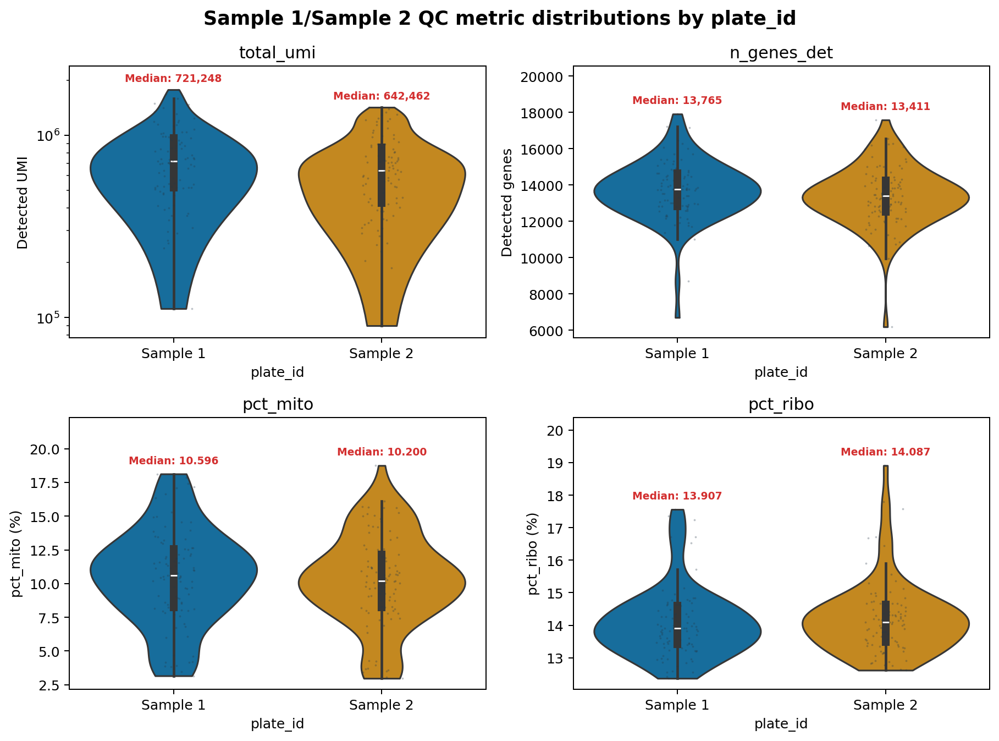

**QC distributions across plates.** Sample 1 and Sample 2 have similar median yield and complexity, with low-yield tails that require sample-level review.

`audit_control_outliers()` returns the DMSO audit table without plotting or filtering.

```python
control_audit = ds.audit_control_outliers(
    dsd, control_label="DMSO", threshold=5.0,
)
```

| Sample | Plate | Well | Total UMI | Detected genes | Score |
| --- | --- | --- | --- | --- | --- |
| Sample 2\_TTGATCTTAA | Sample 2 | Well-dT-85 | 204,182 | 10,652 | 6.20 |
| Sample 1\_TTGATCTTAA | Sample 1 | Well-dT-85 | 265,265 | 11,366 | 6.14 |

`plot_control_outlier_audit()` creates only the audit scatter from that table.

```python
fig = ds.plot_control_outlier_audit(control_audit)
fig.savefig("results/qc/dmso_outlier_audit.png", dpi=180)
```

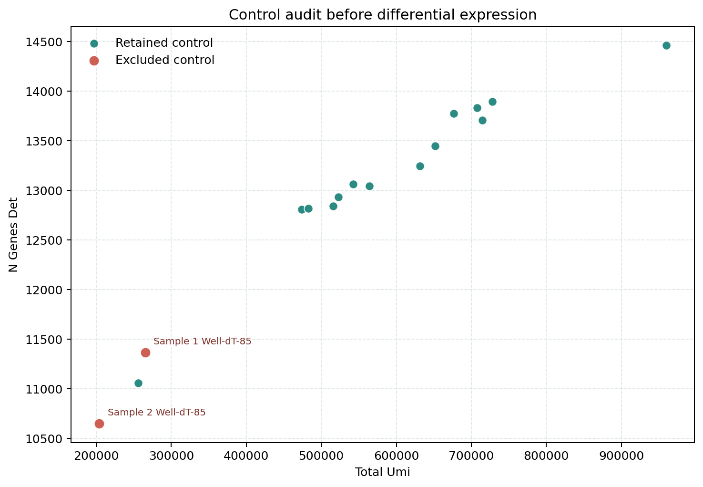

**Cross-plate DMSO audit.** Two DMSO controls exceed the worked outlier-score cutoff; the retained controls remain represented on both plates.

**Control balance after filtering.** Recompute the design table after exclusions. The worked analysis retains controls on both plates, so treatment and plate remain separable.

### Record exclusions and prepare expression

The worked result applies a DMSO outlier-score cutoff of 5 after reviewing the controls and removes two wells (186 → 184). This is an example-specific decision. On your own data, review the audit and control balance before applying an exclusion. Keep an explicit exclusion table. The filtering and normalization step below also makes the expression scale explicit for later normalized-expression reproducibility plots.

```python
# Worked-example exclusion rule; review before applying to a new experiment.
is_control = dsd.obs["compound"].astype(str).str.casefold().eq("dmso")
excluded = is_control & (dsd.obs["outlier_score"] > 5.0)
dsd.obs.loc[excluded].to_csv("results/qc/excluded_wells.csv", index=False)
dsd = dsd.subset(obs_mask=(~excluded).to_numpy())
print(pd.crosstab(dsd.obs["compound"], dsd.obs["plate_id"]))

# The worked analysis keeps genes detected at >=5 counts in >=3 wells.
dsd = ds.filter_genes(dsd, min_count=5, min_samples=3, group_aware=False)
ds.normalize_counts(dsd, method="limma_voom", inplace=True)
# X is normalized; layers['counts'] still contains raw UMI counts.
```

For multiple doses or time points, define a matched condition column instead of grouping only by compound, and use it consistently in the design, batch covariates, repeatability, and DE calls. Count independent biological units, not only wells. Pairwise well correlations share observations and are not independent replicates.

<a id="batch"></a>

## 4. Diagnose and remove batch effects

Create an uncorrected view, then use limma-voom normalization and a linear model to subtract the fitted plate component while preserving the treatment term. The corrected `adata.X` is used for exploratory views; `layers['counts']` remains unchanged.

```python
# Use the SAME normalization for both views; preserve the counts layer.
corrected = dsd.copy()
ds.correct_batch(
    corrected, batch_col="plate_id", method="limma_voom",
    covariate_cols=["compound"], inplace=True,
)
before = corrected.copy()
before.adata.X = corrected.adata.layers["batch_uncorrected"].copy()

n_pcs = min(30, dsd.n_obs - 1, dsd.n_vars - 1)
if n_pcs < 2:
    raise ValueError("At least three wells and genes are needed for these views.")
for view in (before, corrected):
    ds.run_pca(view, n_pcs=n_pcs, use_highly_variable=False, inplace=True)
    ds.run_umap(view, dims=min(20, n_pcs), random_state=42, inplace=True)
    ds.run_tsne(
        view, dims=min(20, n_pcs),
        perplexity=min(30, (dsd.n_obs - 1) / 3), random_state=42, inplace=True,
    )
```

### PCA: global linear structure

`plot_pca()` creates one PCA figure for one supplied object.

```python
fig = ds.plot_pca(before, color_by="plate_id")
fig.savefig("results/batch/pca_before_batch_correction.png", dpi=180)
```

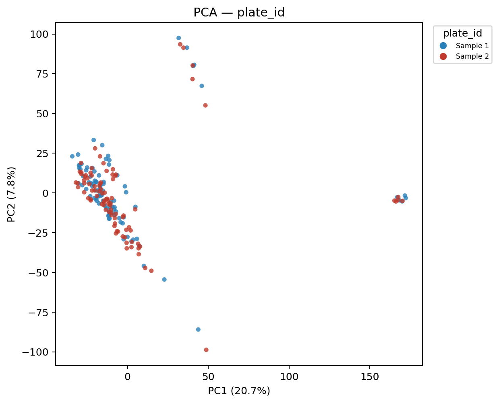

**PCA before correction.** Plate labels diagnose linear separation in normalized expression.

```python
fig = ds.plot_pca(corrected, color_by="plate_id")
fig.savefig("results/batch/pca_after_batch_correction.png", dpi=180)
```

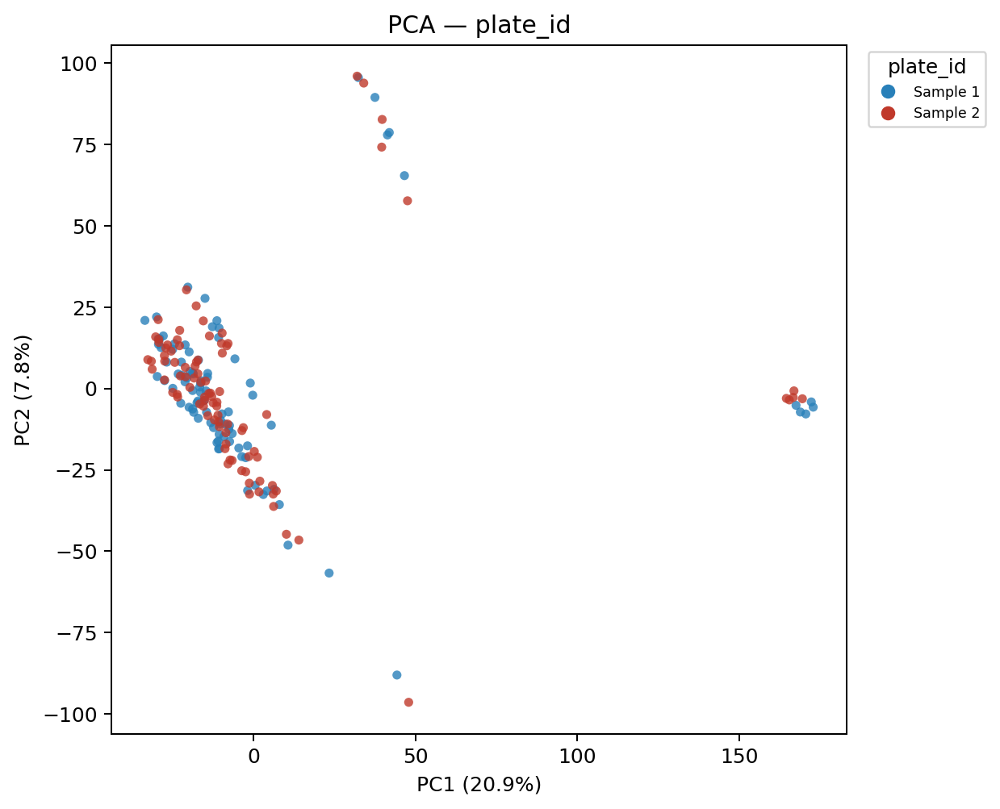

**PCA after limma batch regression.** The plate component is reduced while the compound term is retained in the correction model.

To check biological preservation, use the same global PCA coordinates but color by `compound` and facet by `plate_id`. The shared palette makes matched treatments directly comparable between panels.

```python
fig = ds.plot_pca(
    before, color_by="compound", split_by="plate_id", label_by=None,
)
fig.savefig("results/batch/pca_before_compound_by_plate.png", dpi=180)
```

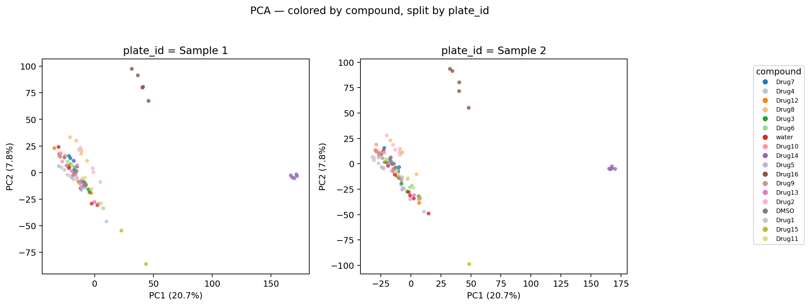

**PCA before correction, split by plate and colored by compound.** Each panel subsets the same global coordinates. Matching colors show whether compound structure is consistent across plates before correction.

```python
fig = ds.plot_pca(
    corrected, color_by="compound", split_by="plate_id", label_by=None,
)
fig.savefig("results/batch/pca_after_compound_by_plate.png", dpi=180)
```


**PCA after correction, split by plate and colored by compound.** Compare matched compound positions with the uncorrected panels to detect loss or recovery of biological structure.

### UMAP: local neighborhood structure

`plot_umap()` creates one UMAP figure for one supplied object.

```python
fig = ds.plot_umap(before, color_by="plate_id")
fig.savefig("results/batch/umap_before_batch_correction.png", dpi=180)
```

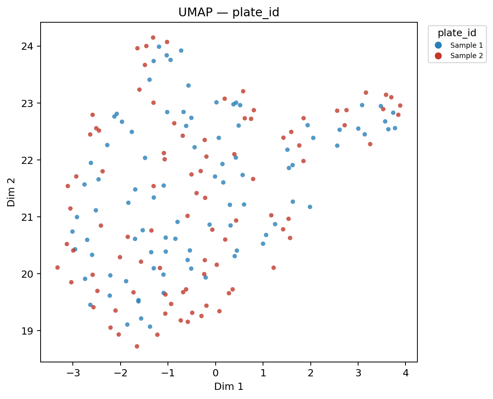

**UMAP before correction.** UMAP is recomputed from the uncorrected PCA coordinates.

```python
fig = ds.plot_umap(corrected, color_by="plate_id")
fig.savefig("results/batch/umap_after_batch_correction.png", dpi=180)
```

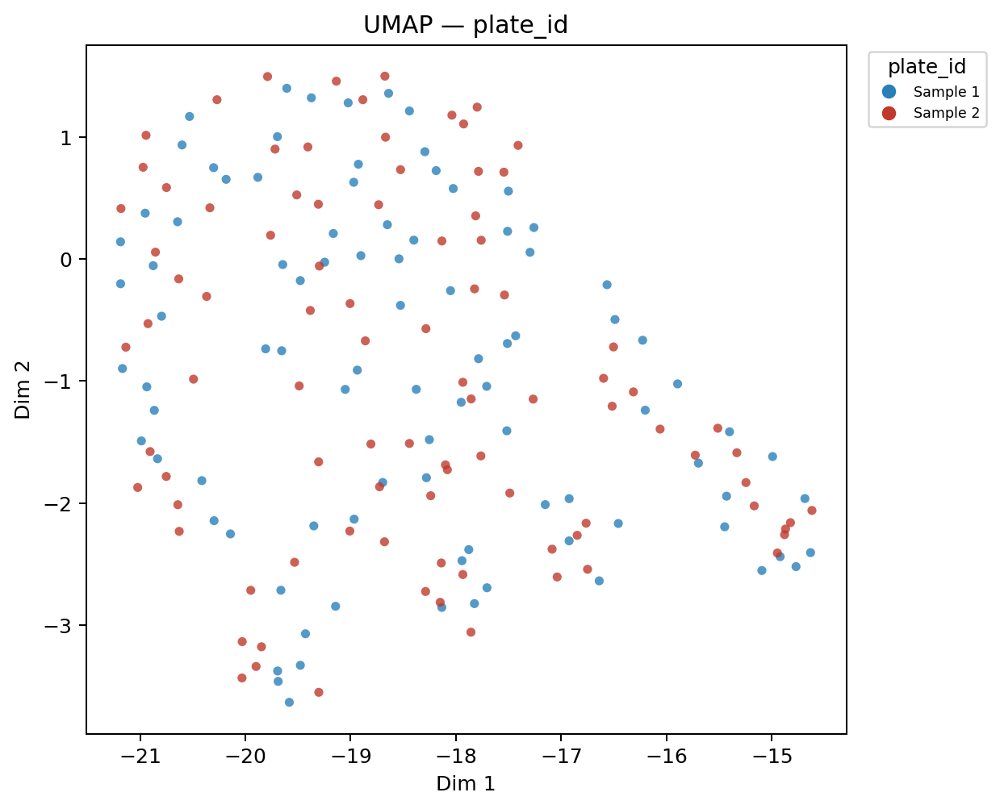

**UMAP after limma batch regression.** UMAP is recomputed from corrected expression rather than reusing old coordinates.

```python
fig = ds.plot_umap(
    before, color_by="compound", split_by="plate_id", label_by=None,
)
fig.savefig("results/batch/umap_before_compound_by_plate.png", dpi=180)
```

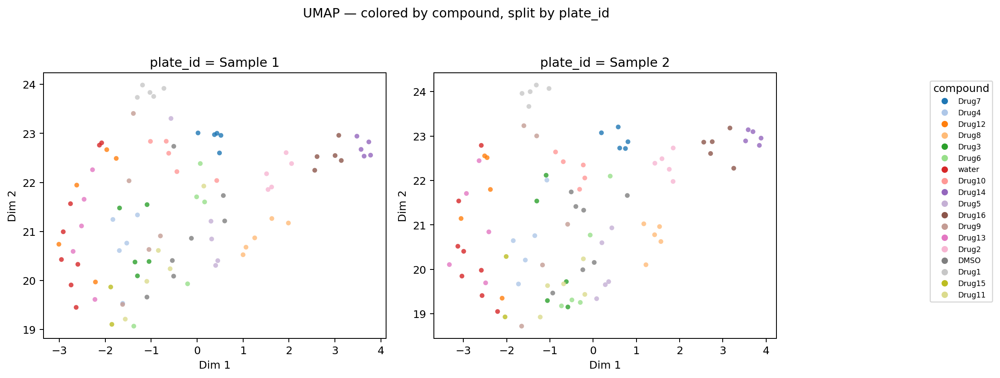

**UMAP before correction, split by plate and colored by compound.** Shared compound colors reveal whether local treatment neighborhoods recur on both plates before correction.

```python
fig = ds.plot_umap(
    corrected, color_by="compound", split_by="plate_id", label_by=None,
)
fig.savefig("results/batch/umap_after_compound_by_plate.png", dpi=180)
```

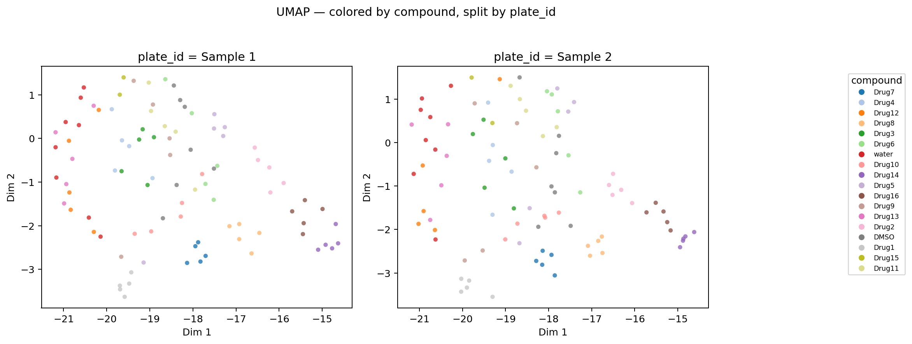

**UMAP after correction, split by plate and colored by compound.** Matched compound neighborhoods should become more comparable without collapsing distinct treatment responses.

### t-SNE: local sample neighborhoods

`plot_tsne()` creates one t-SNE figure for one supplied object.

```python
fig = ds.plot_tsne(before, color_by="plate_id")
fig.savefig("results/batch/tsne_before_batch_correction.png", dpi=180)
```

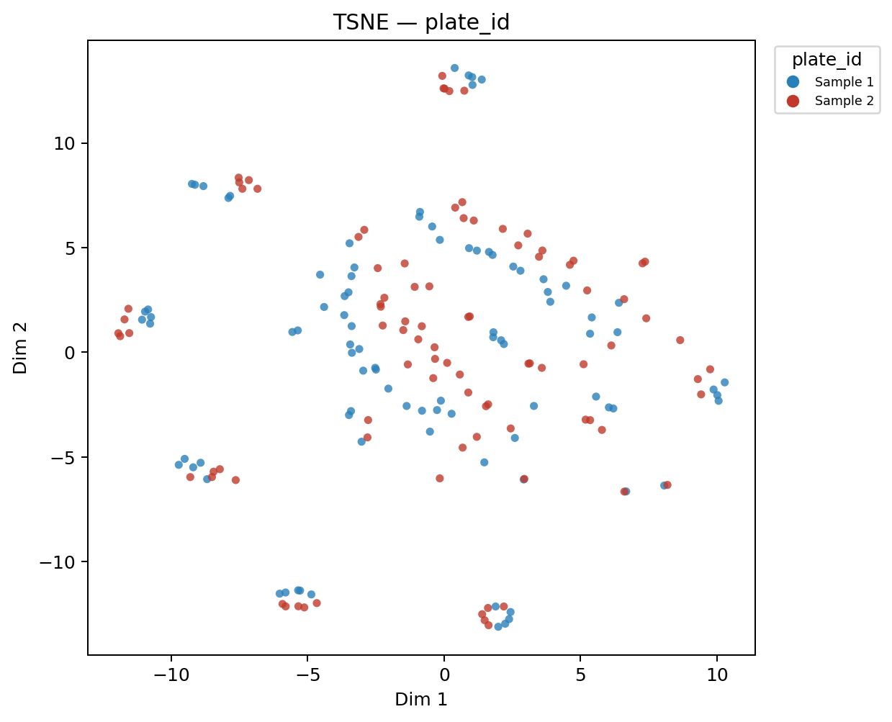

**t-SNE before correction.** The dedicated t-SNE function uses the first 20 PCA components with a fixed seed.

```python
fig = ds.plot_tsne(corrected, color_by="plate_id")
fig.savefig("results/batch/tsne_after_batch_correction.png", dpi=180)
```

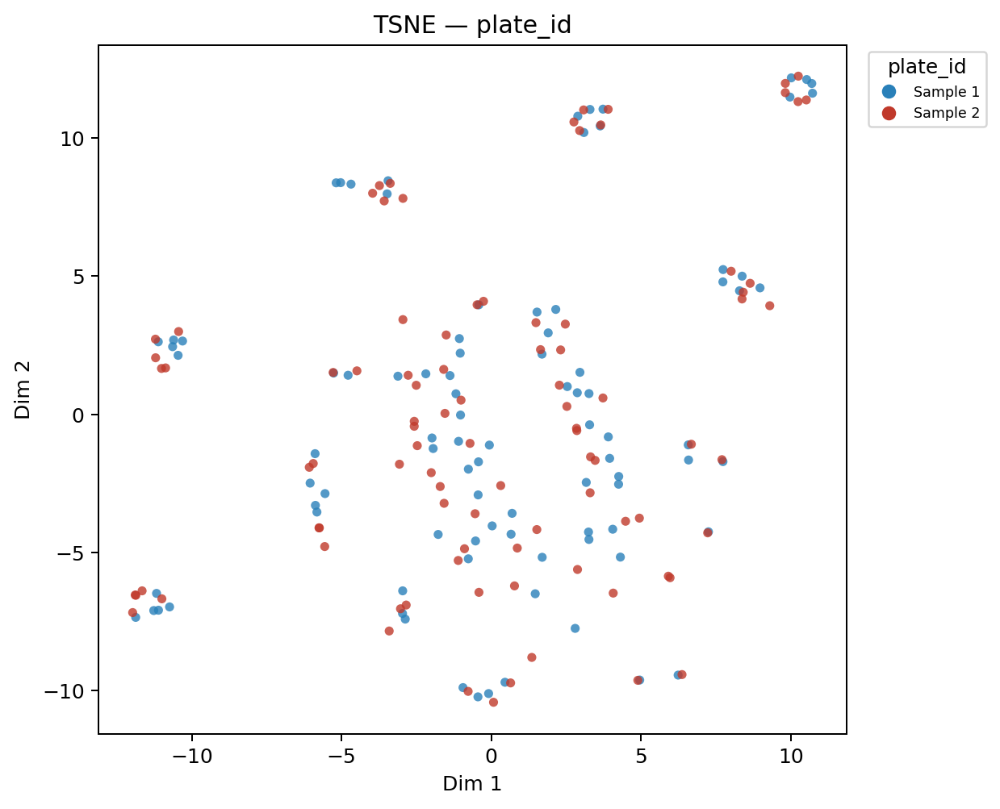

**t-SNE after limma batch regression.** Compare plate mixing without interpreting global t-SNE distances.

```python
fig = ds.plot_tsne(
    before, color_by="compound", split_by="plate_id", label_by=None,
)
fig.savefig("results/batch/tsne_before_compound_by_plate.png", dpi=180)
```

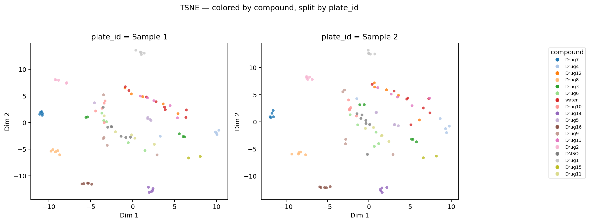

**t-SNE before correction, split by plate and colored by compound.** Plate facets expose treatment-specific local neighborhoods while retaining a shared compound palette.

```python
fig = ds.plot_tsne(
    corrected, color_by="compound", split_by="plate_id", label_by=None,
)
fig.savefig("results/batch/tsne_after_compound_by_plate.png", dpi=180)
```

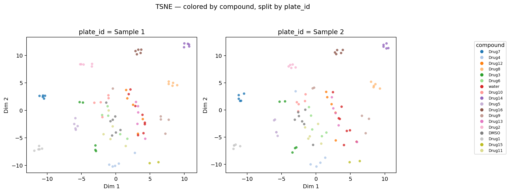

**t-SNE after correction, split by plate and colored by compound.** Use local neighborhood agreement as supporting evidence; do not compare long-range t-SNE distances.

### MDS: leading log-fold-change distances

`plot_mds()` computes and creates one MDS figure per call.

```python
fig = ds.plot_mds(
    before, group_by="plate_id", label_by=None, n_top_genes=500,
)
fig.savefig("results/batch/mds_before_batch_correction.png", dpi=180)
```

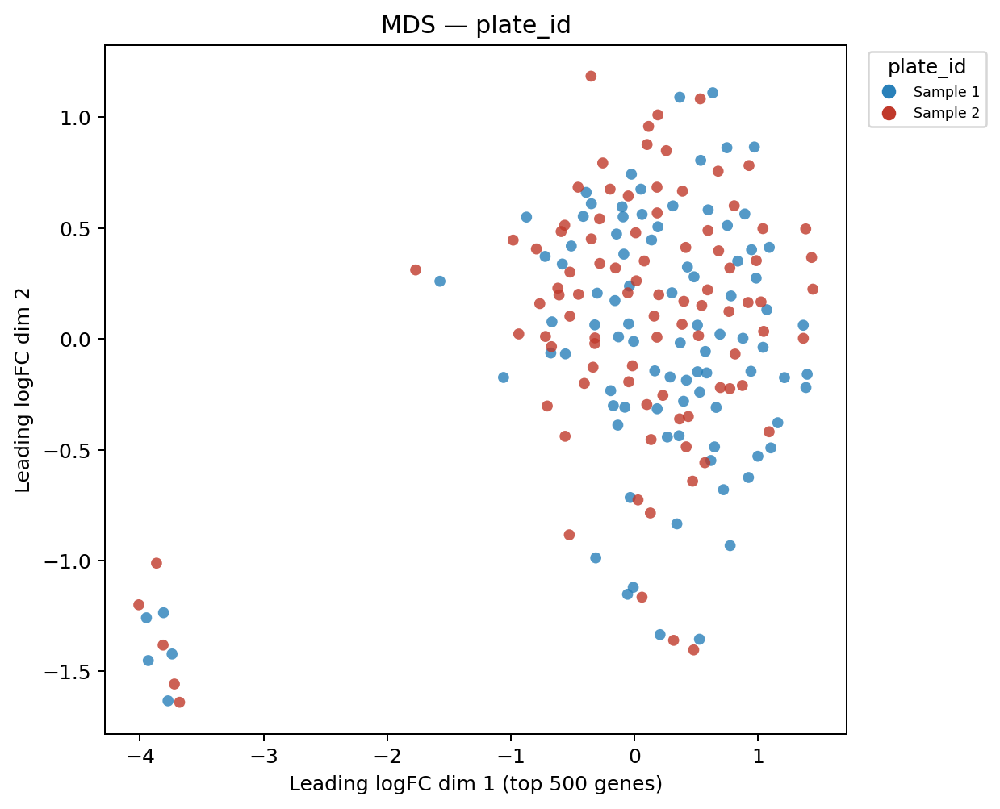

**MDS before correction.** Limma-style leading log-fold-change distances use the top 500 variable genes.

```python
fig = ds.plot_mds(
    corrected, group_by="plate_id", label_by=None, n_top_genes=500,
)
fig.savefig("results/batch/mds_after_batch_correction.png", dpi=180)
```

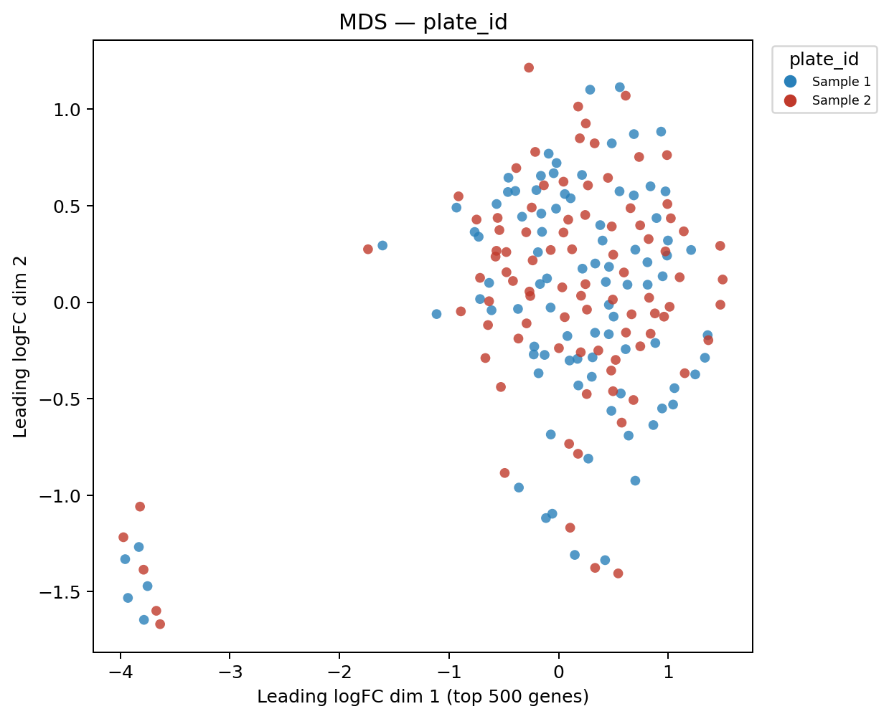

**MDS after limma batch regression.** MDS is recalculated from the corrected log-expression matrix.

```python
fig = ds.plot_mds(
    before, group_by="compound", split_by="plate_id",
    label_by=None, n_top_genes=500,
)
fig.savefig("results/batch/mds_before_compound_by_plate.png", dpi=180)
```

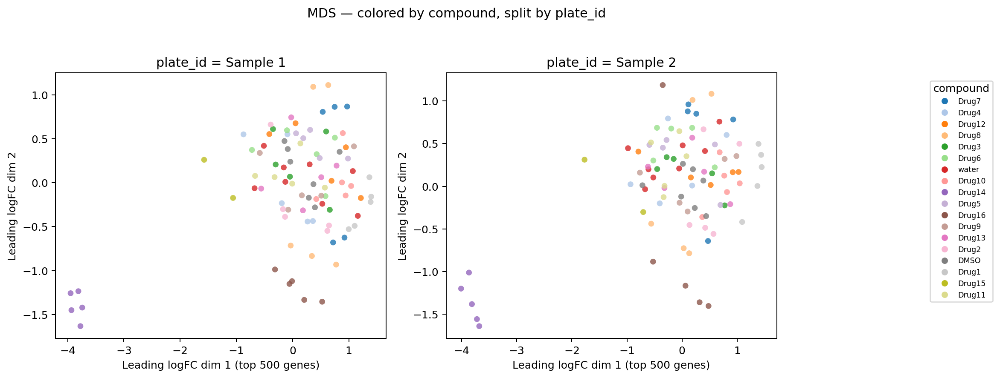

**MDS before correction, split by plate and colored by compound.** The same leading-logFC coordinate system is faceted by plate to compare matched treatment distances.

```python
fig = ds.plot_mds(
    corrected, group_by="compound", split_by="plate_id",
    label_by=None, n_top_genes=500,
)
fig.savefig("results/batch/mds_after_compound_by_plate.png", dpi=180)
```

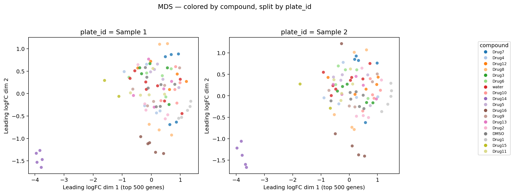

**MDS after correction, split by plate and colored by compound.** Comparable compound geometry across panels supports preservation of broad treatment-response distances.

`compute_batch_effect_metrics()` creates the before/after diagnostic table independently of all plots.

```python
batch_metrics = ds.compute_batch_effect_metrics(
    before, corrected, batch_col="plate_id", group_col="compound",
    reduction="X_pca", n_dims=10,
)
```

| Diagnostic | Before | After limma batch regression |
| --- | --- | --- |
| Plate silhouette (lower is better mixing) | 0.027 | -0.007 |
| Variance attributable to plate | 0.012 | 0.000 |
| Median matched-centroid distance | 14.454 | 6.026 |
| Cross-plate compound retrieval accuracy | 0.833 | 0.889 |

### Worked result: modest initial batch structure

Plate silhouette changes from 0.0269 to -0.0067, and the plate-associated variance fraction changes from 0.0121 to 0.0000. Matched-centroid distance and compound retrieval are checked for biological preservation.

**-0.007** post-correction plate silhouette

**Correction is not automatically beneficial.** Here the uncorrected silhouette is already close to zero. The evidence supports a small correction, not a claim that a large plate artifact was removed.

**Keep correction and inference separate.** Use batch-corrected normalized expression for PCA, UMAP, t-SNE, and MDS. For differential expression, keep the original raw counts and include `plate_id` as a model covariate; do not run DE on the corrected matrix.

<a id="repeatability"></a>

## 5. Evaluate within-plate repeatability

The [dedicated well-to-well tutorial](well-to-well-repeatability.md) explains all-well heatmaps, matched-condition pair selection, and scatter plots in detail. Here the same question is evaluated separately on each plate before cross-plate inference.

Repeatability asks whether replicate wells agree under the same plate conditions. Correlations are therefore computed only between wells sharing both `plate_id` and `compound`; wells from different compounds are never treated as replicates.

`compute_within_plate_repeatability()` creates one row per valid replicate-well pair without plotting. Pearson correlation on `log10(raw UMI + 1)` is the default; set `method="spearman"` for rank agreement or `use_norm=True` for normalized expression.

```python
correlation_method = "pearson"       # alternative: "spearman"
use_normalized_expression = False  # default: log10(raw UMI + 1)
repeatability = ds.compute_within_plate_repeatability(
    dsd,
    plate_col="plate_id",
    group_col="compound",
    use_norm=use_normalized_expression,
    method=correlation_method,
)
plate_a, plate_b = sorted(dsd.obs["plate_id"].astype(str).unique())[:2]
```

`summarise_within_plate_repeatability()` creates the displayed one-row-per-plate-and-compound table.

```python
repeatability_summary = ds.summarise_within_plate_repeatability(
    repeatability, plate_col="plate_id", group_col="compound",
)
```

| Plate | Compound | Method | Expression | Replicates | Well pairs | Median correlation | Minimum correlation |
| --- | --- | --- | --- | --- | --- | --- | --- |
| Sample 1 | DMSO | pearson | log10(raw UMI + 1) | 7 | 21 | 0.945 | 0.938 |
| Sample 2 | DMSO | pearson | log10(raw UMI + 1) | 7 | 21 | 0.946 | 0.923 |
| Sample 1 | Drug1 | pearson | log10(raw UMI + 1) | 5 | 10 | 0.960 | 0.954 |
| Sample 2 | Drug1 | pearson | log10(raw UMI + 1) | 5 | 10 | 0.962 | 0.955 |
| Sample 1 | Drug10 | pearson | log10(raw UMI + 1) | 5 | 10 | 0.957 | 0.950 |
| Sample 2 | Drug10 | pearson | log10(raw UMI + 1) | 5 | 10 | 0.957 | 0.951 |
| Sample 1 | Drug11 | pearson | log10(raw UMI + 1) | 5 | 10 | 0.938 | 0.926 |
| Sample 2 | Drug11 | pearson | log10(raw UMI + 1) | 5 | 10 | 0.934 | 0.928 |
| Sample 1 | Drug12 | pearson | log10(raw UMI + 1) | 5 | 10 | 0.948 | 0.934 |
| Sample 2 | Drug12 | pearson | log10(raw UMI + 1) | 5 | 10 | 0.949 | 0.920 |
| Sample 1 | Drug13 | pearson | log10(raw UMI + 1) | 5 | 10 | 0.946 | 0.929 |
| Sample 2 | Drug13 | pearson | log10(raw UMI + 1) | 5 | 10 | 0.942 | 0.925 |
| Sample 1 | Drug14 | pearson | log10(raw UMI + 1) | 5 | 10 | 0.958 | 0.951 |
| Sample 2 | Drug14 | pearson | log10(raw UMI + 1) | 5 | 10 | 0.955 | 0.948 |
| Sample 1 | Drug15 | pearson | log10(raw UMI + 1) | 2 | 1 | 0.906 | 0.906 |
| Sample 2 | Drug15 | pearson | log10(raw UMI + 1) | 2 | 1 | 0.890 | 0.890 |
| Sample 1 | Drug16 | pearson | log10(raw UMI + 1) | 5 | 10 | 0.961 | 0.956 |
| Sample 2 | Drug16 | pearson | log10(raw UMI + 1) | 5 | 10 | 0.959 | 0.951 |
| Sample 1 | Drug2 | pearson | log10(raw UMI + 1) | 5 | 10 | 0.943 | 0.937 |
| Sample 2 | Drug2 | pearson | log10(raw UMI + 1) | 5 | 10 | 0.952 | 0.950 |
| Sample 1 | Drug3 | pearson | log10(raw UMI + 1) | 5 | 10 | 0.940 | 0.934 |
| Sample 2 | Drug3 | pearson | log10(raw UMI + 1) | 5 | 10 | 0.938 | 0.931 |
| Sample 1 | Drug4 | pearson | log10(raw UMI + 1) | 5 | 10 | 0.940 | 0.912 |
| Sample 2 | Drug4 | pearson | log10(raw UMI + 1) | 5 | 10 | 0.933 | 0.911 |
| Sample 1 | Drug5 | pearson | log10(raw UMI + 1) | 5 | 10 | 0.946 | 0.942 |
| Sample 2 | Drug5 | pearson | log10(raw UMI + 1) | 5 | 10 | 0.934 | 0.924 |
| Sample 1 | Drug6 | pearson | log10(raw UMI + 1) | 5 | 10 | 0.944 | 0.923 |
| Sample 2 | Drug6 | pearson | log10(raw UMI + 1) | 5 | 10 | 0.934 | 0.927 |
| Sample 1 | Drug7 | pearson | log10(raw UMI + 1) | 5 | 10 | 0.958 | 0.954 |
| Sample 2 | Drug7 | pearson | log10(raw UMI + 1) | 5 | 10 | 0.948 | 0.945 |
| Sample 1 | Drug8 | pearson | log10(raw UMI + 1) | 5 | 10 | 0.961 | 0.954 |
| Sample 2 | Drug8 | pearson | log10(raw UMI + 1) | 5 | 10 | 0.951 | 0.938 |
| Sample 1 | Drug9 | pearson | log10(raw UMI + 1) | 5 | 10 | 0.944 | 0.928 |
| Sample 2 | Drug9 | pearson | log10(raw UMI + 1) | 5 | 10 | 0.945 | 0.924 |
| Sample 1 | water | pearson | log10(raw UMI + 1) | 8 | 28 | 0.940 | 0.919 |
| Sample 2 | water | pearson | log10(raw UMI + 1) | 8 | 28 | 0.928 | 0.901 |

### Compound-separated repeatability distributions

`plot_within_plate_repeatability()` keeps each compound separate and draws boxes from its own within-plate replicate-pair correlations.

```python
fig = ds.plot_within_plate_repeatability(repeatability)
fig.savefig("results/reproducibility/within_plate_repeatability_by_compound.png", dpi=180)
```

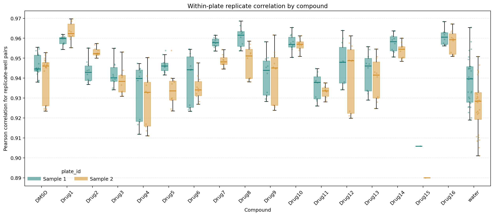

**Within-plate repeatability separated by compound.** Every box contains only correlations between replicate wells for the labeled compound and plate; no different-compound pairs are pooled.

### Replicate-well expression scatter plots

`plot_within_plate_replicate_scatter()` creates one scatter-gallery figure for one selected plate and compound. It defaults to `log10(raw UMI + 1)`; pass `use_norm=True` to plot normalized expression instead.

```python
fig = ds.plot_within_plate_replicate_scatter(
    dsd, plate=plate_a, compound="DMSO",
    method=correlation_method,
    use_norm=use_normalized_expression,
    max_pairs=4,
)
fig.savefig("results/reproducibility/" + plate_a + "_DMSO_replicate_scatter.png", dpi=180)
```

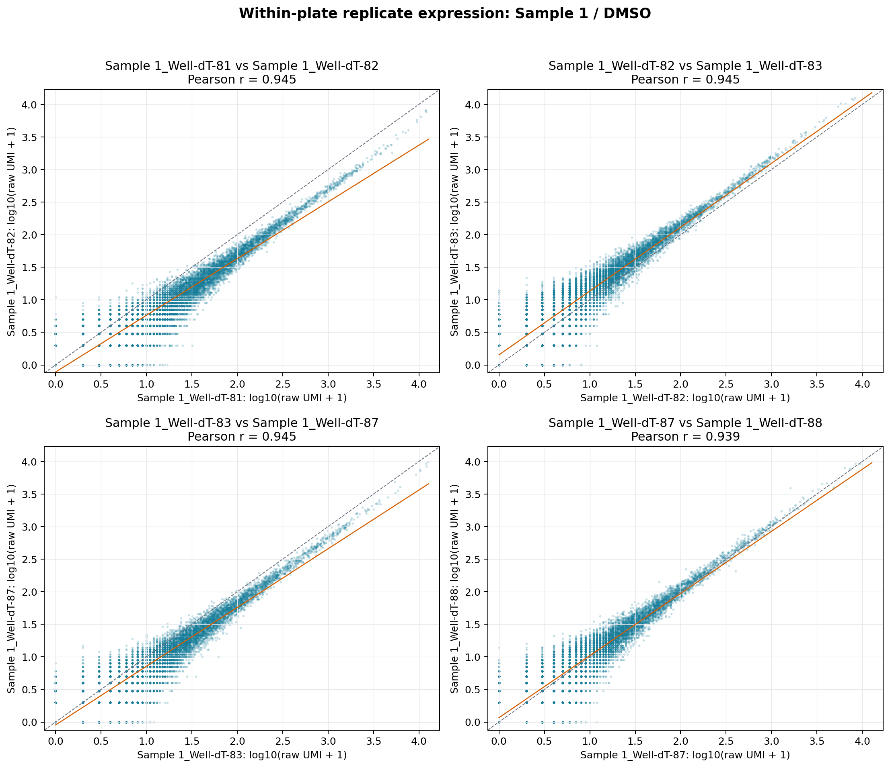

**First-plate DMSO replicate scatter plots.** Each panel compares two Sample 1 DMSO wells using log10(raw UMI + 1). The identity and fitted lines expose systematic shifts.

```python
fig = ds.plot_within_plate_replicate_scatter(
    dsd, plate=plate_b, compound="DMSO",
    method=correlation_method,
    use_norm=use_normalized_expression,
    max_pairs=4,
)
fig.savefig("results/reproducibility/" + plate_b + "_DMSO_replicate_scatter.png", dpi=180)
```

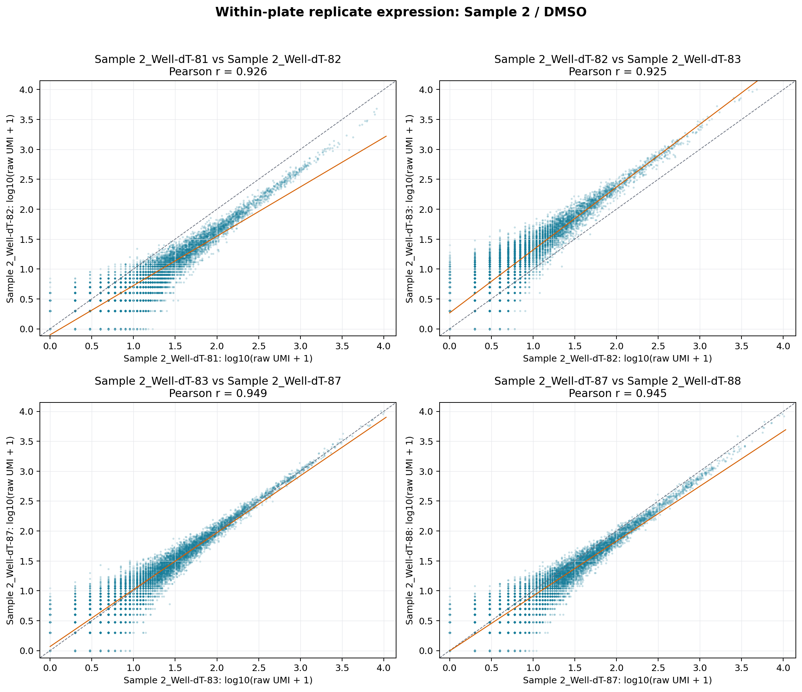

**Second-plate DMSO replicate scatter plots.** The same raw-UMI calculation is repeated within Sample 2 without creating any Sample 1-to-Sample 2 replicate pairs.

### Within-group correlation heatmaps

`plot_within_plate_correlation_heatmap()` creates one correlation matrix for one selected plate and compound.

```python
fig = ds.plot_within_plate_correlation_heatmap(
    dsd, plate=plate_a, compound="DMSO",
    method=correlation_method, use_norm=use_normalized_expression,
)
fig.savefig("results/reproducibility/" + plate_a + "_DMSO_correlation_heatmap.png", dpi=180)
```

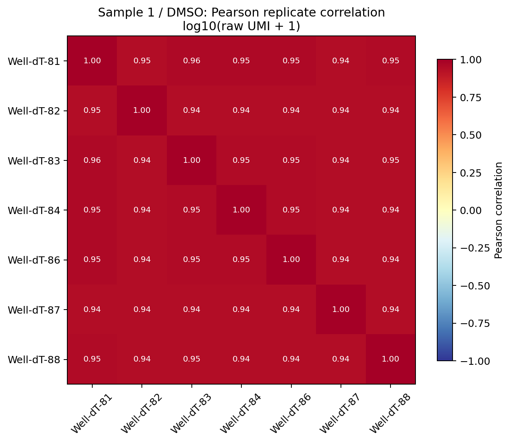

**First-plate DMSO replicate heatmap.** Only Sample 1 DMSO wells are included, so every off-diagonal cell is a valid within-condition replicate comparison.

```python
fig = ds.plot_within_plate_correlation_heatmap(
    dsd, plate=plate_b, compound="DMSO",
    method=correlation_method, use_norm=use_normalized_expression,
)
fig.savefig("results/reproducibility/" + plate_b + "_DMSO_correlation_heatmap.png", dpi=180)
```

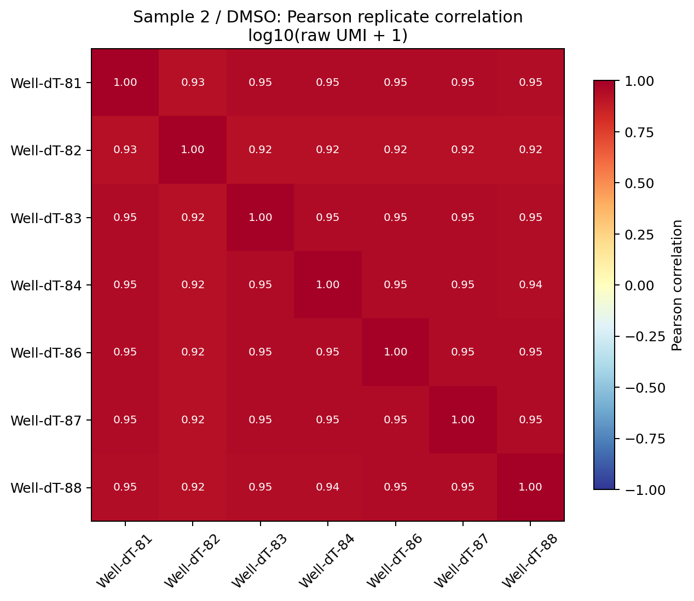

**Second-plate DMSO replicate heatmap.** Only Sample 2 DMSO wells are included. Use the same function for any treatment by changing compound.

The overall median within-group Pearson correlation is 0.946. Inspect the compound-specific boxes, scatter geometry, and heatmap cells rather than relying on this single aggregate.

<a id="single-plate-de"></a>

## 6. Single-plate differential expression

Fit each plate independently before combining them. This exposes plate-specific effects that a combined model can hide and supplies the gene-level inputs for the reproducibility analysis in the next section.

`compute_cross_plate_reproducibility()` performs the independent treatment-versus-DMSO models and stores one DE table for every plate and compound.

```python
reproducibility = ds.compute_cross_plate_reproducibility(
    dsd,
    plate_col="plate_id",
    group_col="compound",
    reference="DMSO",
    exclude_levels=("water",),
    method="limma_voom",
)
reproducibility_summary = reproducibility["summary"]
```

```python
if reproducibility_summary.empty:
    raise ValueError("No supported cross-plate comparisons; review replication and controls.")
plate_priority = reproducibility_summary.sort_values(
    ["n_significant_union", "compound"], ascending=[False, True],
).iloc[0]["compound"]
```

### Single-plate volcano plots

`plot_single_plate_de_volcano()` creates one volcano plot from one independently fitted plate/compound result.

```python
fig = ds.plot_single_plate_de_volcano(
    reproducibility, plate=plate_a, compound=plate_priority,
)
fig.savefig("results/reproducibility/" + plate_a + "_" + str(plate_priority) + "_volcano.png", dpi=180)
```

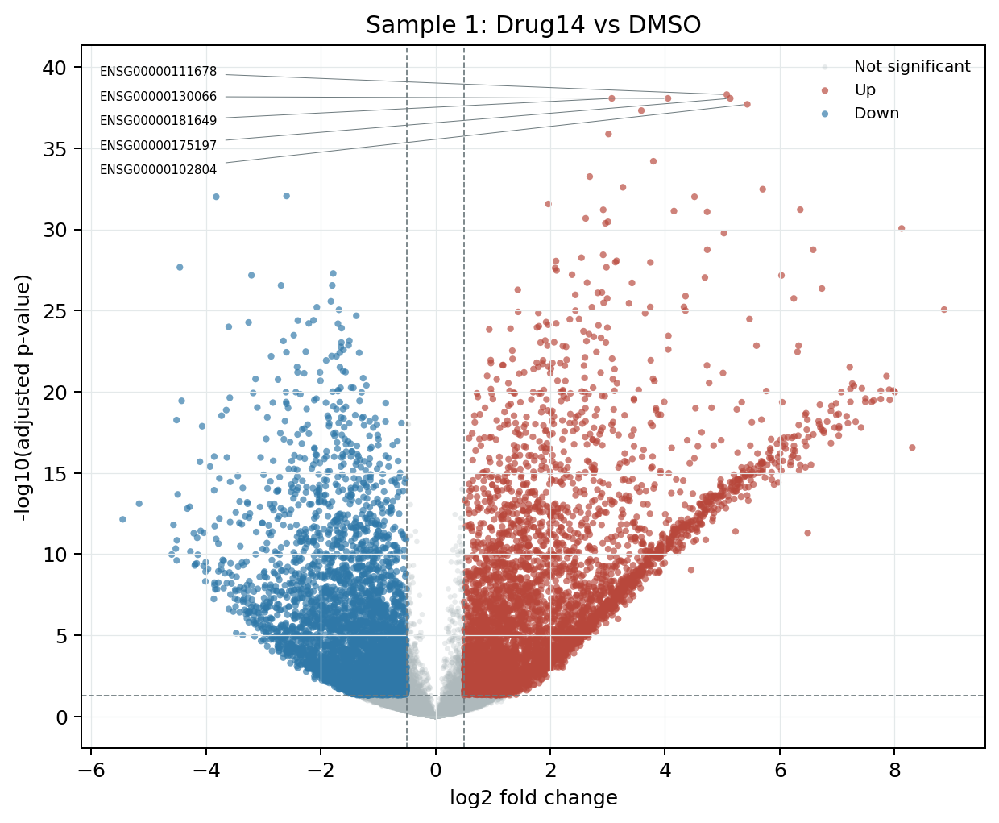

**Sample 1 Drug14 single-plate volcano.** Upregulated, downregulated, and nonsignificant genes come from the independently fitted Sample 1 model.

```python
fig = ds.plot_single_plate_de_volcano(
    reproducibility, plate=plate_b, compound=plate_priority,
)
fig.savefig("results/reproducibility/" + plate_b + "_" + str(plate_priority) + "_volcano.png", dpi=180)
```

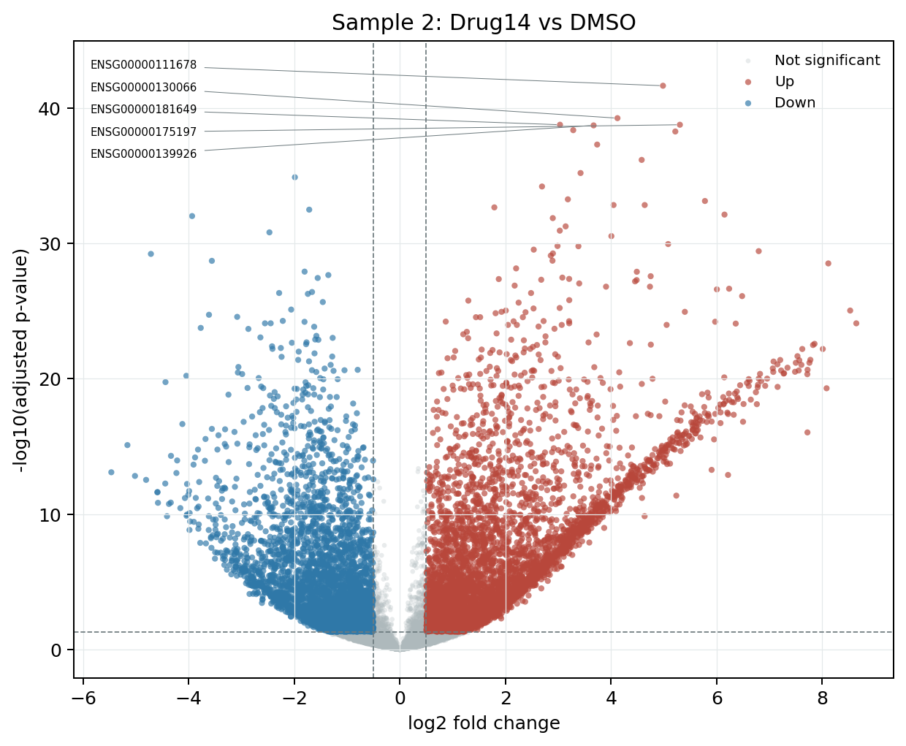

**Sample 2 Drug14 single-plate volcano.** The corresponding Sample 2 model is shown separately rather than pooling plate-specific residual variation.

### Spatial DEG-signature layouts

`plot_single_plate_de_layout()` maps the signed top-DEG expression score back to physical wells for one plate.

```python
fig = ds.plot_single_plate_de_layout(
    dsd, reproducibility, plate=plate_a, compound=plate_priority,
    n_top_genes=30,
)
fig.savefig("results/reproducibility/" + plate_a + "_" + str(plate_priority) + "_plate_layout.png", dpi=180)
```

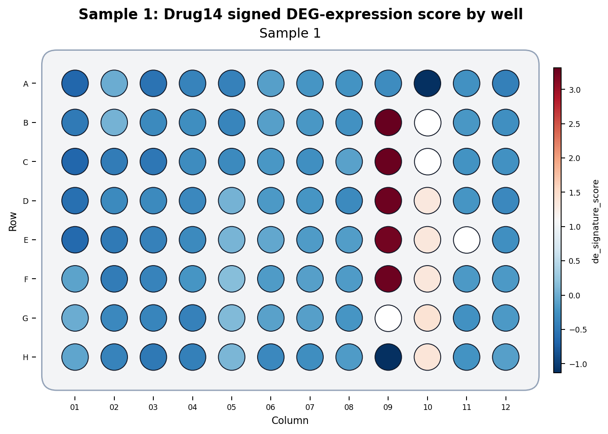

**Sample 1 Drug14 DEG-signature plate layout.** Each well is colored by a signed, standardized expression score from the top Sample 1 DEGs, exposing spatial gradients or isolated wells.

```python
fig = ds.plot_single_plate_de_layout(
    dsd, reproducibility, plate=plate_b, compound=plate_priority,
    n_top_genes=30,
)
fig.savefig("results/reproducibility/" + plate_b + "_" + str(plate_priority) + "_plate_layout.png", dpi=180)
```

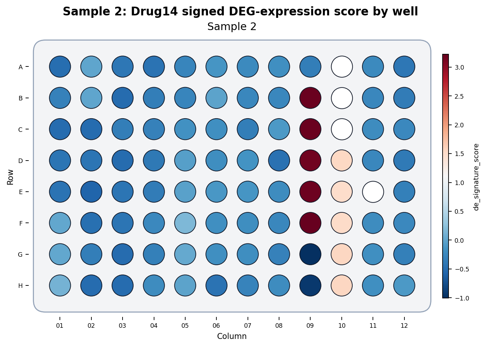

**Sample 2 Drug14 DEG-signature plate layout.** The Sample 2 layout uses its own independently selected DEGs and shows whether the response is spatially coherent.

### Top-DEG expression heatmaps

`plot_single_plate_de_heatmap()` creates one sample heatmap for the selected plate using only that plate's treatment and DMSO wells.

```python
fig = ds.plot_single_plate_de_heatmap(
    dsd, reproducibility, plate=plate_a, compound=plate_priority,
    n_top_genes=30,
)
fig.savefig("results/reproducibility/" + plate_a + "_" + str(plate_priority) + "_heatmap.png", dpi=180)
```

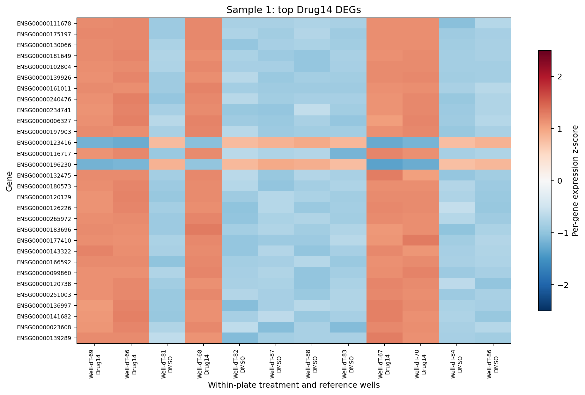

**Sample 1 Drug14 top-DEG heatmap.** Per-gene z-scores compare the selected treatment wells with Sample 1 DMSO controls.

```python
fig = ds.plot_single_plate_de_heatmap(
    dsd, reproducibility, plate=plate_b, compound=plate_priority,
    n_top_genes=30,
)
fig.savefig("results/reproducibility/" + plate_b + "_" + str(plate_priority) + "_heatmap.png", dpi=180)
```

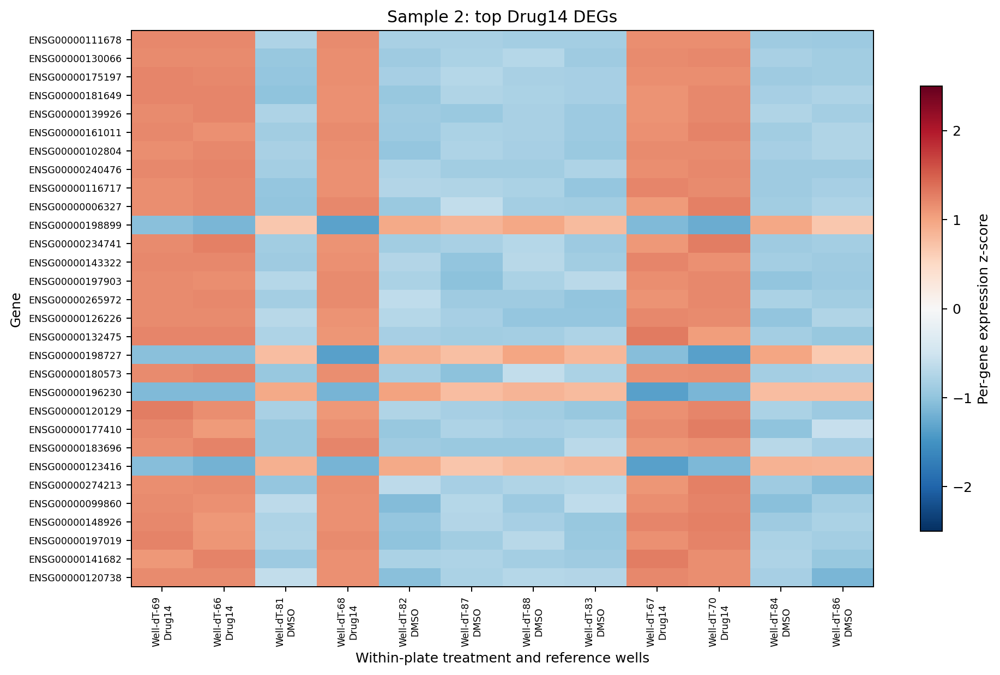

**Sample 2 Drug14 top-DEG heatmap.** The Sample 2 heatmap is generated from Sample 2 DEGs and Sample 2 treatment/control wells only.

<a id="reproducibility"></a>

## 7. Evaluate cross-plate reproducibility

Reproducibility compares the independently fitted plate results above. Pearson correlation is the default for treatment logFC vectors; Spearman remains available when rank agreement is the intended endpoint.

| Treatment | logFC Pearson r | DEGs plate A | DEGs plate B | Overlap | Jaccard | Sign concordance |
| --- | --- | --- | --- | --- | --- | --- |
| Drug14 | 0.952 | 7,475 | 7,108 | 6,178 | 0.735 | 0.984 |
| Drug16 | 0.855 | 4,935 | 4,322 | 3,394 | 0.579 | 0.973 |
| Drug1 | 0.724 | 1,835 | 1,734 | 1,002 | 0.390 | 0.957 |
| Drug7 | 0.596 | 1,309 | 754 | 476 | 0.300 | 0.953 |
| Drug8 | 0.588 | 803 | 468 | 261 | 0.258 | 0.929 |
| Drug15 | 0.579 | 4,763 | 3,753 | 2,543 | 0.426 | 0.919 |
| Drug2 | 0.445 | 257 | 120 | 65 | 0.208 | 0.946 |
| Drug4 | 0.274 | 22 | 18 | 8 | 0.250 | 0.906 |
| Drug9 | 0.241 | 1 | 2 | 0 | 0.000 | 0.000 |
| Drug5 | 0.184 | 5 | 16 | 2 | 0.105 | 0.895 |
| Drug13 | 0.172 | 3 | 0 | 0 | 0.000 | 0.667 |
| Drug3 | 0.170 | 20 | 2 | 1 | 0.048 | 0.905 |
| Drug12 | 0.162 | 0 | 0 | 0 | NA | NA |
| Drug10 | 0.122 | 0 | 2 | 0 | 0.000 | 0.500 |
| Drug6 | 0.111 | 0 | 0 | 0 | NA | NA |
| Drug11 | 0.031 | 3 | 4 | 0 | 0.000 | 0.857 |

`plot_cross_plate_reproducibility()` creates only the correlation/DEG-overlap overview.

```python
fig = ds.plot_cross_plate_reproducibility(
    reproducibility_summary, correlation_method="pearson",
)
fig.savefig("results/reproducibility/cross_plate_reproducibility.png", dpi=180)
```

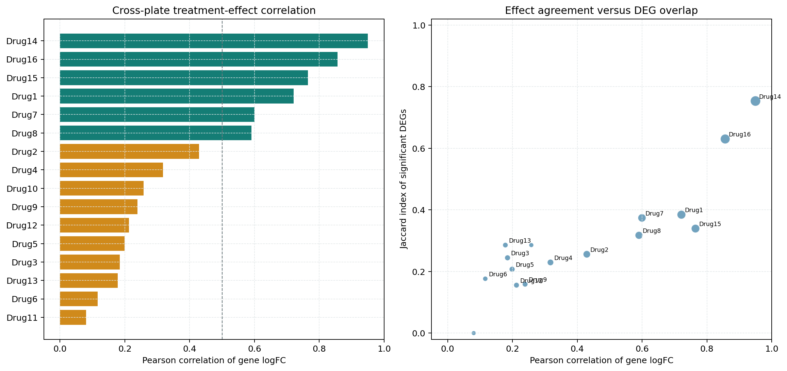

**Cross-plate treatment-effect reproducibility.** Strong signatures reproduce well, whereas weak or null signatures have unstable correlations and little DEG overlap.

`plot_plate_logfc_concordance()` colors genes as significant on both plates, only plate A, only plate B, or neither. Select `value_type="log2fc"`, `"log10_umi"`, or `"normalized"` for the two axes.

```python
fig = ds.plot_plate_logfc_concordance(
    reproducibility, max_panels=4, value_type="log2fc",
    correlation_method="pearson",
)
fig.savefig("results/reproducibility/plate_specific_logfc_concordance.png", dpi=180)
```

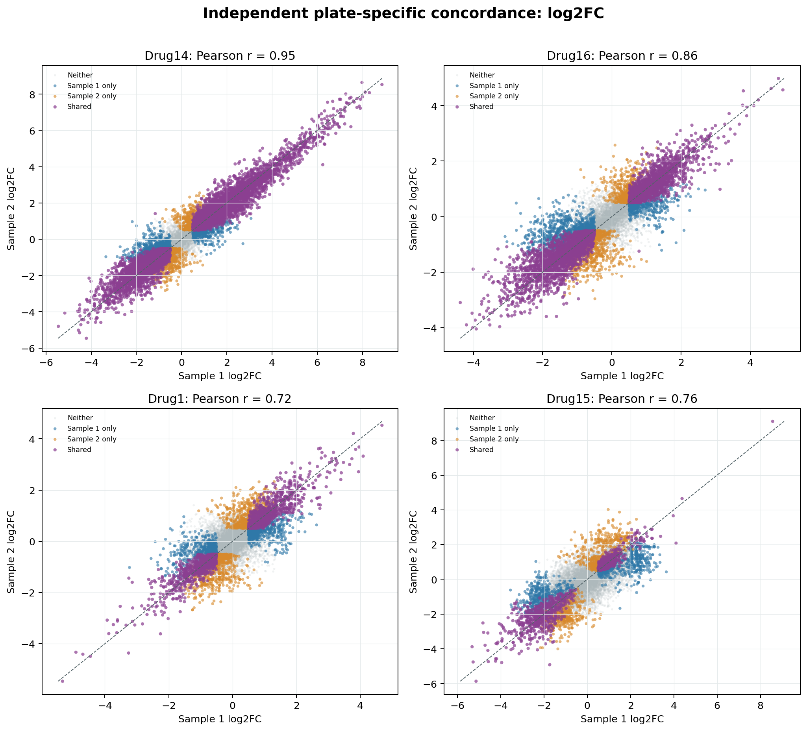

**Plate-specific log2FC concordance.** Purple genes are significant on both plates; blue and orange genes are significant on only one plate. Agreement near the diagonal supports reproducible treatment effects.

```python
fig = ds.plot_plate_logfc_concordance(
    reproducibility, max_panels=4, value_type="log10_umi",
    correlation_method="pearson",
)
fig.savefig("results/reproducibility/plate_specific_log10_umi_concordance.png", dpi=180)
```

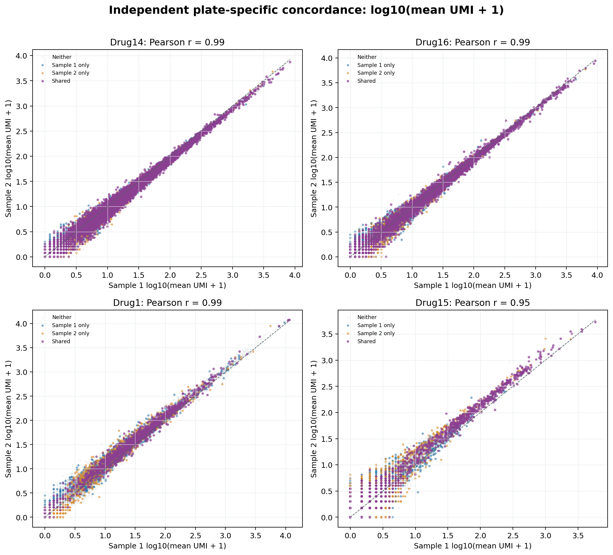

**Plate-specific log10 mean-UMI concordance.** Axes show log10(mean raw UMI + 1) for the selected compound on each plate while colors retain the plate-specific DE significance categories.

```python
fig = ds.plot_plate_logfc_concordance(
    reproducibility, max_panels=4, value_type="normalized",
    correlation_method="pearson",
)
fig.savefig("results/reproducibility/plate_specific_normalized_expression_concordance.png", dpi=180)
```

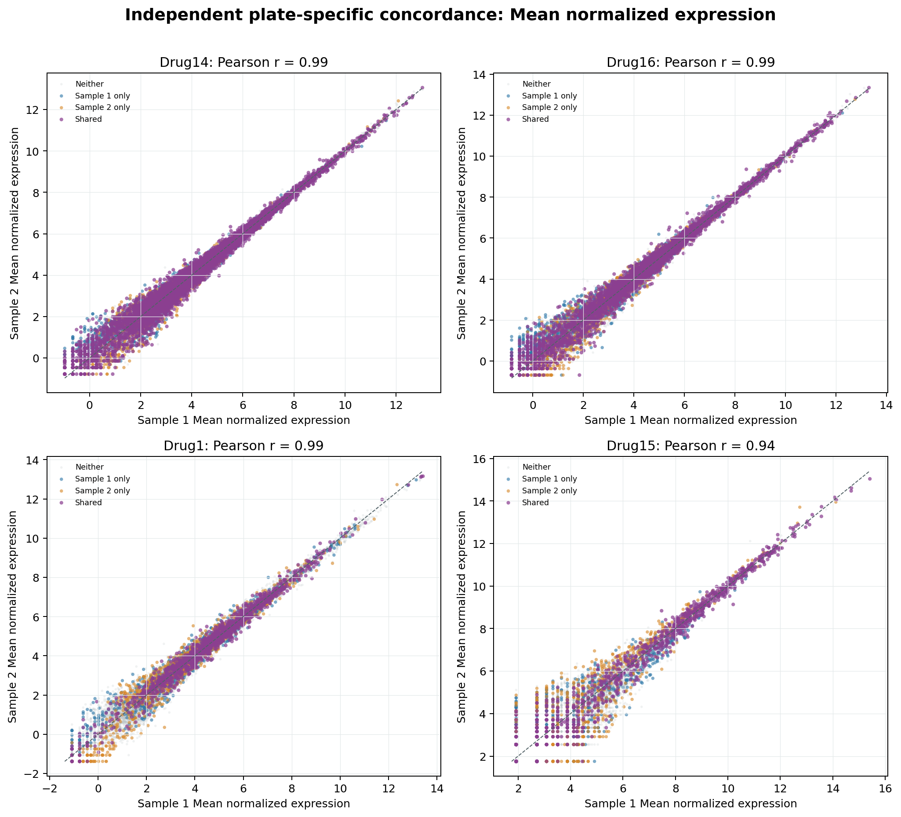

**Plate-specific normalized-expression concordance.** Axes show mean normalized compound expression on each plate; shared and plate-only significance colors use the same legend as the log2FC view.

### Worked result: reproducibility depends on effect strength

The median logFC Pearson correlation is 0.258 across all treatments, and 6 of 16 signatures reach r ≥ 0.5. Null treatments should not be labeled irreproducible solely because noise correlates poorly.

**6/16** treatments with logFC r ≥ 0.5

<a id="de"></a>

## 8. Plate-adjusted differential expression

The final combined model uses all retained samples, requires case/control support within plates, and adds plate as a nuisance covariate.

`compute_multi_de()` fits the count-level models and creates no figures.

```python
ds.compute_multi_de(
    dsd,
    group_col="compound",
    reference="DMSO",
    exclude_levels=("water",),
    methods=("limma_voom",),
    batch_cols=["plate_id"],
    within_plate=True,
    inplace=True,
)
```

`summarise_comparison()` creates the combined-model summary table.

```python
de_summary = ds.summarise_comparison(dsd)
if de_summary.empty:
    raise ValueError("No fitted contrasts; inspect the comparison manifest.")
priority = de_summary.sort_values(
    ["n_sig_total", "min_padj"], ascending=[False, True],
).iloc[0]["contrast"]
```

### Complete combined-model summary

| Contrast | Up | Down | Total DEGs | Minimum FDR |
| --- | --- | --- | --- | --- |
| Drug14 | 4,636 | 3,614 | 8,250 | 6.46e-27 |
| Drug15 | 541 | 6,068 | 6,609 | 7.32e-13 |
| Drug16 | 2,541 | 3,372 | 5,913 | 2.63e-19 |
| Drug1 | 1,827 | 1,078 | 2,905 | 7.81e-18 |
| Drug7 | 1,095 | 1,082 | 2,177 | 2.50e-16 |
| Drug8 | 951 | 701 | 1,652 | 3.17e-14 |
| Drug2 | 433 | 738 | 1,171 | 5.34e-12 |
| Drug4 | 149 | 300 | 449 | 5.21e-10 |
| Drug5 | 91 | 51 | 142 | 4.80e-07 |
| Drug3 | 35 | 95 | 130 | 3.76e-10 |
| Drug9 | 62 | 51 | 113 | 1.38e-04 |
| Drug13 | 51 | 30 | 81 | 3.11e-04 |
| Drug12 | 29 | 17 | 46 | 7.15e-04 |
| Drug6 | 7 | 2 | 9 | 1.17e-03 |
| Drug10 | 2 | 1 | 3 | 2.47e-03 |
| Drug11 | 0 | 0 | 0 | 6.12e-01 |

`plot_deg_counts()` creates only the plate-adjusted DEG-count figure.

```python
fig = ds.plot_deg_counts(dsd)
fig.savefig("results/comparison/deg_counts.png", dpi=180)
```

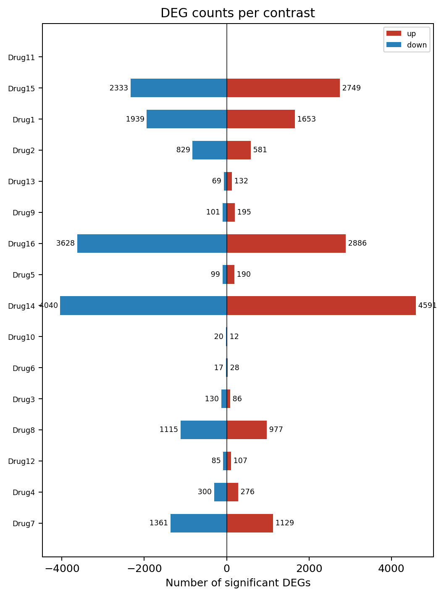

**Plate-adjusted DEG counts.** Counts come from the combined model after control exclusion and plate adjustment.

`plot_comparison_volcano()` creates the combined-model volcano plot for one selected contrast.

```python
fig = ds.plot_comparison_volcano(
    dsd, contrast=priority, n_label=5,
)
fig.savefig("results/comparison/" + str(priority) + "_volcano.png", dpi=180)
```

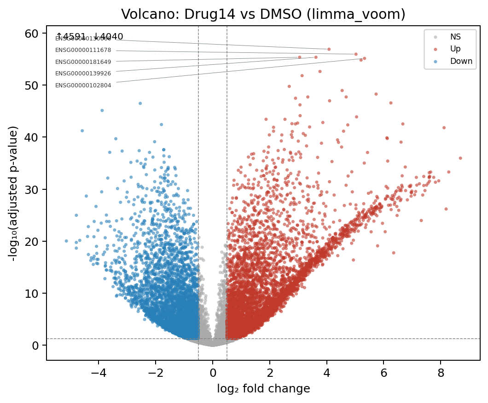

**Drug14 plate-adjusted volcano.** The combined raw-count model includes plate\_id as a covariate; colors identify adjusted upregulated, downregulated, and nonsignificant genes.

**Large changes in DEG count are not automatically better.** Combining plates increases sample size but also changes variance estimation. Compare combined effects with the plate-specific estimates above.

<a id="enrichment"></a>

## 9. Enrichment from adjusted DEGs

Directional ORA is run from the combined plate-adjusted DEGs. This preserves the statistical model used to define the gene lists while keeping enrichment interpretation separate for higher and lower expression.

```python
# Optional: supply your own local GMT libraries with matching identifiers.
gene_set_paths = {
    "hallmark": Path("gene_sets/hallmark.gmt"),
    "go_bp": Path("gene_sets/go_bp.gmt"),
    "reactome": Path("gene_sets/reactome.gmt"),
}
missing = [str(p) for p in gene_set_paths.values() if not p.is_file()]
if missing:
    raise FileNotFoundError(f"Supply GMT files before running this optional section: {missing}")
ds.run_enrichment(
    dsd, libraries=tuple(gene_set_paths), gene_set_paths=gene_set_paths,
    mode=("ora",), background="all_tested", allow_network=False, inplace=True,
)
```

`plot_enrichment_dotplot()` creates exactly one requested direction per call.

```python
fig = ds.plot_enrichment_dotplot(
    dsd, contrast=priority, direction="up", mode="ora",
)
fig.savefig("results/comparison/" + str(priority) + "_up_enrichment_dotplot.png", dpi=180)
```

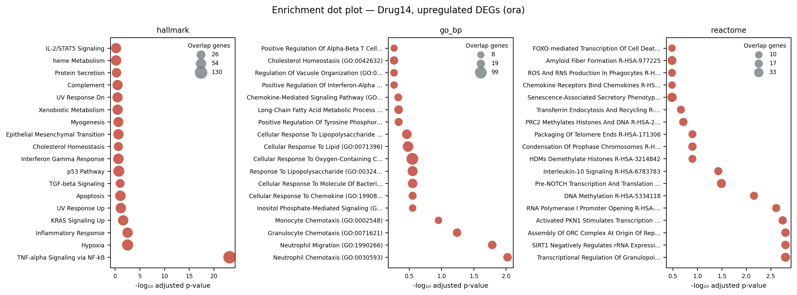

**Drug14 upregulated DEG enrichment.** Only pathways enriched among adjusted upregulated DEGs are shown. Point size reports overlap genes.

```python
fig = ds.plot_enrichment_dotplot(
    dsd, contrast=priority, direction="down", mode="ora",
)
fig.savefig("results/comparison/" + str(priority) + "_down_enrichment_dotplot.png", dpi=180)
```

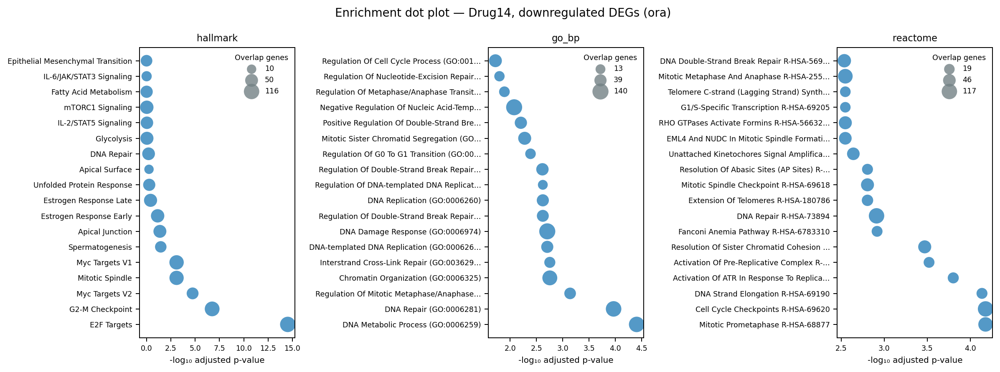

**Drug14 downregulated DEG enrichment.** Only pathways enriched among adjusted downregulated DEGs are shown. Point size reports overlap genes.

1,712 pathway rows pass FDR < 0.05 across all contrasts, libraries, and directions.

`enrichment_summary()` creates the pathway table independently of the figures.

```python
pathway_table = ds.enrichment_summary(dsd)
significant_pathways = pathway_table.query("padj < 0.05")
```

| Library | Direction | Pathway | Overlap | Odds ratio | FDR |
| --- | --- | --- | --- | --- | --- |
| hallmark | up | TNF-alpha Signaling via NF-kB | 132/180 | 5.30 | 7.06e-25 |
| hallmark | down | E2F Targets | 116/198 | 3.92 | 2.18e-19 |
| hallmark | down | G2-M Checkpoint | 95/193 | 2.67 | 6.63e-10 |
| reactome | down | Cell Cycle Checkpoints R-HSA-69620 | 113/252 | 2.25 | 6.53e-07 |
| go\_bp | down | DNA Metabolic Process (GO:0006259) | 113/255 | 2.20 | 3.49e-06 |
| go\_bp | down | DNA Repair (GO:0006281) | 114/264 | 2.10 | 9.13e-06 |
| reactome | down | Mitotic Prometaphase R-HSA-68877 | 83/181 | 2.33 | 9.68e-06 |
| reactome | up | Transcriptional Regulation Of Granulopoiesis R-HSA-9616222 | 29/40 | 4.88 | 1.25e-03 |
| hallmark | up | Inflammatory Response | 57/107 | 2.17 | 1.29e-03 |
| reactome | up | SIRT1 Negatively Regulates rRNA Expression R-HSA-427359 | 20/25 | 7.08 | 1.63e-03 |
| go\_bp | up | Neutrophil Chemotaxis (GO:0030593) | 20/25 | 7.08 | 1.13e-02 |
| go\_bp | up | Neutrophil Migration (GO:1990266) | 21/28 | 5.45 | 1.95e-02 |

<a id="tables"></a>

## 10. Saved outputs

```text
results/
├── qc/dmso_outlier_audit.csv
├── batch/{batch_effect_metrics.tsv, pca_*.png, umap_*.png, tsne_*.png, mds_*.png}
├── reproducibility/
   ├── within_plate_repeatability.tsv
   ├── within_plate_repeatability_summary.tsv
   ├── *_DMSO_replicate_scatter.png
   ├── *_DMSO_correlation_heatmap.png
   ├── single_plate_de/{*_volcano.png, *_plate_layout.png, *_heatmap.png}
   ├── plate_specific_*_concordance.png
   ├── cross_plate_reproducibility.tsv
   └── de_by_plate/<plate>/<contrast>.tsv
└── comparison/results/{de, enrichment, figures, manifests}/
```

<a id="notes"></a>

## 11. Important notes

- Diagnose batch magnitude before correction and remeasure it afterward.
- Evaluate biological preservation using matched treatments, not plate mixing alone.
- Use corrected embeddings for exploration and plate covariates for gene-level inference.
- Report within-plate repeatability and cross-plate treatment-effect reproducibility separately.
- For three or more plates, inspect all pairwise effects and sensitivity to leaving each plate out.
<a id="glossary"></a>

## Glossary

**Batch effect** — A systematic technical difference associated with plate, run, operator, reagent lot, or processing time.

**Contrast** — A defined case-minus-control comparison. Positive logFC means higher expression in the case.

**DEG** — A gene passing both the adjusted p-value and effect-size thresholds.

**Batch regression** — A linear-model adjustment that subtracts fitted plate effects from normalized expression while retaining named biological covariates.

**ORA** — Over-representation analysis of a selected gene list against a tested-gene background.

**Repeatability** — Agreement among replicate wells measured under the same plate conditions.

**Reproducibility** — Agreement of independently estimated treatment effects across plates.

**Within-plate support** — Presence of both case and control wells on the same plate, needed to separate treatment from plate.

<a id="troubleshooting"></a>

## Troubleshooting

The DMSO label is not found

Check exact spelling and case in `adata.obs['compound']`, or change `reference` to the label used by the experiment.

No enrichment is returned

Confirm that significant DEGs exist in the requested direction, gene symbols overlap the GMT files, and the tested-gene background is appropriate.

A treatment has zero DEGs

This is a valid result at the configured thresholds. Inspect effect sizes and replicate values; do not relax thresholds only to obtain a non-empty list.

Batch correction removes biological separation

Check whether treatment is confounded with plate and include estimable biological terms in `covariate_cols`. Use corrected expression for exploratory views only; DE should use raw counts and a plate covariate.

Cross-plate correlations are low

Review within-plate repeatability, control quality, dose/time matching, missing wells, and effect strength. Weak null signatures have unstable correlations and should not be forced into agreement.

<a id="complete-report"></a>

## 12. Complete reproducible run

The portable runner validates inputs, keeps an exclusion audit, fits supported comparisons, and writes results. It retains all wells during QC; the treatment model excludes blank groups. Use `--exclude-samples reviewed_exclusions.csv` only for reviewed Sample 1/2 well IDs. The CSV must contain `sample_id` and may include `reason`; the runner saves the matched rows to `reviewed_exclusions.csv` in its output directory. Pass `--full-embeddings` to add UMAP and t-SNE. The runner uses a smaller practice gene-filter rule (at least one count in two wells), while the detailed worked example above uses five counts in three wells. The archived figures are interpretation examples, not expected synthetic output.

```bash
python scripts/run_tutorial.py comparison --data-dir data --output-dir results
```

---

[← Previous chapter](single-plate-comparison.md) · [Next chapter →](bulk-rnaseq-comparison.md)
