# Quality-control workflow

[Learning path](index.md) · [Prepare inputs](input-preparation.md) · [API reference](api-reference.md)

> **Before you start:** complete [Getting started](getting-started.md). Run code blocks in order from the repository root. “Sample 1–4” identify example plate datasets; each observation is one well. This chapter uses **Sample 3 and Sample 4**. Worked results are shown for interpretation. The separately supplied synthetic practice inputs will produce different numbers.

Load aligned expression and metadata, inspect every physical well, understand library-quality metrics, and connect optional STARsolo read statistics to the count matrix. The procedure applies to arbitrary plates and sample counts.

<a id="overview"></a>

## Overview

This page presents a reusable QC workflow for Drug-seq and related high-throughput transcriptomics experiments. Sample 3 and Sample 4 are used only as a worked example with real expression, metadata, and optional STARsolo input.

Worked figures and result tables illustrate an analyzed example with standardized sample labels. The synthetic practice dataset produces different values; compare the interpretation and output structure, not exact numbers.

<a id="input"></a>

## 1. Input and metadata

The standard expression input is a gene-by-sample table or a dedicated `matrix/` directory containing only `matrix.mtx.gz`, `features.tsv.gz`, and `barcodes.tsv.gz`. Metadata remain beside that directory and can be CSV, tab-delimited text, or Excel. At minimum, provide identifiers that match the count barcodes plus `plate_id`, `well_id`, and experimental labels such as `compound`, `dose`, and `time`.

### Example input directories

Each example plate directory contains a raw-count matrix bundle and one metadata table. The historical worked analysis used filtered STARsolo bundles; the synthetic practice bundle follows the same file contract. Sample 3 and Sample 4 have the same schema:

```text
data/
├── sample_3/
│   ├── metadata.csv
│   └── matrix/
│       ├── matrix.mtx.gz
│       ├── features.tsv.gz
│       └── barcodes.tsv.gz
├── sample_4/
│   ├── metadata.csv
│   └── matrix/  (same three files)
└── star_results/  (optional; supply separately)
    ├── Sample 3/Solo.out/Gene/
    └── Sample 4/Solo.out/Gene/
```

| File | Contents and relationship |
| --- | --- |
| `matrix.mtx.gz` | Compressed Matrix Market sparse count matrix. Rows correspond to `features.tsv.gz`; columns correspond to `barcodes.tsv.gz`. |
| `features.tsv.gz` | Feature annotation in matrix-row order. The example contains an Ensembl gene ID, gene symbol, and feature type such as `Gene Expression`. |
| `barcodes.tsv.gz` | One sample barcode per matrix column. These values are joined to the metadata `barcode` column. |
| `metadata.csv` | Plate and experimental annotations for all nominal wells. Only barcodes shared with the filtered expression matrix are retained in the DrugSeqData object. |

### Metadata preview

This anonymized metadata preview illustrates the worked example. Use the synthetic bundle or your own input tables when running the code:

| plate\_id | barcode | well\_id | compound | dose | time | total\_well | x | y |
| --- | --- | --- | --- | --- | --- | --- | --- | --- |
| Sample 3 | TAACAGCCAA | Well-dT-1 | water | NA | 24h | 96 | 1 | 1 |
| Sample 3 | CTAAGAGTCC | Well-dT-2 | 231 | NA | 24h | 96 | 1 | 2 |
| Sample 3 | TTACTGCCTT | Well-dT-3 | 3T3 | NA | 24h | 96 | 1 | 3 |
| Sample 3 | CGCTGAATTC | Well-dT-4 | 231 | NA | 24h | 96 | 1 | 4 |
| Sample 3 | TGACGTCCTT | Well-dT-5 | 3T3 | NA | 24h | 96 | 1 | 5 |

Worked metadata preview with the schema used by `data/sample_3/metadata.csv`. The example value `NA` represents missing dose information.

### Metadata column definitions

| Column | Meaning |
| --- | --- |
| `plate_id` | Plate or processing-batch identifier. It is used for grouping, faceting, filename labels, and construction of a globally unique sample ID. |
| `barcode` | Sample barcode matched to an entry in `barcodes.tsv.gz`. A terminal `-1` is removed during matching when present. |
| `well_id` | Physical well identifier. Parseable Well-dT values determine the canonical plate position; numbering runs down an 8-row column before moving to the next column. |
| `compound` | Experimental material or treatment label. In the Sample 3/Sample 4 example, `231`, `3T3`, and `water` also describe expected sample identity. |
| `dose` | Treatment dose. It may be numeric or text and may be absent; `NA` in this example is treated as missing when the metadata are loaded. |
| `time` | Treatment or collection duration, including its unit, such as `24h`. It contributes to the generated treatment label. |
| `total_well` | Nominal number of wells on the plate. The layout code uses it to complete the physical grid and display filtered or absent wells as empty positions. |
| `x` | Original input-layout x coordinate. It is retained for auditing and serves as a fallback only when `well_id` cannot be parsed. |
| `y` | Original input-layout y coordinate. It is retained for auditing and serves as a fallback only when `well_id` cannot be parsed. |

**Coordinate precedence.** When `well_id` is parseable, it defines the canonical plate row and column. The source `x`/`y` fields remain available for auditing and are used only as a fallback. This parsing convention does not validate the experimental layout. Check the result against the physical design, especially when barcode numbering differs from position.

### Coordinate check before plotting

Read the [physical-coordinate check](input-preparation.md#4-verify-physical-plate-positions) before using these plate maps. Parseable `well_id` values take precedence over `x` and `y`; if the physical layout disagrees, preserve the original label and assign verified A1-style positions.

### Columns created during import

**`sample_id`** — Created automatically by joining `plate_id` and `barcode` with an underscore. Assign it to `obj.adata.obs_names` before merging, as shown below; the extra metadata column alone does not rename observations.

**`treatment`** — Created automatically by joining non-empty `compound`, `dose`, and `time` values. Missing components are skipped rather than written as literal “nan”.

**Count orientation** — Files are read as genes × samples; the constructed AnnData is samples × genes. Raw counts are retained in `adata.layers['counts']`.

### Load the example

```python
from pathlib import Path
import pandas as pd
import drugseqpy as ds

# Run from the tutorial repository root.
objects = []
for number in (3, 4):
    folder = Path("data") / f"sample_{number}"
    obj = ds.create_drugseq_from_files(
        folder / "matrix", folder / "metadata.csv",
        metadata_key="barcode", min_overlap=1.0,
    )
    obj.adata.obs_names = obj.obs["sample_id"].astype(str)
    assert obj.obs_names.is_unique
    objects.append(obj)

dsd = ds.merge_drugseq_objects(*objects, batch_key="source_plate")
assert dsd.obs_names.is_unique
for folder in ("qc", "species", "batch", "reproducibility", "comparison"):
    (Path("results") / folder).mkdir(parents=True, exist_ok=True)
print(dsd)
```

**Worked output (illustration):**
```text
DrugSeqData
  Samples   : 184
  Genes     : 157233
  Plates    : 2
  Compounds : 2
  QC done   : False
  Normalized: no
  DE results: 0 compound(s)
```

**Matched samples only.** Sample 3/Sample 4 metadata contain 192 wells, while 184 barcodes are present in the copied filtered matrices. The object intentionally keeps the intersection. This is why “metadata rows” and “retained samples” differ.

<a id="run"></a>

## 2. Essential QC metrics and distributions

Start by validating metadata and calculating the sample-level metrics once. `audit` is an ordinary Python dictionary returned by `ds.validate_metadata()`: `audit['ok']` reports whether every requested check passed, while `audit['issues']` lists each item that needs review. It is a diagnostic result, not a filtered dataset and not an instruction to remove samples.

```python
audit = ds.validate_metadata(dsd, verbose=False)
ds.compute_qc_metrics(
    dsd,
    mito_prefixes=("MT-", "mt-"),
    ribo_prefixes=("RPL", "RPS", "rpl", "rps"),
    inplace=True,
)
audit
```

**Worked output (illustration):**
```text
{'ok': False, 'issues': ["Column 'dose' has 184 NA value(s)."]}
```

**Reading this example audit.** The Sample 3/Sample 4 result reports missing `dose` values because that field is part of the package’s default metadata contract. These species-mixture wells do not have doses, so the warning is expected. For a design where dose is optional, call `ds.validate_metadata(dsd, required_cols=["plate_id", "well_id", "compound", "sample_type"])`.

### Essential sample QC metrics

**`total_umi`** — Total raw UMI count in each well; this measures library yield.

**`n_genes_det`** — Number of genes with at least one UMI; this measures observed library complexity.

**`pct_mito` / `mt.pct`** — Percentage of UMIs assigned to mitochondrial genes. The shorter name is a plotting alias.

**`pct_ribo` / `ribo.pct`** — Percentage of UMIs assigned to ribosomal-protein genes. The shorter name is a plotting alias.

**`outlier_score`** — Robust multivariate MAD score across key metrics. It ranks unusual wells but does not automatically reject them.

### Mitochondrial and ribosomal gene definitions

`ds.compute_qc_metrics()` matches both `adata.var_names` and `adata.var['gene_symbol']`. By default, mitochondrial genes begin with `MT-` or `mt-`, while ribosomal genes begin with uppercase or lowercase `RPL`/`RPS`. You can instead provide a custom prefix, a regular expression, or an exact gene list.

```python
# Exact lists have highest priority over regex and prefixes
ds.compute_qc_metrics(
    dsd,
    mito_genes=["MT-ND1", "MT-ND2", "MT-CO1"],
    ribo_genes=["RPL3", "RPL4", "RPS3", "RPS4X"],
    inplace=True,
)
```

The resolved mode, requested prefixes/pattern/list, and number of matched features are stored in `dsd.uns['qc_gene_definitions']`.

### How the MAD outlier score is calculated

For sample *i* and QC metric *j*, the implementation first calculates the across-sample median and median absolute deviation:

```text
m_j = median_i(x_ij)
MAD_j = median_i(abs(x_ij - m_j))
z_ij = (x_ij - m_j) / MAD_j
outlier_score_i = sqrt(sum_j(z_ij ** 2))
```

The five input metrics are `log10(total_umi + 1)`, `n_genes_det`, `pct_mito`, `pct_ribo`, and `gini_index`. A metric column containing any missing value is omitted; a zero MAD is replaced by 1.0. The raw MAD is used without the 1.4826 normal-consistency multiplier. Scores are calculated across all samples in the object—`groupby` changes only the visualization, not the score.

**Grouping, splitting, and colors.** The default `groupby="plate_id"` can be replaced by any column in `dsd.obs`, such as `compound` or `treatment`. It controls categories or colors within the same axes. `split_by=None` is the default; set it to a metadata column only when separate panels are needed. Every workflow visualization accepts `palette` as a Seaborn palette name, a sequence of colors, or a dictionary such as `{"Sample 3": "#167d9a", "Sample 4": "#d46b3d"}`. Numeric plate layouts use the separate `cmap` parameter.

**No automatic filtering.** QC metrics and an outlier score are evidence for review. The report does not delete wells. Choose thresholds after comparing plates, controls, and biological groups.

### QC metric violin panels

`ds.generate_qc_metric_violin_figure()` creates separate-axis violin panels and places each median label above its violin instead of over the distribution. `metrics=None` uses all four defaults; pass a list such as `["total_umi", "n_genes_det"]` to show only a subset. The example explicitly lists all four and keeps the default plate grouping.

```python
violin_files = ds.generate_qc_metric_violin_figure(
    dsd,
    output_dir="results/qc",
    formats=("png",),
    metrics=["mt.pct", "ribo.pct", "total_umi", "n_genes_det"],
    groupby="plate_id",    # e.g. "compound" or "treatment"
    palette="colorblind",  # Seaborn name, color list, or mapping
)
```

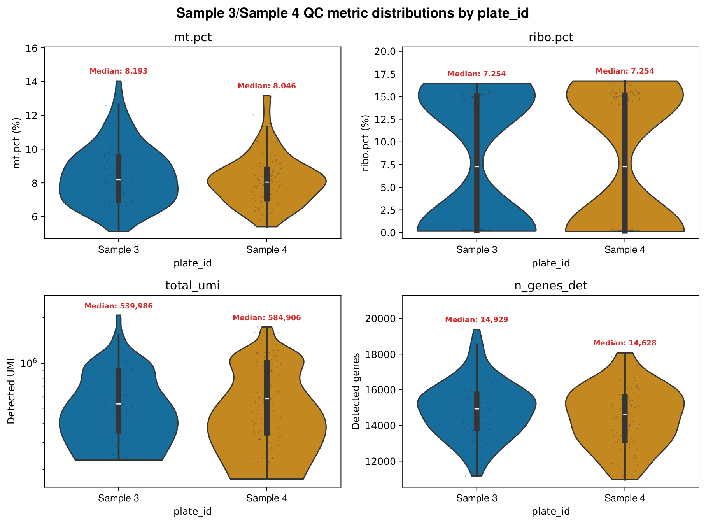

**QC metric violin panels.** Each metric has its own y-axis and is grouped by plate\_id. Red median annotations sit above the corresponding violin bodies; individual wells remain visible as translucent points.

### Outlier-score scatter

`ds.generate_outlier_score_scatter_figure()` plots one sample per point with `outlier_score` on the y-axis. `groupby` controls both point color and sample ordering; its default is `plate_id`. This worked example sets `label_outliers=True` and labels the ten highest scores by `well_id`, verifying the annotation path. The optional `threshold` can restrict labels to points above a justified review cutoff.

```python
outlier_files = ds.generate_outlier_score_scatter_figure(
    dsd,
    output_dir="results/qc",
    formats=("png",),
    groupby="plate_id",    # controls sample ordering and point colors
    palette="colorblind",
    threshold=None,        # set a review threshold only when justified
    label_outliers=True,   # label the highest scores for review
    label_col="well_id",
    max_labels=10,
)
```

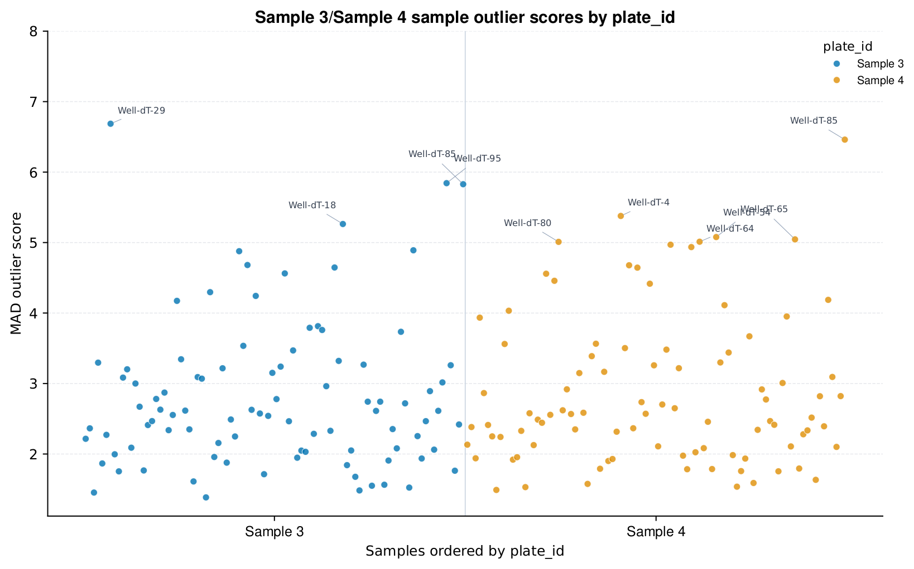

**Sample outlier scores.** Each point is one retained sample, colored by plate\_id and ordered into plate groups along the x-axis. Higher MAD scores indicate more unusual multivariate QC profiles; they identify samples for review rather than automatic deletion.

#### Colored and ordered by compound

The second call changes `groupby` to `compound`. It does not recalculate the MAD scores. A custom `output_name` keeps this figure and its source table alongside the default plate-colored output.

```python
outlier_compound_files = ds.generate_outlier_score_scatter_figure(
    dsd,
    output_dir="results/qc",
    formats=("png",),
    groupby="compound",  # color and order wells by 231, 3T3, water
    palette={"231": "#16B4D1", "3T3": "#1B2A40", "water": "#64748B"},
    threshold=None,
    label_outliers=True,
    label_col="well_id",
    max_labels=10,
    output_name="Samples_3_4_Outlier_Score_Scatter_by_compound",
)
```

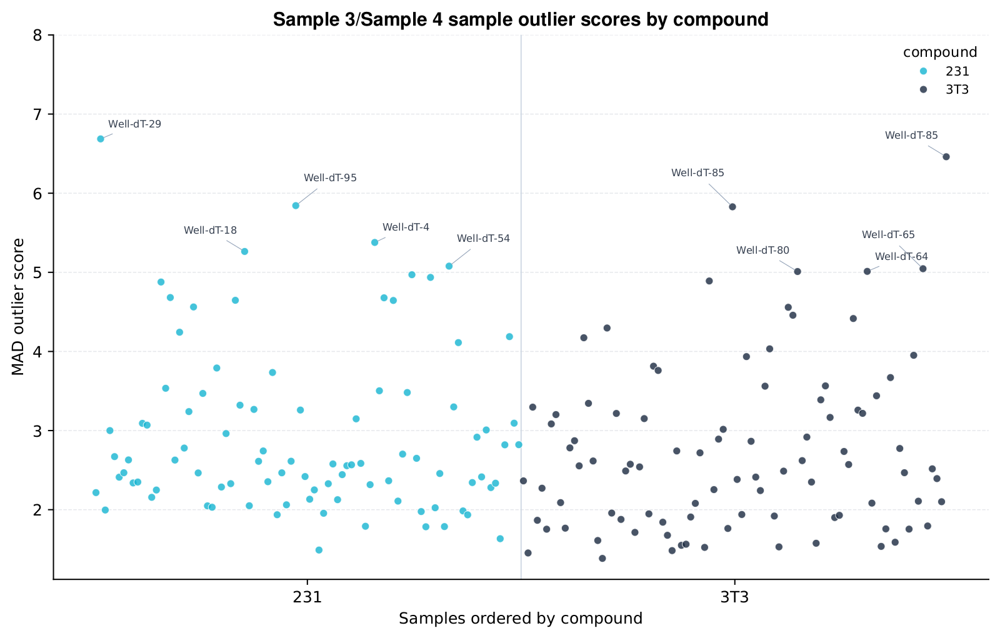

**Sample outlier scores colored by compound.** The MAD score is unchanged from the plate-colored view. Only point color and sample ordering change, making compound-associated QC patterns easier to inspect.

### UMI density

`ds.generate_umi_density_figure()` creates only the total-UMI distribution figure and uses the same configurable grouping and palette interface.

```python
umi_density_files = ds.generate_umi_density_figure(
    dsd,
    output_dir="results/qc",
    formats=("png",),
    groupby="plate_id",
    palette="colorblind",
)
```

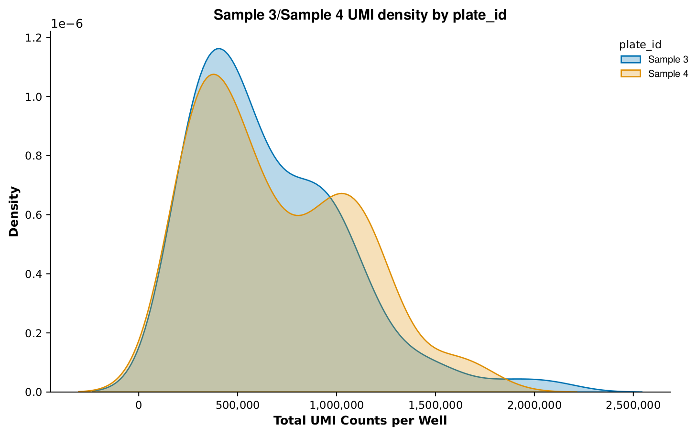

**Per-well UMI density.** The density shape compares library-size distributions between Sample 3 and Sample 4 using plate names, not positional codes.

### Detected-gene density

`ds.generate_detected_gene_density_figure()` creates only the detected-gene distribution figure and uses the same configurable grouping and palette interface.

```python
gene_density_files = ds.generate_detected_gene_density_figure(
    dsd,
    output_dir="results/qc",
    formats=("png",),
    groupby="plate_id",
    palette="colorblind",
)
```

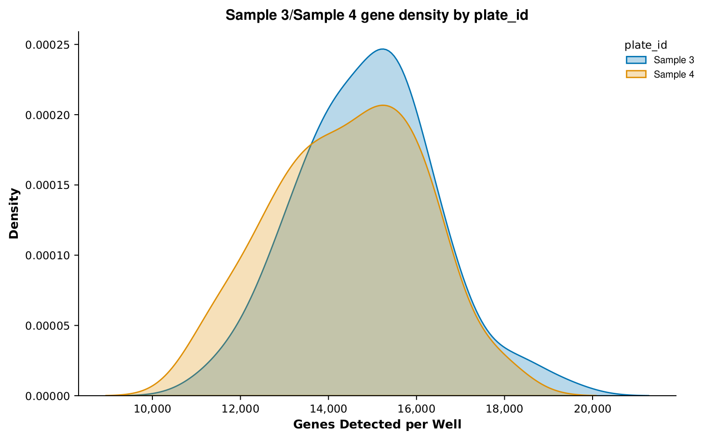

**Per-well detected-gene density.** A left-shifted plate would indicate lower sample complexity; a multimodal curve can indicate distinct well-quality populations.

**Combined wrapper.** `ds.generate_qc_distribution_figures()` now creates all four sample-QC outputs together: the selected violin metrics, outlier-score scatter, UMI density, and detected-gene density. The focused functions above remain useful when each code block should correspond to one figure.

<a id="plate-layout"></a>

## 3. Plate layouts

Plate maps are the fastest way to detect edge effects, dispensing failures, coordinate mistakes, and spatially structured signal. Sample 3/Sample 4 use an 8-row × 12-column layout. Well-dT numbering runs down rows within a column, so the first column contains Well-dT-1 through Well-dT-8. Use `palette` for categorical wells and `cmap` for continuous values.

`generate_plate_layout_figures()` creates exactly one figure per call. Supply exactly one color source: `plate_value` for an `obs` field, `plate_gene` for expression, or `well_color` for a fixed literal fill. There is no separate `legend_col`: a categorical legend always represents `plate_value`.

**Tip — empty wells.** White wells with a black border represent empty or missing positions on the physical plate. This convention is documented here instead of adding explanatory text inside every generated figure.

**Plate format and scaling.** The defaults `nrow=8` and `ncol=12` describe a 96-well plate. Use `nrow=16, ncol=24` for a standard 384-well plate or provide another exact grid. `plate_id` names the metadata column containing actual plate identities. `nrow_plate` is the maximum number of plate panels in one figure row; `1` stacks plates vertically. Continuous values use `log1p` by default and the bright blue-to-red `RdYlBu_r` map; use `log_values=False` for the original scale.

Every well has a border by default, including missing wells. Set `well_border=False` to remove all borders, or customize `well_border_color` and `well_border_width`. The panel and well sizes remain adjustable with `figsize` and `well_size`.

### Detected UMI count

```python
umi_plate = ds.generate_plate_layout_figures(
    dsd,
    output_dir="results/qc",
    formats=("png",),
    plate_value="total_umi",
    plate_id="plate_id",  # obs column containing actual plate identities
    continuous=True,
    log_values=True,      # default: color by log1p(total_umi)
    nrow=8, ncol=12,
    nrow_plate=1,         # maximum plate panels per figure row
    output_name="plate_layout_detected_umi",
    cmap="RdYlBu_r",
)
```

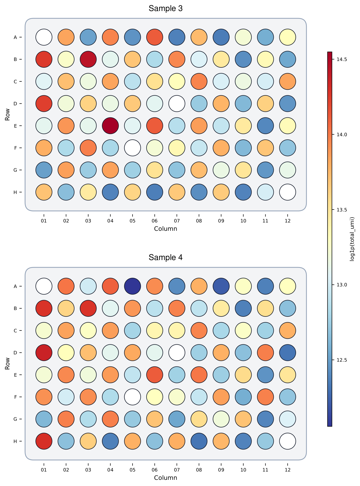

**Plate layout colored by detected UMI count.** Compare intensity within and between plates to find spatial gradients, edge effects, or isolated low-yield wells. Labels are intentionally omitted.

### Detected gene count

```python
gene_count_plate = ds.generate_plate_layout_figures(
    dsd,
    output_dir="results/qc",
    formats=("png",),
    plate_value="n_genes_det",
    continuous=True,
    log_values=True,
    nrow=8, ncol=12,
    nrow_plate=1,
    output_name="plate_layout_detected_genes",
    cmap="RdYlBu_r",
)
```

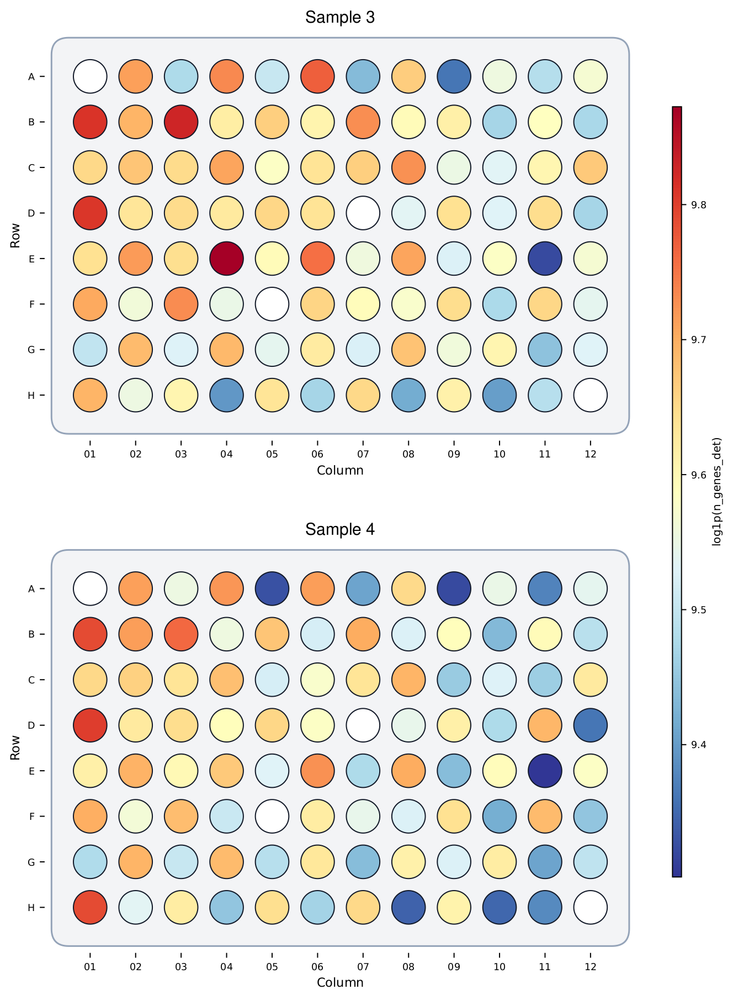

**Plate layout colored by detected gene count.** This is a library-complexity view. A well can have many UMIs but relatively few detected genes when a small number of transcripts dominate.

### Compound categories

```python
compound_plate = ds.generate_plate_layout_figures(
    dsd,
    output_dir="results/qc",
    formats=("png",),
    plate_value="compound",
    continuous=False,
    nrow=8, ncol=12,
    nrow_plate=1,
    output_name="plate_layout_compound",
    palette="colorblind",
)
```

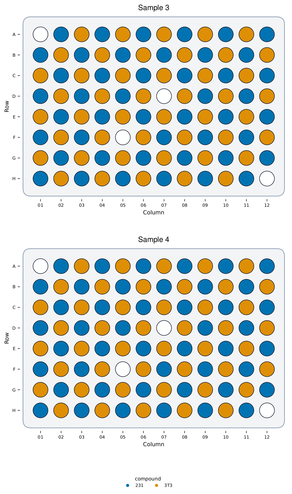

**Plate layout colored by compound.** The legend and well colors use the same categorical variable. This map checks randomization and the spatial placement of 231, 3T3, and water wells.

### Well labels with a fixed fill

`well_color="#E2E8F0"` sets the literal fill of occupied wells. It is not the name of a metadata field. `label_col` defaults to `None`; specifying it enables labels, whose color, size, style, and weight are adjustable. Here `nrow_plate=1` places one plate in each figure row, stacking Sample 3 and Sample 4 vertically and giving each label substantially more display space.

```python
well_id_plate = ds.generate_plate_layout_figures(
    dsd,
    output_dir="results/qc",
    formats=("png",),
    well_color="#E2E8F0",  # literal fill for occupied wells
    label_col="well_id",
    show_legend=False,
    nrow=8, ncol=12,
    nrow_plate=1,  # one plate per row; stack Sample 3 and Sample 4
    output_name="plate_layout_well_id",
    well_size=0.88,
    well_border=True,
    well_border_color="#111827",
    well_border_width=0.8,
    label_color="#111827",
    label_size=6,
    label_style="normal",
    label_weight="normal",
)
```

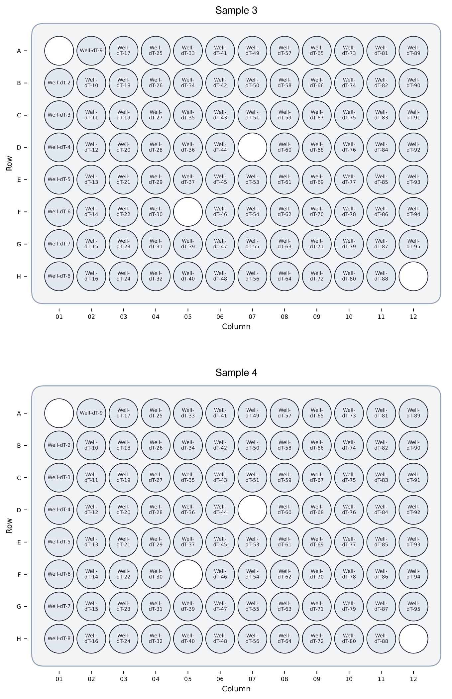

**Plate layout labeled by well ID.** Occupied wells use a pale fill so labels remain legible. Numbering is column-major: 1–8 down the first column.

### Single-gene expression

When `plate_gene` is one string, the map displays only that gene's per-well expression. This worked example uses `"FN1"`. If multiple features share the requested symbol, their counts are summed for that gene.

```python
expression_plate = ds.generate_plate_layout_figures(
    dsd,
    output_dir="results/qc",
    formats=("png",),
    plate_gene="FN1",
    continuous=True,
    log_values=True,
    nrow=8, ncol=12,
    nrow_plate=1,
    output_name="plate_layout_gene_expression",
    cmap="RdYlBu_r",
)
```

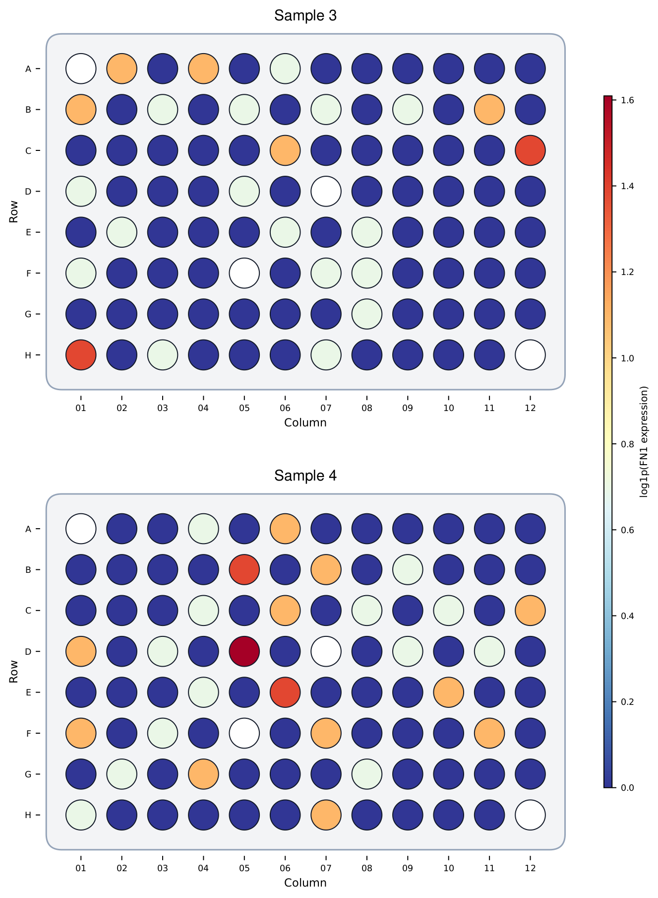

**Spatial FN1 expression.** A real single-gene expression map generated for FN1. The same call accepts any available gene symbol or feature ID.

### Gene-set expression

When `plate_gene` is a list, each requested gene is resolved and summarized separately before the per-well values are combined. `gene_aggregation="mean"` is the default; `"sum"` and `"median"` are also supported. All requested genes must be present, preventing a partially matched signature from being plotted silently.

```python
geneset_plate = ds.generate_plate_layout_figures(
    dsd,
    output_dir="results/qc",
    formats=("png",),
    plate_gene=["FN1", "CDH2"],
    gene_aggregation="mean",  # alternatives: "sum" or "median"
    continuous=True,
    log_values=True,
    nrow=8, ncol=12,
    nrow_plate=1,
    output_name="plate_layout_gene_set_expression",
    cmap="RdYlBu_r",
)
```

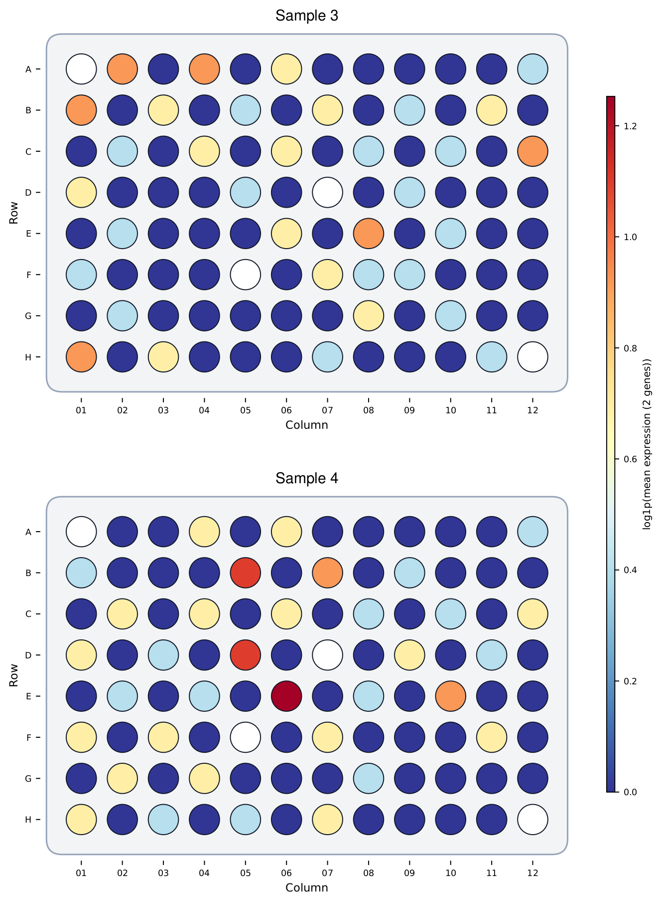

**Spatial FN1/CDH2 gene-set expression.** Each gene is first resolved independently and duplicate features for that gene are summed. The displayed value is then the mean expression across FN1 and CDH2 for each well.

<a id="gene-qc"></a>

## 4. Gene summaries and markers

### Gene-level UMI distributions

`ds.generate_gene_umi_distribution_figures()` is dedicated to feature-level total-UMI distributions. `identifier_types=None` draws both Ensembl-ID and gene-symbol views by default. Pass `"ensembl_id"` or `"gene_symbol"` to generate only one. The default `groupby="plate_id"` calculates feature totals independently for every plate and overlays those distributions by color; it no longer collapses every sample before plotting.

```python
gene_umi_files = ds.generate_gene_umi_distribution_figures(
    dsd,
    output_dir="results/qc",
    formats=("png",),
    identifier_types=["ensembl_id", "gene_symbol"],  # default: both
    groupby="plate_id",  # separate per-group totals, overlaid by color
    palette="colorblind",
)
```

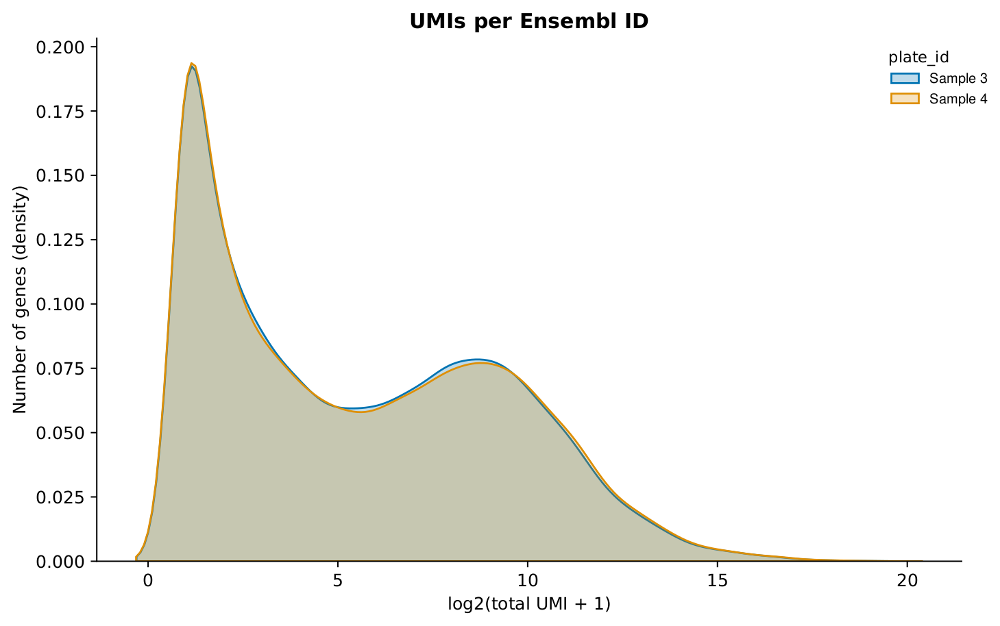

**UMI totals per Ensembl ID.** This density uses group-specific feature totals from the actual matrix. groupby='plate\_id' overlays the Sample 3 and Sample 4 curves by color in one axes.

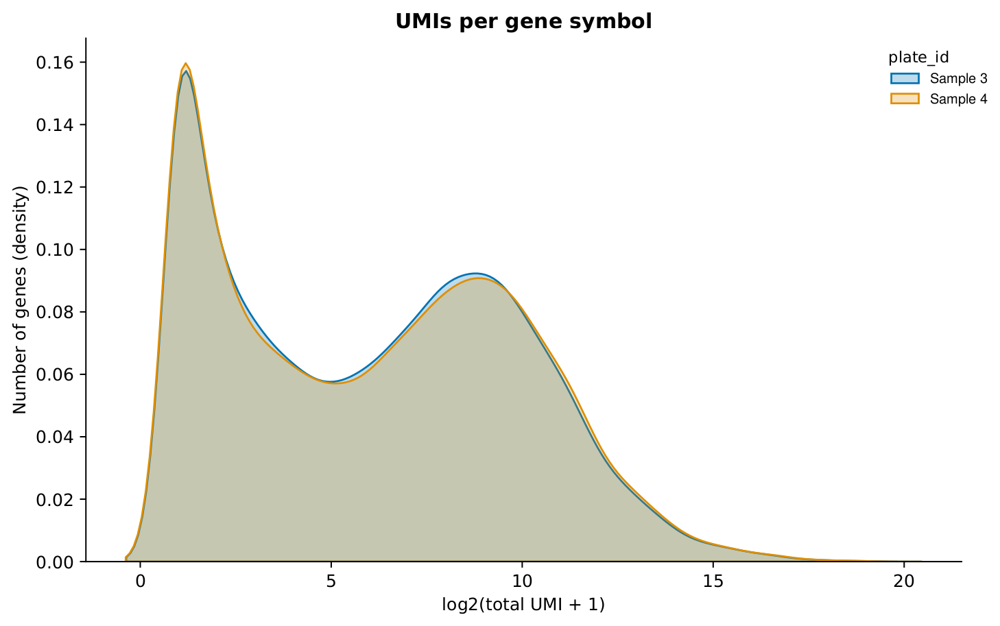

**UMI totals per gene symbol.** This companion density uses group-specific totals for features with human-readable symbols; Sample 3 and Sample 4 remain overlaid rather than split into separate panels.

### Specific marker-gene panel

`ds.generate_marker_gene_figure()` accepts an explicit ordered marker list. The worked example supplies the actual MDA-MB-231 panel rather than using `None`: VIM, FN1, CDH2, CD44, EGFR, MMP9, TGFB1, SNAI1, TWIST1, and ITGB1. Here `groupby="compound"` compares the treatment categories `3T3` and `231` within each axes, while `split_by="plate_id"` creates separate Sample 3 and Sample 4 panels. Water controls are retained in `dsd` but excluded from the marker-only copy.

```python
mda_mb_231_markers = [
    "VIM", "FN1", "CDH2", "CD44", "EGFR",
    "MMP9", "TGFB1", "SNAI1", "TWIST1", "ITGB1",
]
# This marker comparison focuses on the two biological treatment/species
# groups; water controls remain in the main QC object and other figures.
marker_dsd = dsd.subset(
    obs_mask=dsd.obs["compound"].astype(str).isin(["3T3", "231"]),
)
marker_files = ds.generate_marker_gene_figure(
    marker_dsd,
    output_dir="results/qc",
    marker_genes=mda_mb_231_markers,
    formats=("png",),
    groupby="compound",   # treatment groups: 3T3 and 231
    split_by="plate_id",  # separate Sample 3 and Sample 4 panels
    nrow_plate=5,
    palette="colorblind",
)
```

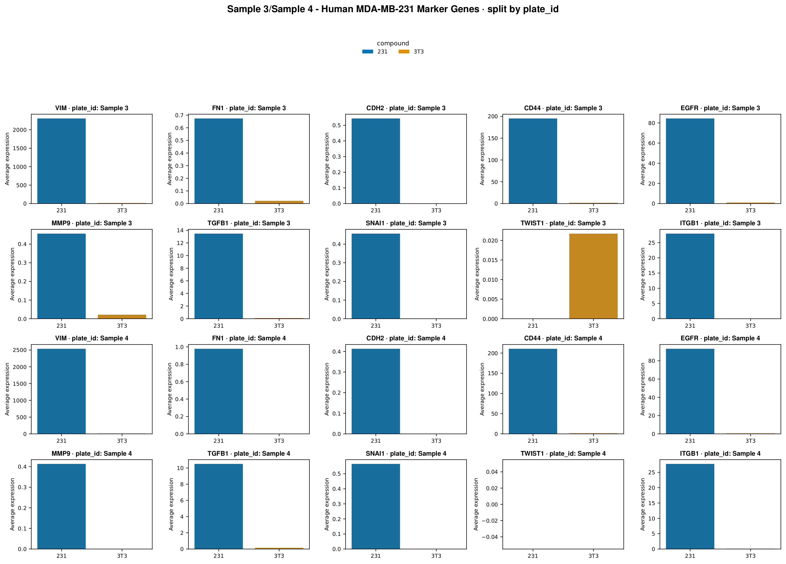

**MDA-MB-231 marker expression by treatment and plate.** Within each Sample 3 or Sample 4 facet, bars compare mean raw expression between the 3T3 and 231 treatment groups. Water controls are omitted from this marker-specific comparison. Interpret the panel as an identity/signal check, not a differential-expression test.

### Marker dot plot

`ds.generate_marker_gene_dotplot_figure()` summarizes two complementary quantities in one compact panel: color is the group mean expression and dot area is the percentage of wells with expression greater than zero. The saved table also records the number of wells contributing to each dot.

```python
marker_dotplot_files = ds.generate_marker_gene_dotplot_figure(
    marker_dsd,
    output_dir="results/qc",
    marker_genes=mda_mb_231_markers,
    formats=("png",),
    groupby="compound",   # treatment groups: 3T3 and 231
    split_by="plate_id",  # separate Sample 3 and Sample 4 panels
    nrow_plate=5,        # five gene/plate panels per row
    cmap="RdYlBu_r",
    dot_min_size=18,
    dot_max_size=280,
)
```

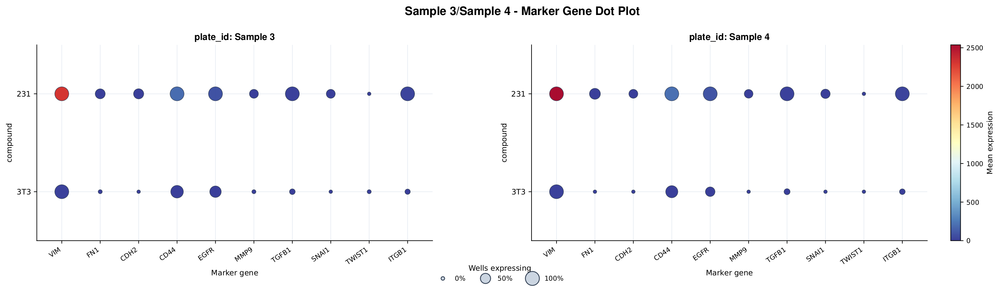

**Marker-expression dot plot.** Color reports mean raw expression and dot area reports the percentage of wells with nonzero expression. Rows compare 3T3 and 231, while separate panels show Sample 3 and Sample 4.

### Marker violin plot

`ds.generate_marker_gene_violin_figure()` retains the per-well distributions hidden by group means. Every gene receives an independent panel and y-axis; with `split_by="plate_id"`, each gene receives one Sample 3 panel and one Sample 4 panel. The 231 and 3T3 violins remain side by side within each panel. It shows raw expression by default; set `log_values=True` when a long upper tail compresses the lower part of the violins.

```python
marker_violin_files = ds.generate_marker_gene_violin_figure(
    marker_dsd,
    output_dir="results/qc",
    marker_genes=mda_mb_231_markers,
    formats=("png",),
    groupby="compound",   # treatment groups: 3T3 and 231
    split_by="plate_id",  # separate Sample 3 and Sample 4 panels
    nrow_plate=5,
    palette="colorblind",
    log_values=False,      # show raw per-well expression
)
```

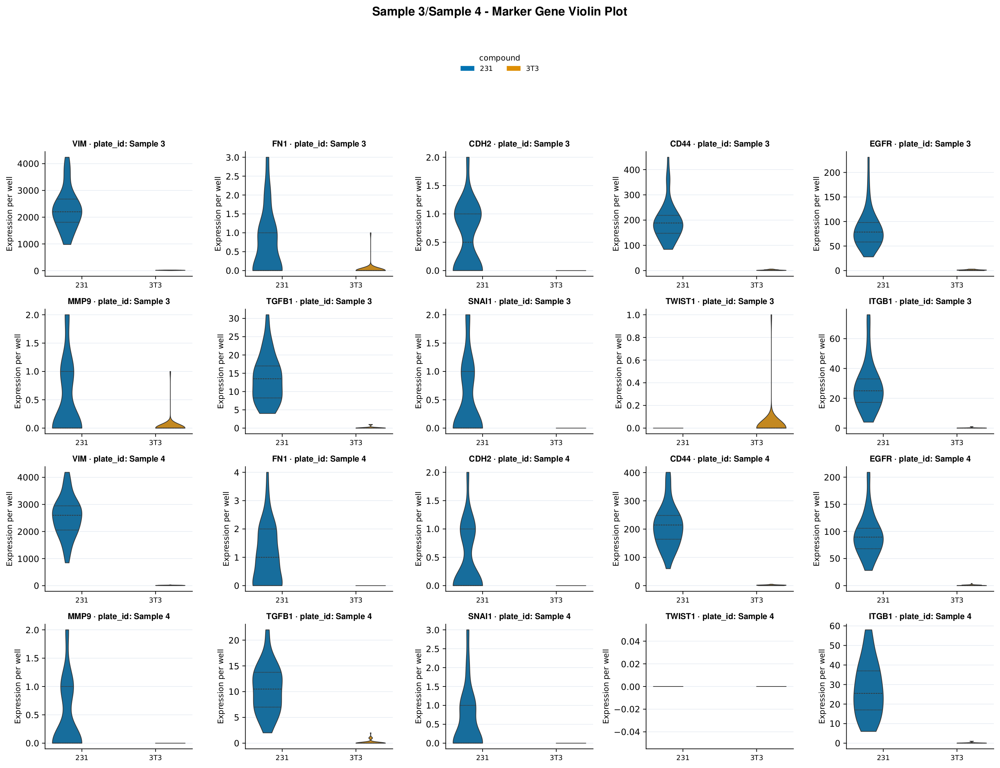

**Marker-expression violin plot.** Each gene has its own panel and independent y-axis. Within a panel, side-by-side violins show the full per-well raw-expression distributions for 231 and 3T3; Sample 3 and Sample 4 are represented by separate gene panels.

**Compatibility wrapper.** `ds.generate_gene_summary_figures()` remains available for existing scripts and delegates to the UMI-distribution and grouped-bar functions. Call the dot-plot and violin functions independently when those views are required.

<a id="star-qc"></a>

## 5. STARsolo read-level QC (Optional)

This optional section requires separately supplied STARsolo read-level outputs; they are not included in the synthetic practice bundle. Skip these calls until your files are available under `data/star_results`, or set `star_root` to a directory with the following structure:

```text
data/star_results/
├── Sample 3/Solo.out/Gene/
│  ├── Summary.csv
│  ├── CellReads.stats
│  └── filtered/barcodes.tsv.gz
└── Sample 4/Solo.out/Gene/
   ├── Summary.csv
   ├── CellReads.stats
   └── filtered/barcodes.tsv.gz
```

`Summary.csv` is required for the read-summary doughnut. `CellReads.stats` must contain `CB`, `cbMatch`, and `nGenesUnique` for saturation. `filtered/barcodes.tsv.gz` selects retained barcodes when present; otherwise non-pass-list rows are excluded. `groupby` defaults to `plate_id`. For the read-summary figure, each plate must map to exactly one grouping value.

### Read-summary doughnut

```python
from pathlib import Path

star_root = Path.cwd() / "data" / "star_results"
star_read_files = ds.generate_star_read_qc_figure(
    dsd,
    star_root=star_root,
    output_dir="results/qc",
    formats=("png",),
    groupby="plate_id",
    split_by=None,       # default: one axes, plate_id controls colors
    palette="colorblind",
)
```

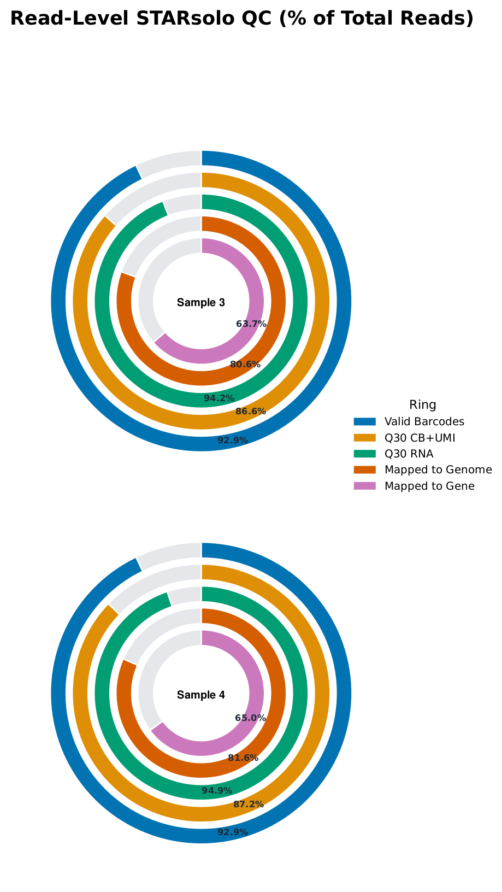

**STARsolo read-level QC.** Concentric rings report valid barcodes, Q30 CB+UMI, Q30 RNA, uniquely genome-mapped reads, and uniquely gene-mapped reads as percentages.

### Reads per well

`ds.generate_star_read_count_violin_figure()` reads `cbMatch` from `CellReads.stats` and retains every analyzed well in `dsd`. The violin and overlaid points show the full per-well distribution for each plate; the mean and median labels are placed above the corresponding violin. A well without a matching STAR barcode is represented by zero reads and `matched_star_record=False` in the saved table rather than silently disappearing.

```python
star_read_count_files = ds.generate_star_read_count_violin_figure(
    dsd,
    star_root=star_root,
    output_dir="results/qc",
    formats=("png",),
    groupby="plate_id",
    palette={"Sample 3": "#16B4D1", "Sample 4": "#1B2A40"},
    point_color="#253746",
    annotation_color="#D32F2F",
)
```

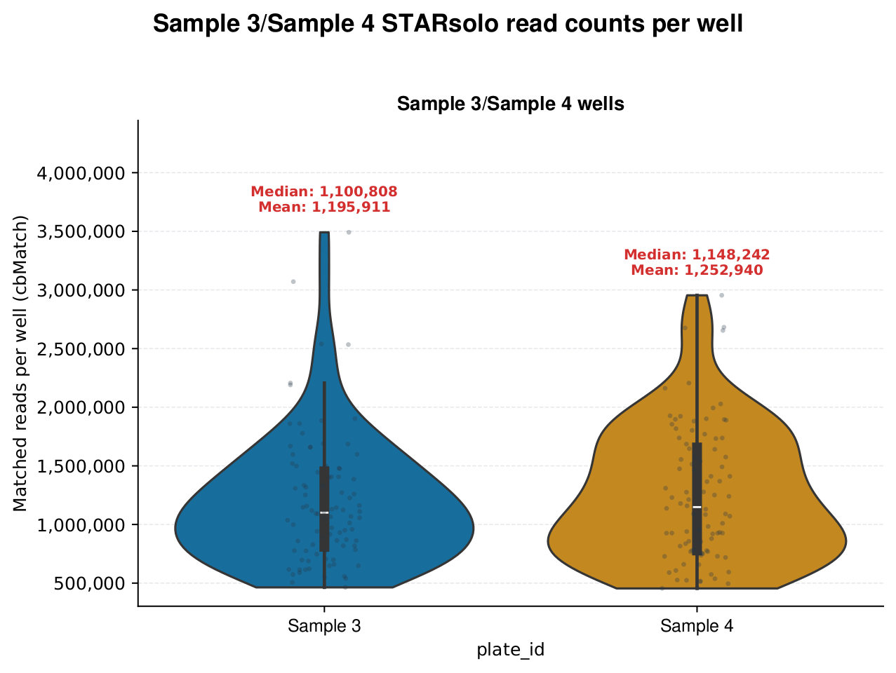

**STAR matched reads per well.** Each point is an analyzed well and violin fills compare plates. Mean and median matched-read counts are labeled above each plate distribution; wells lacking a matching STAR record remain in the source table with zero reads and an explicit false match flag.

### Read-depth saturation

These saturation diagnostics compare read counts with detected genes across wells; they are not curves obtained by downsampling each library. They use original read and detected-gene values rather than log-scaled axes. `groupby` controls point color and keeps all groups in one axes by default. The red median label is placed at the upper-left outside the data region so it does not hide points.

#### Grouped in one axes (default)

```python
star_saturation_files = ds.generate_star_saturation_figures(
    dsd,
    star_root=star_root,
    output_dir="results/qc",
    formats=("png",),
    groupby="plate_id",
    nrow_plate=1,
    palette="colorblind",
)
```

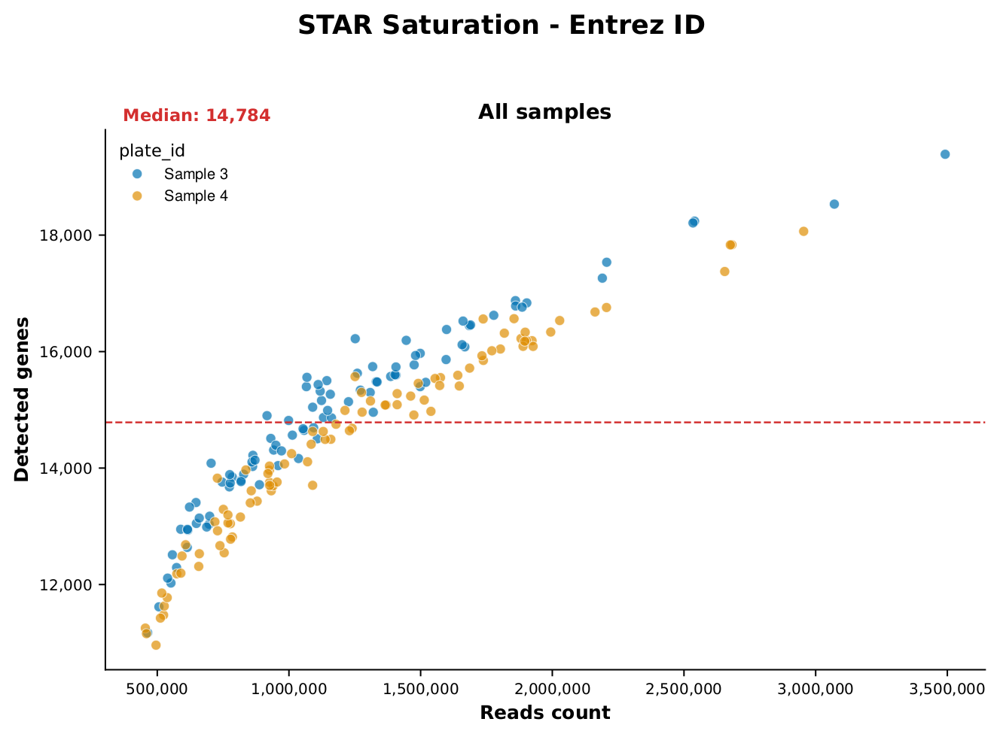

**STAR read saturation: Ensembl IDs.** Raw read counts are on the x-axis and detected genes on the y-axis. The values are not log-transformed; a plateau suggests additional reads recover fewer new genes.

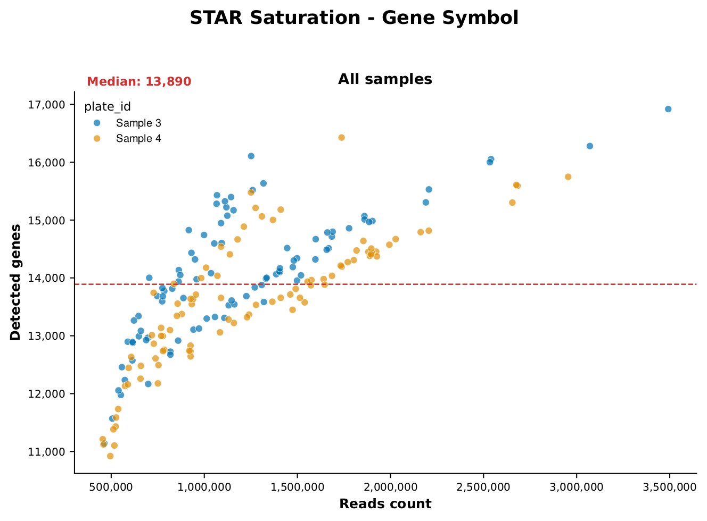

**STAR read saturation: gene symbols.** The same raw-scale saturation diagnostic using detected gene-symbol features. The dashed horizontal line is the median detected-gene count.

#### Split into separate panels

Set `split_by="plate_id"` when separate plate panels are useful. `nrow_plate` then controls the maximum number of split panels per row. The split output receives a `_split_by_plate_id` filename suffix and therefore does not overwrite the grouped figure.

```python
star_saturation_split_files = ds.generate_star_saturation_figures(
    dsd,
    star_root=star_root,
    output_dir="results/qc",
    formats=("png",),
    groupby="plate_id",  # colors within each panel
    split_by="plate_id", # one panel per plate
    nrow_plate=2,
    palette="colorblind",
)
```

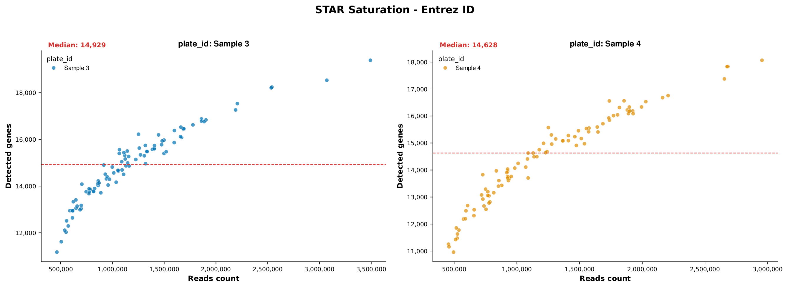

**Split saturation: Ensembl IDs.** Setting split\_by='plate\_id' creates one panel per plate while groupby still controls point colors within each panel.

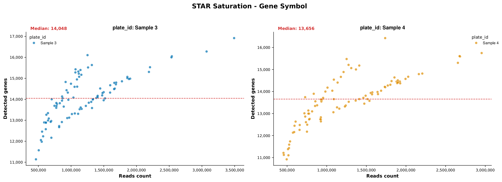

**Split saturation: gene symbols.** The split view is useful when overplotting obscures plate-specific trends. Median labels sit outside the data region at the upper-left of each axes.

<a id="subsetting"></a>

## 6. Subset wells and genes

Subsetting is optional. The examples below always create a new `DrugSeqData` object and leave `dsd` unchanged. Keep the full object through QC review whenever possible, record every applied mask or threshold, and save the excluded identifiers for auditability.

### Keep specific wells

Use `dsd.subset(obs_mask=...)` for an explicit well list or any Boolean metadata condition. Because `well_id` is reused on every plate, combine it with `plate_id` when selecting individual wells.

```python
# Keep explicit wells. Include plate_id because well_id repeats across plates.
wells_to_keep = {
    ("Sample 3", "Well-dT-2"),
    ("Sample 3", "Well-dT-4"),
    ("Sample 4", "Well-dT-2"),
    ("Sample 4", "Well-dT-4"),
}
well_keys = list(zip(dsd.obs["plate_id"], dsd.obs["well_id"]))
well_mask = [key in wells_to_keep for key in well_keys]
dsd_selected_wells = dsd.subset(obs_mask=well_mask)
print(dsd_selected_wells)
```

### Keep specific genes

Use `dsd.subset(var_mask=...)` for an explicit gene panel. Matching both stable feature IDs and `gene_symbol` prevents accidental misses when users provide a mixture of identifier types. The same method accepts both `obs_mask` and `var_mask` to subset wells and genes together.

```python
# Gene requests may contain stable feature IDs, symbols, or both.
genes_to_keep = {"FN1", "CDH2"}
gene_mask = dsd.var_names.isin(genes_to_keep)
if "gene_symbol" in dsd.var:
    gene_mask |= dsd.var["gene_symbol"].isin(genes_to_keep).to_numpy()
dsd_selected_genes = dsd.subset(var_mask=gene_mask)
print(dsd_selected_genes)

# Both dimensions can be subset in one operation.
dsd_selected = dsd.subset(obs_mask=well_mask, var_mask=gene_mask)
```

### Optionally remove low-quality wells

`ds.filter_samples()` applies reviewed limits for UMI yield, detected genes, mitochondrial/ribosomal percentages, housekeeping metrics, and the MAD outlier score. It requires QC metrics first and returns a new object. The quantiles below are only an adaptive demonstration—not recommended universal cutoffs. Examine the candidate table, plate layouts, controls, and experimental design before filtering.

```python
# QC filtering is optional. Calculate and inspect metrics before filtering.
qc_for_filtering = dsd.copy()
ds.compute_qc_metrics(qc_for_filtering, inplace=True)

# Illustrative, data-adaptive review thresholds—not universal cutoffs.
thresholds = {
    "min_umi": qc_for_filtering.obs["total_umi"].quantile(0.01),
    "min_genes": qc_for_filtering.obs["n_genes_det"].quantile(0.01),
    "max_pct_mito": qc_for_filtering.obs["pct_mito"].quantile(0.99),
    "max_outlier_score": qc_for_filtering.obs["outlier_score"].quantile(0.99),
}
review_mask = (
    (qc_for_filtering.obs["total_umi"] < thresholds["min_umi"])
    | (qc_for_filtering.obs["n_genes_det"] < thresholds["min_genes"])
    | (qc_for_filtering.obs["pct_mito"] > thresholds["max_pct_mito"])
    | (qc_for_filtering.obs["outlier_score"] > thresholds["max_outlier_score"])
)
review_table = qc_for_filtering.obs.loc[
    review_mask,
    ["sample_id", "plate_id", "well_id", "total_umi", "n_genes_det",
     "pct_mito", "outlier_score"],
]
print(review_table.to_string(index=False))

# Apply only after reviewing the candidates and experimental controls.
dsd_quality_wells = ds.filter_samples(
    qc_for_filtering,
    **thresholds,
    keep_sample_types=["DMSO", "vehicle", "positive_ctrl", "negative_ctrl"],
)
```

**Protect controls deliberately.** By default, `ds.filter_samples()` exempts DMSO, vehicle, and positive/negative controls from library-QC thresholds. Pass `keep_sample_types=[]` only when intentionally allowing those controls to be removed. Water/media behavior depends on its `sample_type` value and should be reviewed explicitly.

### Optionally remove low-expression genes

`ds.filter_genes()` filters raw counts and returns a new object. For perturbation screens, `group_aware=True` retains a gene if it passes in at least one treatment group, protecting genes induced only by particular compounds. Apply well filtering first when failed wells would distort expression prevalence.

```python
# Retain genes expressed in >=3 wells in at least one compound group.
# min_cpm=1 adds an experiment-wide CPM requirement in >=3 wells.
dsd_quality_genes = ds.filter_genes(
    dsd,
    min_count=1,
    min_samples=3,
    group_aware=True,
    group_col="compound",
    min_cpm=1,
    min_cpm_samples=3,
    remove_mito=False,
    remove_ribo=False,
)
```

**Feature-name patterns.** `remove_mito=True` and `remove_ribo=True` match `mito_pattern`/`ribo_pattern` against feature names. When `var_names` are Ensembl IDs, use an explicit symbol-aware mask or map symbols before relying on those options.

<a id="complete-report"></a>

## 7. Complete automated report

`ds.generate_qc_report()` is the batch entry point after the individual operations are understood. Internally it runs `ds.compute_qc_metrics()`, `ds.validate_metadata()`, and, when suitable sample-type metadata exist, `ds.compute_plate_qc()`. It then calls `ds.generate_plate_layout_figures()`, `ds.generate_qc_metric_violin_figure()`, `ds.generate_outlier_score_scatter_figure()`, `ds.generate_umi_density_figure()`, `ds.generate_detected_gene_density_figure()`, `ds.generate_gene_umi_distribution_figures()`, `ds.generate_marker_gene_figure()`, and—when `star_root` is supplied—the focused `ds.generate_star_read_qc_figure()`, `ds.generate_star_read_count_violin_figure()`, and `ds.generate_star_saturation_figures()` functions. It also writes the sample metrics, metadata audit, source tables, and a producer-aware figure manifest. The separately grouped compound outlier view in the script is an additional focused call so it can coexist with the report's default plate-colored view.

The following complete script applies the same workflow to the tutorial input layout. It generates new results from your inputs; the historical figures and numbers above remain interpretation examples. Optional read-level figures run only when the STARsolo directory exists.

```python
from pathlib import Path
import pandas as pd
import drugseqpy as ds

# Run from the tutorial repository root.
objects = []
for number in (3, 4):
    folder = Path("data") / f"sample_{number}"
    obj = ds.create_drugseq_from_files(
        folder / "matrix", folder / "metadata.csv",
        metadata_key="barcode", min_overlap=1.0,
    )
    obj.adata.obs_names = obj.obs["sample_id"].astype(str)
    assert obj.obs_names.is_unique
    objects.append(obj)

dsd = ds.merge_drugseq_objects(*objects, batch_key="source_plate")
assert dsd.obs_names.is_unique
for folder in ("qc", "species", "batch", "reproducibility", "comparison"):
    (Path("results") / folder).mkdir(parents=True, exist_ok=True)
print(dsd)

output_dir = Path("results/qc")
star_root = Path("data/star_results")

# Complete batch report, including optional STARsolo figures when available.
all_files = ds.generate_qc_report(
    dsd,
    output_dir=output_dir,
    formats=("png",),
    star_root=star_root if star_root.exists() else None,
    marker_genes=[
        "VIM", "FN1", "CDH2", "CD44", "EGFR",
        "MMP9", "TGFB1", "SNAI1", "TWIST1", "ITGB1",
    ],
    gene_umi_identifier_types=["ensembl_id", "gene_symbol"],
    plate_gene="FN1",
    plate_gene_set=["FN1", "CDH2"],
    plate_gene_aggregation="mean",
    plate_nrow=8,
    plate_ncol=12,
    nrow_plate=1,
    violin_metrics=None,  # all four defaults; or provide a subset
    groupby="plate_id",
    split_by=None,        # combine groups unless faceting is requested
    palette="colorblind",
    cmap="RdYlBu_r",
    outlier_threshold=None,
    label_outliers=True,
)

# Add a second outlier view without replacing the plate-colored default.
compound_outlier_files = ds.generate_outlier_score_scatter_figure(
    dsd,
    output_dir=output_dir,
    formats=("png",),
    groupby="compound",
    palette={"231": "#16B4D1", "3T3": "#1B2A40", "water": "#64748B"},
    label_outliers=True,
    output_name="Samples_3_4_Outlier_Score_Scatter_by_compound",
)
all_files.extend(compound_outlier_files)

# Regroup only the marker panel by treatment and split it by plate.
marker_dsd = dsd.subset(
    obs_mask=dsd.obs["compound"].astype(str).isin(["3T3", "231"]),
)
marker_files = ds.generate_marker_gene_figure(
    marker_dsd,
    output_dir=output_dir,
    marker_genes=[
        "VIM", "FN1", "CDH2", "CD44", "EGFR",
        "MMP9", "TGFB1", "SNAI1", "TWIST1", "ITGB1",
    ],
    formats=("png",),
    groupby="compound",
    split_by="plate_id",
    nrow_plate=5,
    palette="colorblind",
)
all_files.extend(marker_files)
dotplot_files = ds.generate_marker_gene_dotplot_figure(
    marker_dsd,
    output_dir=output_dir,
    marker_genes=[
        "VIM", "FN1", "CDH2", "CD44", "EGFR",
        "MMP9", "TGFB1", "SNAI1", "TWIST1", "ITGB1",
    ],
    formats=("png",),
    groupby="compound",
    split_by="plate_id",
    nrow_plate=2,
    cmap="RdYlBu_r",
)
all_files.extend(dotplot_files)
violin_files = ds.generate_marker_gene_violin_figure(
    marker_dsd,
    output_dir=output_dir,
    marker_genes=[
        "VIM", "FN1", "CDH2", "CD44", "EGFR",
        "MMP9", "TGFB1", "SNAI1", "TWIST1", "ITGB1",
    ],
    formats=("png",),
    groupby="compound",
    split_by="plate_id",
    nrow_plate=5,
    palette="colorblind",
    log_values=False,
)
all_files.extend(violin_files)
print(f"Generated {len(all_files)} figure files in {output_dir}")
```

<a id="tables"></a>

## 8. Saved result tables

The report saves data behind the visualizations so a flagged well or summary value can be inspected without reverse-engineering a plot.

### Sample QC metrics

**Generated by:** `ds.generate_qc_report()`, using metrics from `ds.compute_qc_metrics()`.

| sample\_id | plate\_id | well\_id | compound | total\_umi | n\_genes\_det | pct\_mito | pct\_ribo | outlier\_score |
| --- | --- | --- | --- | --- | --- | --- | --- | --- |
| Sample 3\_AAGATCAATT | Sample 3 | Well-dT-34 | 231 | 8.83e+05 | 1.57e+04 | 9.74 | 14.9 | 2.22 |
| Sample 3\_AAGATTAACC | Sample 3 | Well-dT-19 | 3T3 | 5.18e+05 | 1.55e+04 | 6.22 | 0.253 | 2.36 |
| Sample 3\_AAGTAAGCGT | Sample 3 | Well-dT-58 | 3T3 | 4.65e+05 | 1.47e+04 | 7.48 | 0.264 | 1.45 |
| Sample 3\_AATACTCGAT | Sample 3 | Well-dT-71 | 3T3 | 5.1e+05 | 1.42e+04 | 6.4 | 0.199 | 3.3 |
| Sample 3\_AATCAGTGGA | Sample 3 | Well-dT-39 | 3T3 | 3.45e+05 | 1.39e+04 | 9.01 | 0.275 | 1.87 |
| Sample 3\_AATCTACAAG | Sample 3 | Well-dT-12 | 3T3 | 5.36e+05 | 1.53e+04 | 5.99 | 0.267 | 2.27 |

Showing 6 of 184 rows from `sample_qc_metrics.csv`.

### QC violin plotting table

**Generated by:** `ds.generate_qc_metric_violin_figure()`.

| metadata\_index | plate\_id | mt.pct | ribo.pct | total\_umi | n\_genes\_det |
| --- | --- | --- | --- | --- | --- |
| Sample 3\_AAGATCAATT | Sample 3 | 9.74 | 14.9 | 8.83e+05 | 1.57e+04 |
| Sample 3\_AAGATTAACC | Sample 3 | 6.22 | 0.253 | 5.18e+05 | 1.55e+04 |
| Sample 3\_AAGTAAGCGT | Sample 3 | 7.48 | 0.264 | 4.65e+05 | 1.47e+04 |
| Sample 3\_AATACTCGAT | Sample 3 | 6.4 | 0.199 | 5.1e+05 | 1.42e+04 |
| Sample 3\_AATCAGTGGA | Sample 3 | 9.01 | 0.275 | 3.45e+05 | 1.39e+04 |
| Sample 3\_AATCTACAAG | Sample 3 | 5.99 | 0.267 | 5.36e+05 | 1.53e+04 |

Showing 6 of 184 rows from `qc_metric_violin_plot_table.csv`.

### Outlier-score plotting table

**Generated by:** `ds.generate_outlier_score_scatter_figure()`.

| sample\_order | sample\_id | plate\_id | well\_id | compound | outlier\_score | above\_threshold |
| --- | --- | --- | --- | --- | --- | --- |
| 1 | Sample 3\_AAGATCAATT | Sample 3 | Well-dT-34 | 231 | 2.22 | False |
| 2 | Sample 3\_AAGATTAACC | Sample 3 | Well-dT-19 | 3T3 | 2.36 | False |
| 3 | Sample 3\_AAGTAAGCGT | Sample 3 | Well-dT-58 | 3T3 | 1.45 | False |
| 4 | Sample 3\_AATACTCGAT | Sample 3 | Well-dT-71 | 3T3 | 3.3 | False |
| 5 | Sample 3\_AATCAGTGGA | Sample 3 | Well-dT-39 | 3T3 | 1.87 | False |
| 6 | Sample 3\_AATCTACAAG | Sample 3 | Well-dT-12 | 3T3 | 2.27 | False |

Showing 6 of 184 rows from `outlier_score_plot_table.csv`.

### Compound-colored outlier plotting table

**Generated by:** the second `ds.generate_outlier_score_scatter_figure()` call with `groupby="compound"` and a custom `output_name`.

| sample\_order | sample\_id | plate\_id | well\_id | compound | outlier\_score | above\_threshold |
| --- | --- | --- | --- | --- | --- | --- |
| 1 | Sample 3\_AAGATCAATT | Sample 3 | Well-dT-34 | 231 | 2.22 | False |
| 2 | Sample 3\_AATGCCAGTT | Sample 3 | Well-dT-29 | 231 | 6.69 | False |
| 3 | Sample 3\_ACACACCAGA | Sample 3 | Well-dT-89 | 231 | 2 | False |
| 4 | Sample 3\_ACGTTGAATA | Sample 3 | Well-dT-77 | 231 | 3 | False |
| 5 | Sample 3\_ACTACGGTCG | Sample 3 | Well-dT-27 | 231 | 2.67 | False |
| 6 | Sample 3\_ACTGGTAAGA | Sample 3 | Well-dT-61 | 231 | 2.41 | False |

Showing 6 of 184 rows from `Samples_3_4_Outlier_Score_Scatter_by_compound_plot_table.csv`.

### Plate-coordinate audit

**Generated by:** `ds.generate_plate_layout_figures()`.

| plate\_id | sample\_id | well\_id | row | column | row\_label | is\_missing\_well |
| --- | --- | --- | --- | --- | --- | --- |
| Sample 3 | NaN | Well-dT-1 | 1 | 1 | A | True |
| Sample 3 | Sample 3\_TTGAAGAAGC | Well-dT-9 | 1 | 2 | A | False |
| Sample 3 | Sample 3\_CGACGGACGA | Well-dT-17 | 1 | 3 | A | False |
| Sample 3 | Sample 3\_TAACATAGCA | Well-dT-25 | 1 | 4 | A | False |
| Sample 3 | Sample 3\_AGGTTAGGAG | Well-dT-33 | 1 | 5 | A | False |
| Sample 3 | Sample 3\_TCCTCCTGGC | Well-dT-41 | 1 | 6 | A | False |

Showing 6 of 192 rows from `plate_layout_coordinates.csv`.

### Gene-set resolution

**Generated by:** `ds.generate_plate_layout_figures()` for the FN1/CDH2 gene-set map.

| requested\_gene | feature\_id | gene\_symbol | matched\_by | aggregation |
| --- | --- | --- | --- | --- |
| FN1 | ENSG00000115414 | FN1 | gene\_symbol | mean |
| CDH2 | ENSG00000170558 | CDH2 | gene\_symbol | mean |

Showing 2 of 2 rows from `plate_layout_gene_set_expression_gene_resolution.csv`.

### Grouped gene-UMI distributions

**Generated by:** `ds.generate_gene_umi_distribution_figures()`.

| identifier\_type | plate\_id | gene | gene\_symbol | total\_umi | detected\_samples | log2\_total\_umi |
| --- | --- | --- | --- | --- | --- | --- |
| ensembl\_id | Sample 3 | ENSG00000142606 | MMEL1 | 1 | 1 | 1 |
| ensembl\_id | Sample 3 | ENSG00000048707 | VPS13D | 217 | 48 | 7.77 |
| ensembl\_id | Sample 3 | ENSG00000197921 | HES5 | 24 | 18 | 4.64 |
| ensembl\_id | Sample 3 | ENSG00000189337 | KAZN | 23 | 18 | 4.58 |
| ensembl\_id | Sample 3 | ENSG00000272420 | ENSG00000272420 | 14 | 11 | 3.91 |
| ensembl\_id | Sample 3 | ENSG00000130940 | CASZ1 | 31 | 21 | 5 |

Showing 6 of 182,931 rows from `gene_umi_distribution_plot_table.csv`.

### Marker-expression summary

**Generated by:** `ds.generate_marker_gene_figure()`.

| plate\_id | compound | gene | mean\_expression |
| --- | --- | --- | --- |
| Sample 3 | 231 | CD44 | 195 |
| Sample 3 | 231 | CDH2 | 0.543 |
| Sample 3 | 231 | EGFR | 84.4 |
| Sample 3 | 231 | FN1 | 0.674 |
| Sample 3 | 231 | ITGB1 | 28 |
| Sample 3 | 231 | MMP9 | 0.457 |

Showing 6 of 40 rows from `marker_expression_summary.csv`.

### Marker dot-plot summary

**Generated by:** `ds.generate_marker_gene_dotplot_figure()`.

| plate\_id | compound | gene | mean\_expression | pct\_expressing | n\_samples |
| --- | --- | --- | --- | --- | --- |
| Sample 3 | 231 | CD44 | 195 | 100 | 46 |
| Sample 3 | 231 | CDH2 | 0.543 | 50 | 46 |
| Sample 3 | 231 | EGFR | 84.4 | 100 | 46 |
| Sample 3 | 231 | FN1 | 0.674 | 47.8 | 46 |
| Sample 3 | 231 | ITGB1 | 28 | 100 | 46 |
| Sample 3 | 231 | MMP9 | 0.457 | 37 | 46 |

Showing 6 of 40 rows from `marker_dotplot_table.csv`.

### Marker violin plotting table

**Generated by:** `ds.generate_marker_gene_violin_figure()`.

| plate\_id | compound | gene | expression | plot\_expression |
| --- | --- | --- | --- | --- |
| Sample 3 | 231 | VIM | 2.27e+03 | 2.27e+03 |
| Sample 3 | 3T3 | VIM | 18 | 18 |
| Sample 3 | 3T3 | VIM | 23 | 23 |
| Sample 3 | 3T3 | VIM | 15 | 15 |
| Sample 3 | 3T3 | VIM | 17 | 17 |
| Sample 3 | 3T3 | VIM | 24 | 24 |

Showing 6 of 1,840 rows from `marker_violin_plot_table.csv`.

### Metadata audit

**Generated by:** `ds.generate_qc_report()`, using `ds.validate_metadata()`.

| ok | issues |
| --- | --- |
| False | Column 'dose' has 184 NA value(s). |

Showing 1 of 1 rows from `metadata_audit.csv`.

### STAR read summary

**Generated by:** `ds.generate_star_read_qc_figure()`.

| plate\_id | metric | fraction | percent |
| --- | --- | --- | --- |
| Sample 3 | Valid Barcodes | 0.929 | 92.9 |
| Sample 3 | Q30 CB+UMI | 0.866 | 86.6 |
| Sample 3 | Q30 RNA | 0.942 | 94.2 |
| Sample 3 | Mapped to Genome | 0.806 | 80.6 |
| Sample 3 | Mapped to Gene | 0.637 | 63.7 |
| Sample 4 | Valid Barcodes | 0.929 | 92.9 |

Showing 6 of 10 rows from `star_group_summary.csv`.

### STAR reads per well

**Generated by:** `ds.generate_star_read_count_violin_figure()`. The per-well table feeds the points and violins; the summary table supplies the labeled plate means and medians.

| sample\_id | plate\_id | barcode | read\_count | matched\_star\_record |
| --- | --- | --- | --- | --- |
| Sample 3\_AAGATCAATT | Sample 3 | AAGATCAATT | 1.41e+06 | True |
| Sample 3\_AAGATTAACC | Sample 3 | AAGATTAACC | 1.14e+06 | True |
| Sample 3\_AAGTAAGCGT | Sample 3 | AAGTAAGCGT | 1.05e+06 | True |
| Sample 3\_AATACTCGAT | Sample 3 | AATACTCGAT | 1.04e+06 | True |
| Sample 3\_AATCAGTGGA | Sample 3 | AATCAGTGGA | 8.28e+05 | True |
| Sample 3\_AATCTACAAG | Sample 3 | AATCTACAAG | 1.16e+06 | True |

Showing 6 of 184 rows from `star_read_count_per_well.csv`.

### STAR read-count summary

**Generated by:** `ds.generate_star_read_count_violin_figure()`.

| plate\_id | n\_wells | n\_matched\_star\_records | mean\_read\_count | median\_read\_count | min\_read\_count | max\_read\_count |
| --- | --- | --- | --- | --- | --- | --- |
| Sample 3 | 92 | 92 | 1.2e+06 | 1.1e+06 | 4.64e+05 | 3.49e+06 |
| Sample 4 | 92 | 92 | 1.25e+06 | 1.15e+06 | 4.55e+05 | 2.95e+06 |

Showing 2 of 2 rows from `star_read_count_summary.csv`.

### STAR saturation metrics

**Generated by:** `ds.generate_star_saturation_figures()`.

| sample\_id | plate\_id | cbMatch | nGenesUnique | entrez\_genes | symbol\_genes |
| --- | --- | --- | --- | --- | --- |
| Sample 3\_CTGTGAGCAG | Sample 3 | 1.13e+06 | 1.49e+04 | 1.49e+04 | 1.35e+04 |
| Sample 3\_CGACGGACGA | Sample 3 | 6.48e+05 | 1.3e+04 | 1.3e+04 | 1.3e+04 |
| Sample 3\_TTGATCTTAA | Sample 3 | 4.64e+05 | 1.12e+04 | 1.12e+04 | 1.11e+04 |
| Sample 3\_AGTTCCTGTC | Sample 3 | 6.6e+05 | 1.31e+04 | 1.31e+04 | 1.31e+04 |
| Sample 3\_TATATGCGTT | Sample 3 | 9.59e+05 | 1.4e+04 | 1.4e+04 | 1.4e+04 |
| Sample 3\_CATCAGTTGG | Sample 3 | 1.5e+06 | 1.54e+04 | 1.54e+04 | 1.4e+04 |

Showing 6 of 184 rows from `star_saturation_metrics.csv`.

### Figure manifest

**Generated by:** `ds.generate_qc_report()`; its `producer` column identifies the public function responsible for every figure.

| figure | producer |
| --- | --- |
| results/qc/plate\_layout\_detected\_umi.pdf | generate\_plate\_layout\_figures |
| results/qc/plate\_layout\_detected\_umi.png | generate\_plate\_layout\_figures |
| results/qc/plate\_layout\_detected\_genes.pdf | generate\_plate\_layout\_figures |
| results/qc/plate\_layout\_detected\_genes.png | generate\_plate\_layout\_figures |
| results/qc/plate\_layout\_compound.pdf | generate\_plate\_layout\_figures |
| results/qc/plate\_layout\_compound.png | generate\_plate\_layout\_figures |

Showing 6 of 34 rows from `qc_figure_manifest.csv`.

```text
Example output directory
results/qc/
├── plate_layout_*.png
├── plate_layout_*_plot_table.csv
├── plate_layout_*_gene_resolution.csv
├── plate_layout_*_per_gene_expression.csv
├── Samples_3_4_*.png
├── sample_qc_metrics.csv
├── qc_metric_violin_plot_table.csv
├── outlier_score_plot_table.csv
├── Samples_3_4_Outlier_Score_Scatter_by_compound_plot_table.csv
├── plate_layout_coordinates.csv
├── gene_umi_summary.csv
├── gene_umi_distribution_plot_table.csv
├── marker_expression_summary.csv
├── marker_dotplot_table.csv
├── marker_violin_plot_table.csv
├── star_group_summary.csv 
(optional)
├── star_read_count_per_well.csv 
(optional)
├── star_read_count_summary.csv 
(optional)
├── star_saturation_metrics.csv 
(optional)
└── qc_figure_manifest.csv
```

<a id="related-functions"></a>

## 9. Related functions

This tutorial uses the functions below. Follow a function name to its complete signature, parameters, return value, side effects, and notes in the separate API reference.

| Function | Description |
| --- | --- |
| [`drugseqpy.load_expression_matrix()`](api-reference.md#api-load-expression-matrix) | Read either a gene-by-sample table or a STARsolo filtered matrix bundle. |
| [`drugseqpy.load_metadata()`](api-reference.md#api-load-metadata) | Read sample metadata from CSV, TSV/TXT, or Excel. |
| [`drugseqpy.create_drugseq_from_files()`](api-reference.md#api-create-drugseq-from-files) | Load, normalize barcode identifiers, align counts to metadata, and construct a DrugSeqData object. |
| [`drugseqpy.activate_gene_names()`](api-reference.md#api-activate-gene-names) | Activate a gene-annotation column as the AnnData variable names without changing matrix values or gene order. |
| [`drugseqpy.merge_drugseq_objects()`](api-reference.md#api-merge-drugseq-objects) | Combine separately loaded plates along the sample axis while retaining the union of genes. |
| [`drugseqpy.compute_qc_metrics()`](api-reference.md#api-compute-qc-metrics) | Calculate sample-level library composition, housekeeping stability, Gini inequality, and a multivariate MAD outlier score. |
| [`drugseqpy.validate_metadata()`](api-reference.md#api-validate-metadata) | Check required columns, missing values, and recognized sample-type labels. |
| [`drugseqpy.filter_samples()`](api-reference.md#api-filter-samples) | Return a new object after applying reviewed sample/well QC thresholds. |
| [`drugseqpy.filter_genes()`](api-reference.md#api-filter-genes) | Return a new object after removing low-expression and optionally mitochondrial/ribosomal genes. |
| [`drugseqpy.compute_plate_qc()`](api-reference.md#api-compute-plate-qc) | Summarize control separation and variability within each plate. |
| [`drugseqpy.plate_qc_summary()`](api-reference.md#api-plate-qc-summary) | Convert stored plate-QC results to a tidy table. |
| [`drugseqpy.build_plate_layout()`](api-reference.md#api-build-plate-layout) | Resolve each metadata row to a physical plate coordinate and attach the requested plotting value. |
| [`drugseqpy.plot_plate_layout()`](api-reference.md#api-plot-plate-layout) | Draw one spatial panel per plate with adaptive marker, font, panel, legend, and colorbar sizing. |
| [`drugseqpy.generate_plate_layout_figures()`](api-reference.md#api-generate-plate-layout-figures) | Generate one universal plate-layout figure and save its resolved plotting table. |
| [`drugseqpy.generate_qc_metric_violin_figure()`](api-reference.md#api-generate-qc-metric-violin-figure) | Generate selectable essential QC-metric violin panels, grouped by configurable sample metadata. |
| [`drugseqpy.generate_outlier_score_scatter_figure()`](api-reference.md#api-generate-outlier-score-scatter-figure) | Plot one MAD outlier score per sample, colored by a configurable metadata group. |
| [`drugseqpy.generate_umi_density_figure()`](api-reference.md#api-generate-umi-density-figure) | Generate the per-well total-UMI density figure, grouped by configurable sample metadata. |
| [`drugseqpy.generate_detected_gene_density_figure()`](api-reference.md#api-generate-detected-gene-density-figure) | Generate the per-well detected-gene density figure, grouped by configurable sample metadata. |
| [`drugseqpy.generate_qc_distribution_figures()`](api-reference.md#api-generate-qc-distribution-figures) | Compatibility wrapper that generates the violin panel, outlier scatter, and both sample-level density figures. |
| [`drugseqpy.generate_gene_umi_distribution_figures()`](api-reference.md#api-generate-gene-umi-distribution-figures) | Generate gene-level total-UMI distributions for selected identifier types. |
| [`drugseqpy.generate_marker_gene_figure()`](api-reference.md#api-generate-marker-gene-figure) | Generate an expression panel for an explicit set of marker genes. |
| [`drugseqpy.generate_marker_gene_dotplot_figure()`](api-reference.md#api-generate-marker-gene-dotplot-figure) | Generate a marker dot plot combining expression magnitude and detection prevalence. |
| [`drugseqpy.generate_marker_gene_violin_figure()`](api-reference.md#api-generate-marker-gene-violin-figure) | Generate grouped violin distributions for per-well marker expression. |
| [`drugseqpy.generate_gene_set_violin_figure()`](api-reference.md#api-generate-gene-set-violin-figure) | Generate grouped violin distributions for aggregated per-well gene-set expression. |
| [`drugseqpy.generate_gene_summary_figures()`](api-reference.md#api-generate-gene-summary-figures) | Compatibility wrapper for the focused UMI-distribution and marker-panel functions. |
| [`drugseqpy.generate_star_read_qc_figure()`](api-reference.md#api-generate-star-read-qc-figure) | Generate the optional STARsolo multilayered read-summary figure. |
| [`drugseqpy.generate_star_read_count_violin_figure()`](api-reference.md#api-generate-star-read-count-violin-figure) | Plot matched STAR reads for every analyzed well and annotate group means and medians. |
| [`drugseqpy.generate_star_saturation_figures()`](api-reference.md#api-generate-star-saturation-figures) | Generate optional STARsolo read-count versus detected-gene saturation figures. |
| [`drugseqpy.generate_star_qc_figures()`](api-reference.md#api-generate-star-qc-figures) | Compatibility wrapper for the STARsolo doughnut, per-well read violin, and saturation functions. |
| [`drugseqpy.generate_qc_report()`](api-reference.md#api-generate-qc-report) | Convenience orchestrator that runs all public QC metric and figure groups for batch reporting. |

<a id="notes"></a>

## 10. Important notes

**Control statistics need control design.** Z-prime and SSMD are meaningful only when `sample_type` identifies adequate positive and negative controls. Species-mixture plates Sample 3/Sample 4 do not provide the standard positive-control/DMSO structure.

- Keep raw counts in `layers['counts']`; QC should precede normalization, filtering, and differential expression.
- A low UMI well may be a technical failure, a deliberately empty control, or a biological effect. Confirm metadata and plate location before removal.
- Mitochondrial and ribosomal percentages depend on the gene-symbol annotation and regex patterns. Inspect the number of matched genes when values are unexpectedly zero.
- Density curves are normalized shapes; their height is not a sample count. Use saved tables for exact numbers.
- Figure sizes, marker sizes, font sizes, legends, and color palettes adapt to plate and category counts, but very high-cardinality labels should remain off the plate map.
<a id="glossary"></a>

## Glossary

Search terms used in the workflow, saved tables, and figure captions.

**UMI** — Unique molecular identifier: a molecule-level tag used to reduce amplification duplicates. `total_umi` is the summed count per well.

**Detected gene** — A feature with at least one count in a well. `n_genes_det` measures observed library complexity.

**mt.pct / pct\_mito** — Percentage of all UMIs assigned to mitochondrial genes. Elevated values can indicate stressed or damaged cells, but expected ranges are context dependent.

**ribo.pct / pct\_ribo** — Percentage of UMIs assigned to ribosomal-protein genes, based on the configured regular expression.

**MAD outlier score** — A robust multivariate distance based on median absolute deviation across several QC metrics. It ranks unusual wells; it is not an automatic exclusion rule.

**Gini index** — Inequality of counts across genes within one well. Higher values mean expression is concentrated in fewer genes.

**Housekeeping genes** — Genes expected to be relatively stable. Their mean, variation, and dropout provide an additional consistency check when enough are present.

**Plate effect** — Systematic variation associated with a plate or physical location rather than the intended treatment.

**Missing well** — A physical plate coordinate with no matched sample. It is drawn as a white circle with a black border and no label.

**Density plot** — A smoothed estimate of a distribution. Compare location, spread, and modality; do not read curve height as a raw sample count.

**groupby** — Metadata column that assigns colors or categories within the same axes. It does not create separate panels.

**split\_by** — Optional metadata column that creates separate figure panels. `None` keeps groups together in one axes.

**Saturation** — Relationship between read depth and detected genes. The plots here compare different wells; depth-controlled downsampling would be needed to estimate additional gene recovery for an individual library.

**Z-prime** — A control-separation statistic combining the distance and variability of positive and negative controls. It is undefined without suitable controls.

**SSMD** — Strictly standardized mean difference between positive and negative controls.

**Ensembl ID** — Stable gene identifier such as ENSG… for human or ENSMUSG… for mouse. The historical output name says “Entrez\_ID”, but these feature prefixes are Ensembl IDs.

**Gene symbol** — Human-readable name such as VIM or EGFR. Symbols may be duplicated or absent, so the stable feature ID remains important.

**STARsolo** — STAR’s single-cell/sample barcode counting mode; it writes matrix bundles and read-level QC summaries used here.

<a id="troubleshooting"></a>

## Troubleshooting

Only a fraction of barcodes match metadata

Check barcode suffixes, whitespace, selected `metadata_key`, and whether the metadata corresponds to the same sequencing plate. The loader removes a terminal `-1` on both sides.

Mitochondrial or ribosomal percentages are all zero

Confirm `adata.var['gene_symbol']` exists and inspect its naming convention. Adjust `mito_pattern` or `ribo_pattern` to the annotation species/case.

STAR figures are missing

Confirm `star_root/<plate>/Solo.out/Gene/Summary.csv` and `CellReads.stats` exist. The matrix/metadata figures still run without these files.

Well positions appear transposed

For Well-dT numbers, verify column-major numbering: 1–8 down column 1, 9–16 down column 2. When explicit x/y metadata are present, inspect `plate_layout_coordinates.csv` to confirm which orientation was selected.

---

[← Previous chapter](input-preparation.md) · [Next chapter →](mix-species-workflow.md)
