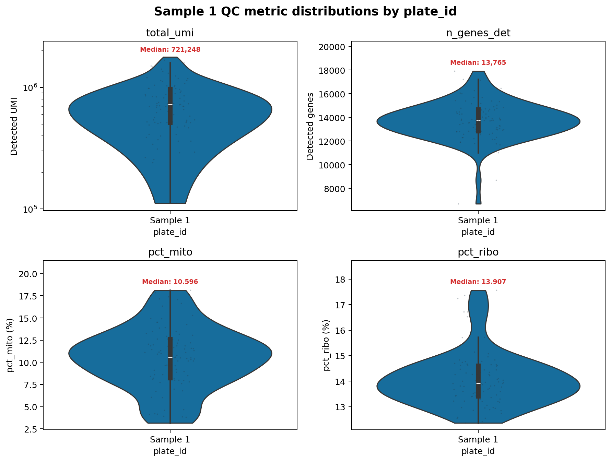
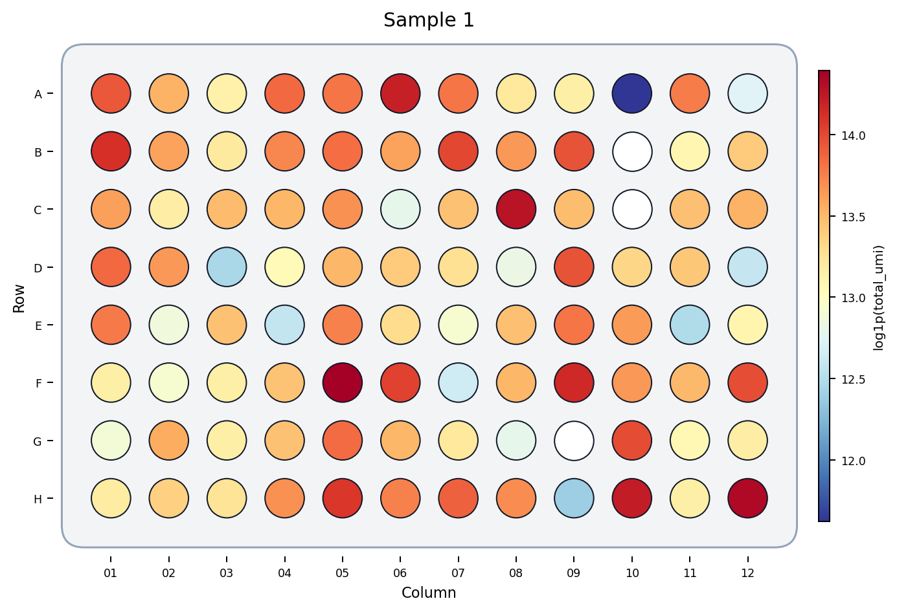
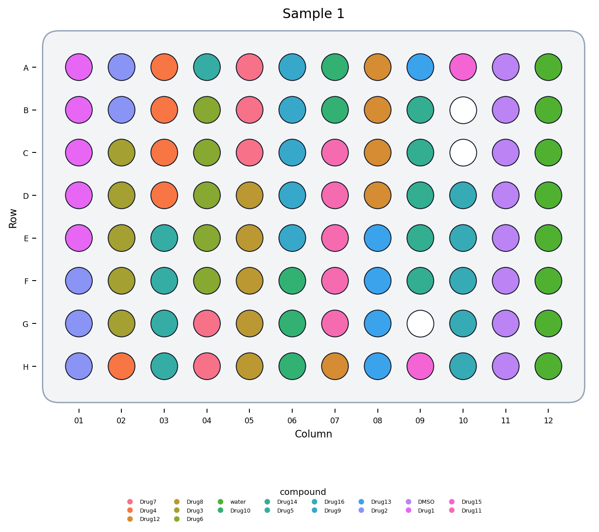
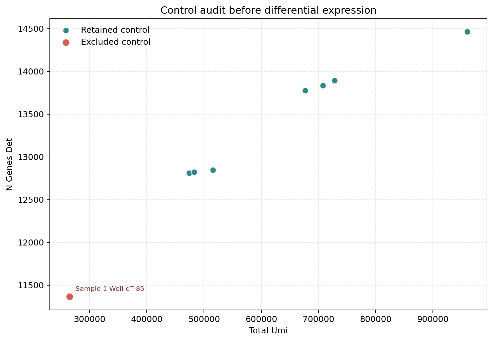
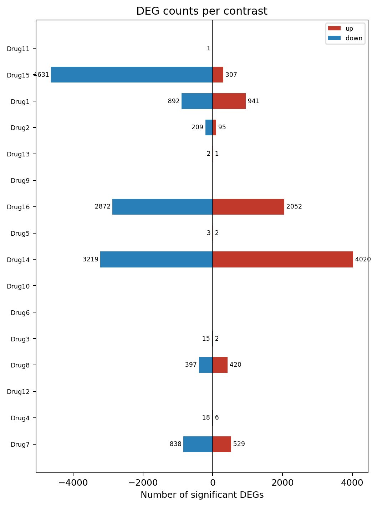
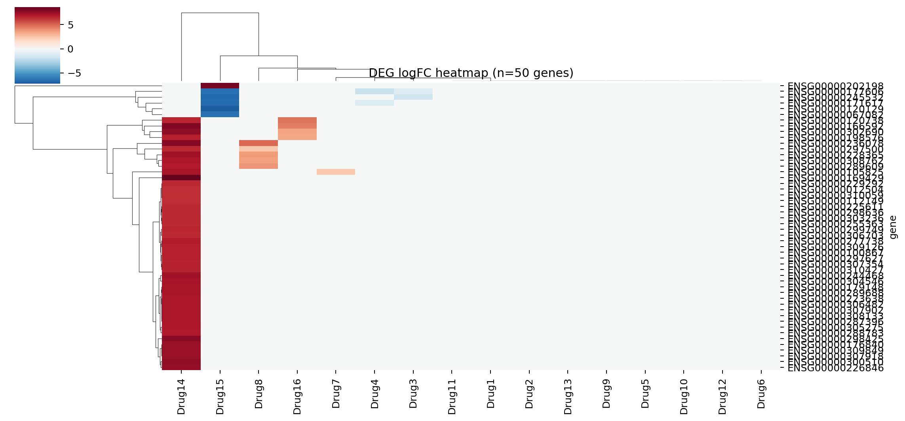
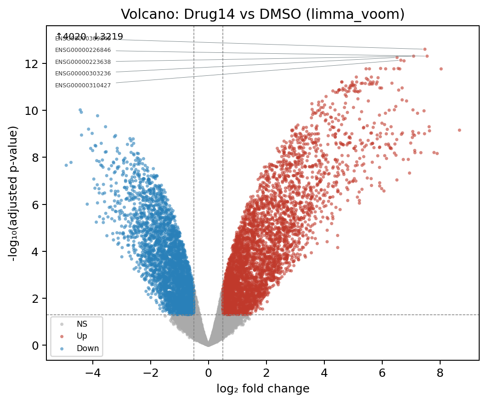
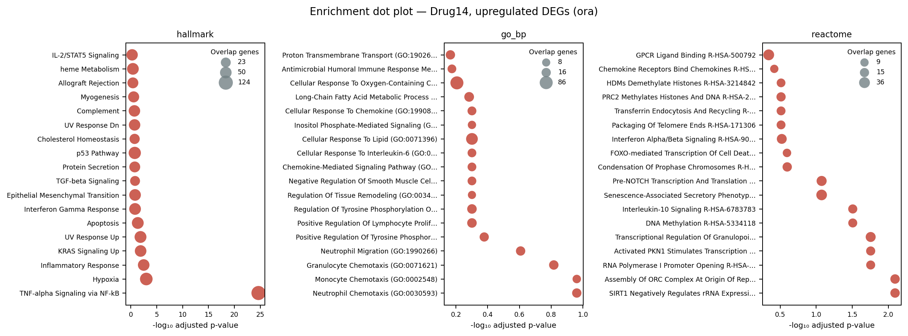
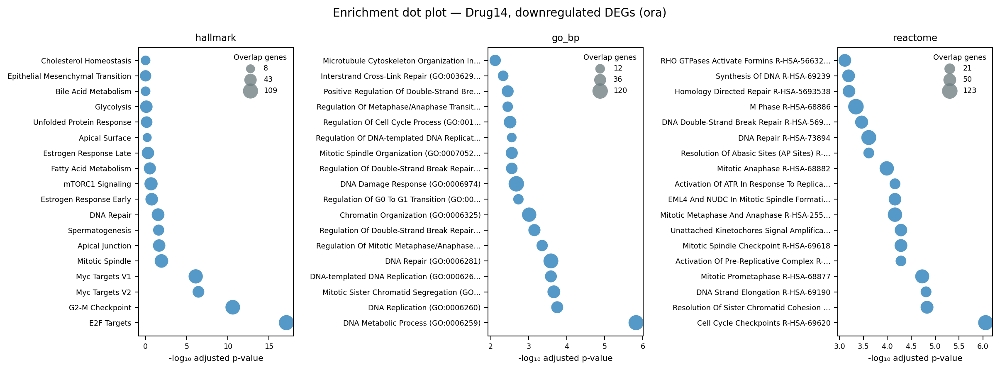

# Single-plate comparison workflow

[Learning path](index.md) · [Prepare inputs](input-preparation.md) · [API reference](api-reference.md)

> **Before you start:** complete [Getting started](getting-started.md) and the [QC workflow](qc-workflow.md). Run the Python blocks in order from the repository root. This chapter uses **Sample 1**, an example plate dataset; each observation is one well. The figures and numerical tables are historical worked results. The bundled synthetic practice inputs produce different numbers and contrasts.

Analyze one plate from physical-well QC through control review, gene filtering, differential expression, and optional directional enrichment. After QC and [well-to-well repeatability review](well-to-well-repeatability.md), use this chapter when every treatment and its matched control occur on the same plate. Continue to [multi-plate comparison](multi-plate-comparison.md) when you have independently processed plates.

<a id="overview"></a>

## Overview

The [Drug-seq worked case](drugseq-case-study.md) applies this workflow to a selected real plate, then extends the same condition panel to three plates. Its case-specific Sample 1 is separate from the historical and synthetic example on this page.

The sequence is QC → control audit → reviewed exclusions → gene filtering → normalization → differential expression → enrichment. A one-plate analysis estimates treatment effects within that plate. It cannot establish that those effects reproduce across plates or runs.

The historical worked analysis removes one reviewed DMSO control, retains seven DMSO controls, and tests 12,807 genes. Its strongest contrast is Drug14. The small synthetic practice dataset contains Drug1 and Drug2 instead, so the code selects an available contrast from your results rather than assuming Drug14 exists.

<a id="choose"></a>

## 1. When to use one plate

Use this workflow when the case and control wells were processed together. With only one plate, a separate plate effect cannot be estimated; do not add a constant plate covariate or run between-plate correction.

| Question | Single-plate decision |
| --- | --- |
| Are treatment and control on the same plate? | Required for every contrast in this workflow. |
| Should batch correction be run? | No separate plate effect can be estimated from one plate. |
| Can row and column effects be reviewed? | Yes. Inspect physical maps and consider prespecified covariates when the design supports them. |
| Can results generalize across runs? | One plate cannot establish this. Additional plates allow cross-plate concordance checks; broader experimental reproducibility requires documented changes in experimental conditions and appropriate independent replication. |

**A well is not automatically a biological replicate.** Several wells from the same culture or preparation may be technical replicates. Identify the independent experimental unit before interpreting uncertainty; treating dependent wells as independent can overstate evidence. The package's minimum well count does not validate the biological design.

The examples group by `compound` because each treatment has one dose and time point. If your experiment has multiple doses or times, define a condition column and use it consistently for the control comparison and plots. Controls must be matched to the relevant time, vehicle, and other experimental conditions. Do not pool distinct conditions merely because their compound name is identical.

<a id="input"></a>

## 2. Input and metadata

The matrix directory contains `matrix.mtx.gz`, `features.tsv.gz`, and `barcodes.tsv.gz`. Each metadata `barcode` must match one matrix barcode. See [Prepare inputs](input-preparation.md) for orientation, coordinates, and required columns.

```python
from pathlib import Path
import re
import numpy as np
import pandas as pd
import matplotlib.pyplot as plt
import drugseqpy as ds

# Run from the tutorial repository root.
data_dir = Path("data/sample_1")
output_dir = Path("results/single-plate-chapter")
qc_dir = output_dir / "qc"
comparison_dir = output_dir / "comparison"
qc_dir.mkdir(parents=True, exist_ok=True)
comparison_dir.mkdir(parents=True, exist_ok=True)

dsd = ds.create_drugseq_from_files(
    expression_path=data_dir / "matrix",
    metadata_path=data_dir / "metadata.csv",
    metadata_key="barcode",
    min_overlap=1.0,
)
dsd.adata.obs_names = dsd.obs["sample_id"].astype(str)
assert dsd.obs_names.is_unique
if dsd.obs["plate_id"].nunique() != 1:
    raise ValueError("Use one plate here; see the multi-plate chapter for merged data.")
print(dsd)
print(dsd.obs.groupby("compound", observed=True).size())
```

The chapter output directory is separate from the command-line runner's output. Rerunning these blocks into the same directory replaces files with matching names.

<a id="qc"></a>

## 3. Essential QC

Compute metrics before excluding wells. Compare distributions with the physical layout so a local failure is not mistaken for a treatment effect. Low counts, low detected-gene counts, or unusual mitochondrial fractions are review signals whose meaning depends on cell type and treatment.

```python
ds.compute_qc_metrics(dsd, inplace=True)
dsd.obs.to_csv(qc_dir / "well_qc.csv", index=False)
```

`generate_qc_metric_violin_figure()` creates the requested QC-distribution figure. It does not filter wells.

```python
qc_distribution_files = ds.generate_qc_metric_violin_figure(
    dsd, output_dir=qc_dir, formats=("png",),
    metrics=("total_umi", "n_genes_det", "pct_mito", "pct_ribo"),
    groupby="plate_id",
)
plt.close("all")
```



**QC metric distributions for the worked plate.** The low-yield tails identify wells for review. Medians summarize the plate but do not define exclusions.

`generate_plate_layout_figures()` creates one requested map per call. The example uses an 8 × 12 plate; change these dimensions to match your actual coordinates.

```python
umi_plate_files = ds.generate_plate_layout_figures(
    dsd, output_dir=qc_dir, plate_value="total_umi",
    continuous=True, output_name="plate_layout_detected_umi",
    nrow=8, ncol=12, formats=("png",),
)
plt.close("all")
```



**Total-UMI plate map.** Spatial position helps reveal edge effects, gradients, and isolated low-yield wells. An unoccupied position is different from a measured well with zero counts.

```python
compound_plate_files = ds.generate_plate_layout_figures(
    dsd, output_dir=qc_dir, plate_value="compound",
    output_name="plate_layout_compound", nrow=8, ncol=12,
    formats=("png",),
)
plt.close("all")
```



**Treatment layout.** Compare treatment placement with the QC map before modeling. A treatment placed entirely along one edge may be confounded with position.

<a id="controls"></a>

## 4. Audit controls and exclusions

The historical example applied `outlier_score > 5` only to DMSO wells after review. It removed one control and retained seven. This is an example-specific decision, not a package default or a universal exclusion rule.

`audit_control_outliers()` returns a control-only table and does not remove wells. Its `excluded` column names a threshold flag; it does not mean the well has already been excluded. Save a clearly named review table and inspect the flagged wells against the QC distributions, physical layout, and experimental notes.

```python
control_audit = ds.audit_control_outliers(
    dsd, control_label="DMSO", threshold=5.0,
)
control_audit.rename(columns={"excluded": "flagged_for_review"}).to_csv(
    qc_dir / "dmso_outlier_audit.csv", index=False,
)
print(control_audit)
```

The historical flagged control was:

| Sample | Plate | Well | Total UMI | Detected genes | Score |
| --- | --- | --- | --- | --- | --- |
| Sample 1\_TTGATCTTAA | Sample 1 | Well-dT-85 | 265,265 | 11,366 | 6.27 |

`plot_control_outlier_audit()` plots the table. The code relabels its legend so threshold flags are not mistaken for completed exclusions.

```python
fig = ds.plot_control_outlier_audit(control_audit)
for label in fig.axes[0].get_legend().get_texts():
    label.set_text({
        "Excluded control": "Flagged for review",
        "Retained control": "Not flagged",
    }.get(label.get_text(), label.get_text()))
fig.savefig(qc_dir / "dmso_outlier_audit.png", dpi=180)
plt.close(fig)
```



**Historical DMSO control audit.** The excluded control differs from the retained control cloud in yield and complexity. The figure's exclusion labels describe the reviewed historical decision; running the audit alone makes no such decision.

Record specific reviewed sample IDs and reasons. The default below retains every well, including flagged controls, until you supply a reviewed decision. Do not copy a historical sample ID into your practice dataset: its barcodes differ.

```python
# Populate only after reviewing your experiment. Empty means no exclusions.
reviewed_exclusions = pd.DataFrame(columns=["sample_id", "reason"])
if reviewed_exclusions["sample_id"].duplicated().any():
    raise ValueError("Each exclusion must have a unique sample_id.")
unknown = set(reviewed_exclusions["sample_id"]) - set(dsd.obs["sample_id"])
if unknown:
    raise ValueError(f"Exclusion IDs not present in this plate: {sorted(unknown)}")
if reviewed_exclusions["reason"].fillna("").str.strip().eq("").any():
    raise ValueError("Record a reason for every reviewed exclusion.")

excluded = dsd.obs["sample_id"].isin(reviewed_exclusions["sample_id"])
exclusion_audit = dsd.obs.loc[excluded].reset_index(drop=True).merge(
    reviewed_exclusions, on="sample_id", how="left",
)
exclusion_audit.to_csv(qc_dir / "reviewed_exclusions.csv", index=False)
analysis_dsd = dsd.subset(obs_mask=(~excluded).to_numpy())
design_counts = analysis_dsd.obs.groupby("compound", observed=True).size()
design_counts.to_csv(comparison_dir / "design_counts.csv", header=["n_wells"])
if "DMSO" not in design_counts or design_counts["DMSO"] < 2:
    raise ValueError("At least two retained DMSO wells are required for this example.")
print(design_counts)
```

Review control representation again after exclusion. A model that runs successfully can still have inadequate independent biological replication.

<a id="preprocess"></a>

## 5. Filter genes and normalize

Low-information genes add to the multiple-testing burden. The historical example retained genes with at least five counts in at least three wells, leaving 12,807 features. These settings illustrate one filtering rule; your synthetic run will retain a different number.

```python
if (np.asarray(analysis_dsd.layers["counts"].sum(axis=1)).ravel() <= 0).any():
    raise ValueError("Review zero-count wells before normalization or DE.")
analysis_dsd = ds.filter_genes(
    analysis_dsd, min_count=5, min_samples=3, group_aware=False,
)
if analysis_dsd.n_vars == 0:
    raise ValueError("No genes passed filtering; review inputs and the filtering rule.")
ds.normalize_counts(analysis_dsd, method="limma_voom", inplace=True)

# Normalized expression: analysis_dsd.adata.X
# Raw integer counts: analysis_dsd.adata.layers["counts"]
print(f"Retained {analysis_dsd.n_obs} wells and {analysis_dsd.n_vars} genes.")
```

Keep the raw `counts` layer intact. The DE function uses that layer for the requested model; normalized expression is available for visualization. Do not replace raw counts with log-transformed or batch-corrected values.

<a id="de"></a>

## 6. Differential expression

Compare each treatment with the retained within-plate DMSO controls. Water is excluded from the contrast list. No plate covariate is supplied because only one plate is present. `within_plate=False` disables the multi-plate contrast construction; it does not mix plates here because the input already contains exactly one plate.

`compute_multi_de()` fits the treatment-versus-control models without creating figures. The example calls a DEG at adjusted p-value < 0.05 and absolute log2 fold change ≥ 0.5. Keep these criteria fixed while comparing contrasts.

```python
ds.compute_multi_de(
    analysis_dsd,
    group_col="compound", reference="DMSO", exclude_levels=("water",),
    methods=("limma_voom",), batch_cols=None, within_plate=False,
    min_replicates=2, fdr_threshold=0.05, lfc_threshold=0.5,
    n_jobs=1, inplace=True,
)
```

`summarise_comparison()` returns the contrast summary. Check for missing results before selecting a contrast, and inspect `comparison_failures` for failed comparisons. Ranking by DEG count selects a figure to inspect; it does not select the most biologically important treatment.

```python
if not analysis_dsd.adata.uns.get("comparison_results"):
    raise ValueError("No fitted contrasts; inspect comparison_failures and replication.")
de_summary = ds.summarise_comparison(analysis_dsd)
if de_summary.empty:
    raise ValueError("The DE summary is empty; inspect comparison_failures.")
de_summary.to_csv(comparison_dir / "comparison_summary.tsv", sep="\t", index=False)
priority = de_summary.sort_values(
    ["n_sig_total", "min_padj"], ascending=[False, True],
).iloc[0]["contrast"]
priority_filename = re.sub(r"[^A-Za-z0-9_-]+", "_", str(priority))
print(de_summary)
```

### Complete historical contrast summary

| Contrast | Up | Down | Total DEGs | Minimum FDR |
| --- | --- | --- | --- | --- |
| Drug14 | 4,020 | 3,219 | 7,239 | 2.50e-13 |
| Drug15 | 307 | 4,631 | 4,938 | 1.06e-06 |
| Drug16 | 2,052 | 2,872 | 4,924 | 1.23e-08 |
| Drug1 | 941 | 892 | 1,833 | 6.38e-08 |
| Drug7 | 529 | 838 | 1,367 | 3.87e-07 |
| Drug8 | 420 | 397 | 817 | 4.90e-06 |
| Drug2 | 95 | 209 | 304 | 1.02e-05 |
| Drug4 | 6 | 18 | 24 | 1.35e-04 |
| Drug3 | 2 | 15 | 17 | 1.58e-03 |
| Drug5 | 2 | 3 | 5 | 1.45e-02 |
| Drug13 | 1 | 2 | 3 | 1.09e-02 |
| Drug11 | 0 | 1 | 1 | 1.86e-02 |
| Drug6 | 0 | 0 | 0 | 1.30e-01 |
| Drug9 | 0 | 0 | 0 | 3.47e-01 |
| Drug12 | 0 | 0 | 0 | 3.58e-01 |
| Drug10 | 0 | 0 | 0 | 5.10e-01 |

`plot_deg_counts()` creates the directional DEG-count figure.

```python
fig = ds.plot_deg_counts(analysis_dsd)
fig.savefig(comparison_dir / "deg_counts.png", dpi=180)
plt.close(fig)
```



**Directional DEG counts.** Red indicates higher expression and blue lower expression in the treatment relative to DMSO. Empty bars are valid results at the chosen thresholds.

`plot_comparison_heatmap()` summarizes cross-treatment log fold changes.

```python
fig = ds.plot_comparison_heatmap(analysis_dsd, n_top_genes=50)
fig.savefig(comparison_dir / "de_logfc_heatmap.png", dpi=180)
plt.close(fig)
```



**Cross-treatment log-fold-change heatmap.** Strong significant effects organize treatments by shared and distinct response patterns. This is a heatmap of estimated treatment effects, rather than individual-well expression.

### Historical worked result: Drug14

The largest historical response contains 7,239 DEGs: 4,020 up and 3,219 down. Broad responses require review of toxicity, global expression shifts, QC, and individual replicates. DEG count alone does not establish a specific mechanism.

`plot_comparison_volcano()` creates one volcano figure for the selected contrast. On synthetic practice data, the selected contrast is Drug1 or Drug2.

```python
fig = ds.plot_comparison_volcano(analysis_dsd, contrast=priority, n_label=5)
fig.savefig(comparison_dir / f"{priority_filename}_volcano.png", dpi=180)
plt.close(fig)
```



**Drug14 volcano plot.** Effect size and adjusted statistical evidence are shown together. Highlighted genes pass both configured thresholds.

<a id="enrichment"></a>

## 7. Directional DEG enrichment

This section is optional. Skip all its code blocks until you have local GMT gene-set files with identifiers that match your gene annotations. No GMT files are bundled, and the calls below disable network retrieval. See the [enrichment API](api-reference.md) for parameters and result fields.

Up- and downregulated DEGs are tested separately. The historical result uses all 12,807 modeled genes as the background. For another run, `background="all_tested"` uses that run's modeled genes. Gene identifiers are mapped through `adata.var["gene_symbol"]` before matching when appropriate; check actual overlap rather than assuming every identifier maps.

```python
# Optional section: supply these local GMT files before running.
gene_set_paths = {
    "hallmark": Path("gene_sets/hallmark.gmt"),
    "go_bp": Path("gene_sets/go_bp.gmt"),
    "reactome": Path("gene_sets/reactome.gmt"),
}
missing = [str(path) for path in gene_set_paths.values() if not path.is_file()]
if missing:
    raise FileNotFoundError(f"Supply local GMT files for this optional section: {missing}")
ds.run_enrichment(
    analysis_dsd, libraries=tuple(gene_set_paths), gene_set_paths=gene_set_paths,
    mode=("ora",), background="all_tested", allow_network=False, inplace=True,
)
```

`plot_enrichment_dotplot()` creates one direction-specific figure per call. A direction with no significant genes or matched pathways may have no interpretable enrichment plot.

```python
fig = ds.plot_enrichment_dotplot(
    analysis_dsd, contrast=priority, direction="up", mode="ora",
)
fig.savefig(comparison_dir / f"{priority_filename}_up_enrichment_dotplot.png", dpi=180)
plt.close(fig)
```



**Drug14 upregulated DEG enrichment.** Pathways are tested among genes with higher expression. Dot position reports pathway FDR and point size reports the overlapping gene count.

```python
fig = ds.plot_enrichment_dotplot(
    analysis_dsd, contrast=priority, direction="down", mode="ora",
)
fig.savefig(comparison_dir / f"{priority_filename}_down_enrichment_dotplot.png", dpi=180)
plt.close(fig)
```



**Drug14 downregulated DEG enrichment.** Pathways are tested among genes with lower expression. Point position and size have the same meaning as in the upregulated panel.

The historical analysis contains 1,018 pathway rows with FDR < 0.05 across all treatment, library, and direction combinations. Overlapping pathways reuse genes and do not represent 1,018 independent biological findings. Enrichment of a directional gene list does not by itself prove pathway activation or inhibition.

`enrichment_summary()` returns pathway results independently of plotting.

```python
pathway_table = ds.enrichment_summary(analysis_dsd)
significant_pathways = pathway_table.loc[pathway_table["padj"] < 0.05].copy()
pathway_table.to_csv(comparison_dir / "pathway_summary.tsv", sep="\t", index=False)
significant_pathways.to_csv(
    comparison_dir / "significant_pathways.tsv", sep="\t", index=False,
)
```

Selected historical pathway results:

| Library | Direction | Pathway | Overlap | Odds ratio | FDR |
| --- | --- | --- | --- | --- | --- |
| hallmark | up | TNF-alpha Signaling via NF-kB | 124/175 | 5.42 | 2.23e-25 |
| hallmark | down | E2F Targets | 109/198 | 3.74 | 7.51e-18 |
| hallmark | down | G2-M Checkpoint | 94/193 | 2.88 | 2.53e-11 |
| reactome | down | Cell Cycle Checkpoints R-HSA-69620 | 107/251 | 2.26 | 8.74e-07 |
| go_bp | down | DNA Metabolic Process (GO:0006259) | 108/253 | 2.26 | 1.50e-06 |
| reactome | down | Resolution Of Sister Chromatid Cohesion R-HSA-2500257 | 52/103 | 3.07 | 1.47e-05 |
| go_bp | down | DNA Replication (GO:0006260) | 37/67 | 3.69 | 1.78e-04 |
| hallmark | up | Hypoxia | 74/159 | 1.92 | 1.03e-03 |
| reactome | up | SIRT1 Negatively Regulates rRNA Expression R-HSA-427359 | 18/24 | 6.24 | 8.06e-03 |
| reactome | up | Assembly Of ORC Complex At Origin Of Replication R-HSA-68616 | 18/24 | 6.24 | 8.06e-03 |

<a id="tables"></a>

## 8. Saved outputs

Save the individual gene-level results and a model-status table as well as figures. This block can run whether or not you completed optional enrichment.

```python
for contrast, table in analysis_dsd.adata.uns["comparison_results"].items():
    filename = re.sub(r"[^A-Za-z0-9_-]+", "_", str(contrast))
    table.to_csv(comparison_dir / f"{filename}_de.tsv", sep="\t", index=False)
failures = analysis_dsd.adata.uns.get("comparison_failures", {})
model_status = pd.DataFrame(
    [{"contrast": key, "status": "succeeded", "message": ""}
     for key in analysis_dsd.adata.uns["comparison_results"]]
    + [{"contrast": key, "status": "failed", "message": message}
       for key, message in failures.items()]
)
model_status.to_csv(comparison_dir / "model_status.tsv", sep="\t", index=False)
print(model_status)
```

The chapter blocks write:

```text
results/single-plate-chapter/
├── qc/
│   ├── well_qc.csv
│   ├── dmso_outlier_audit.csv
│   ├── reviewed_exclusions.csv
│   └── QC distributions and plate-map PNGs
└── comparison/
    ├── design_counts.csv
    ├── comparison_summary.tsv
    ├── model_status.tsv
    ├── <contrast>_de.tsv
    ├── DEG-count, heatmap, and volcano PNGs
    └── optional pathway tables and enrichment PNGs
```

Keep the reviewed exclusion table, filtering thresholds, condition definitions, gene-set versions, and software environment with your analysis. The command-line runner below organizes its exports separately and records its configuration.

<a id="notes"></a>

## 9. Important notes

- A one-plate analysis provides within-plate evidence. Use [multi-plate comparison](multi-plate-comparison.md) to assess independently estimated effects across plates.
- Match treatment and control by dose design, time, vehicle, and other relevant conditions. Technical wells do not substitute for independent biological replication.
- Review unusual controls before exclusion, document the decision, and check how conclusions change when a questionable well is retained.
- Preserve raw counts for DE and use normalized expression for the intended visualizations.
- Treat zero DEGs as a valid result, and interpret overlapping pathways as related hypotheses rather than independent discoveries.

<a id="glossary"></a>

## Glossary

**Batch effect** — A systematic technical difference associated with plate, run, operator, reagent lot, or processing time.

**Contrast** — A defined treatment-minus-control comparison. Positive log fold change means higher expression in the treatment.

**DEG** — A differentially expressed gene passing both the adjusted p-value and effect-size thresholds.

**FDR** — False discovery rate. Adjusted p-values support controlling the expected proportion of false discoveries among a set of rejected hypotheses under the method's assumptions.

**Batch regression** — A model-based adjustment of normalized expression for an estimable batch effect. This chapter has only one plate and does not perform it.

**ORA** — Over-representation analysis of a selected gene list against a defined tested-gene background.

**Repeatability** — Agreement among replicate wells measured under the same plate conditions.

**Cross-plate treatment-effect concordance** — Similarity of treatment-versus-control effects estimated separately on different plates.

**Experimental reproducibility** — Consistency evaluated under explicitly changed experimental conditions. A single plate cannot establish this; simply adding plate labels does not establish it either. See the [terminology guide](input-preparation.md#repeatability-and-concordance).

**Within-plate support** — Presence of both treatment and control wells on the same plate, needed for a within-plate contrast.

<a id="troubleshooting"></a>

## Troubleshooting

**The DMSO label is not found.** Check exact spelling and case in `analysis_dsd.obs["compound"]`. The audit accepts case-insensitive matching, while the model's `reference` must match the stored condition label. Correct inconsistent metadata before fitting.

**No contrasts are returned.** Review `analysis_dsd.adata.uns["comparison_failures"]`, treatment/control representation, the raw counts layer, and the minimum-replicate requirement. A summary cannot be selected from an empty result.

**A treatment has zero DEGs.** Inspect effect sizes, replicate values, and uncertainty. Do not relax thresholds solely to obtain a nonempty list.

**No enrichment is returned.** Check that local GMT files exist, gene symbols overlap those libraries, significant DEGs exist in the requested direction, and the tested-gene background is appropriate. The synthetic inputs demonstrate the workflow; their artificial identifiers need not reproduce meaningful biological enrichment.

**The numbers differ from the tables above.** The tables and figures are historical worked results. Synthetic practice inputs, reviewed exclusions, filtering choices, model settings, and library versions determine the output of your own run.

<a id="complete-report"></a>

<a id="10-complete-reproducible-run"></a>

## 10. Complete runnable workflow

For a complete practice run from the repository root:

```bash
python scripts/run_tutorial.py single-plate --data-dir data --output-dir results
```

This runs Sample 1 through QC, control review, filtering, normalization, DE, and result export. It does not automatically exclude flagged controls. Enrichment requires optional local gene-set files; inspect `python scripts/run_tutorial.py --help` for those inputs and reviewed-exclusion options. The practice runner uses settings appropriate to the bundled synthetic inputs, so its results need not match the historical example or every chapter setting.

For a different experiment, use a new output directory and review the [input contract](input-preparation.md), [QC workflow](qc-workflow.md), and [API reference](api-reference.md) before adapting the condition labels or thresholds.

[← Mixed-species review](mix-species-workflow.md) · [Multi-plate comparison →](multi-plate-comparison.md)
