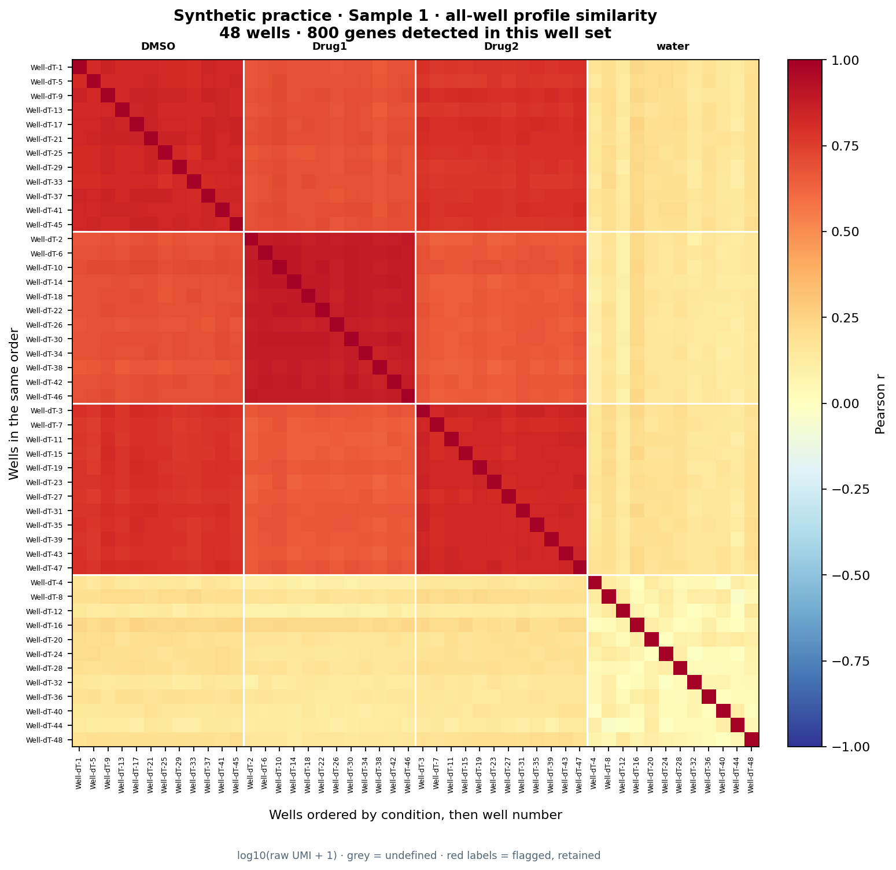
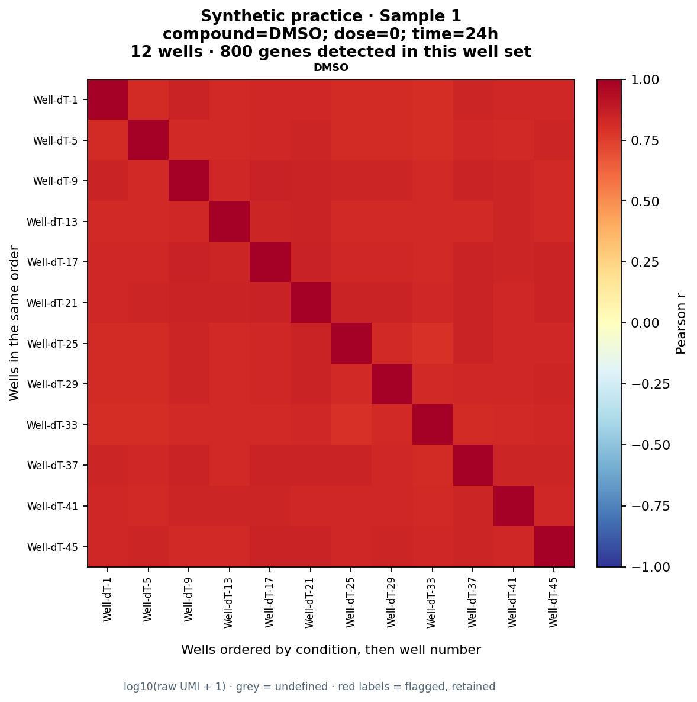
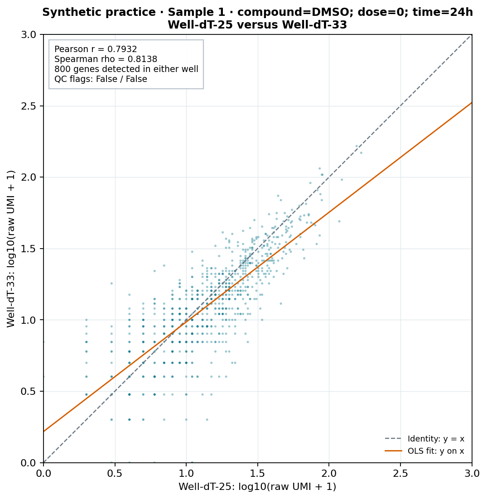
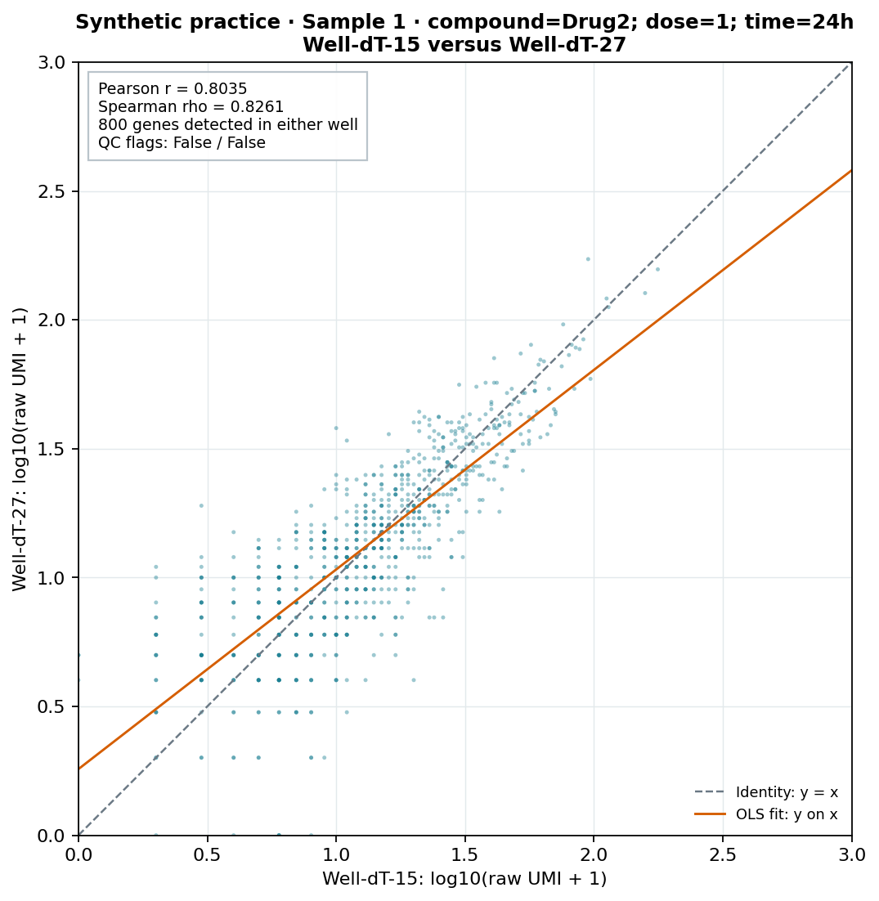
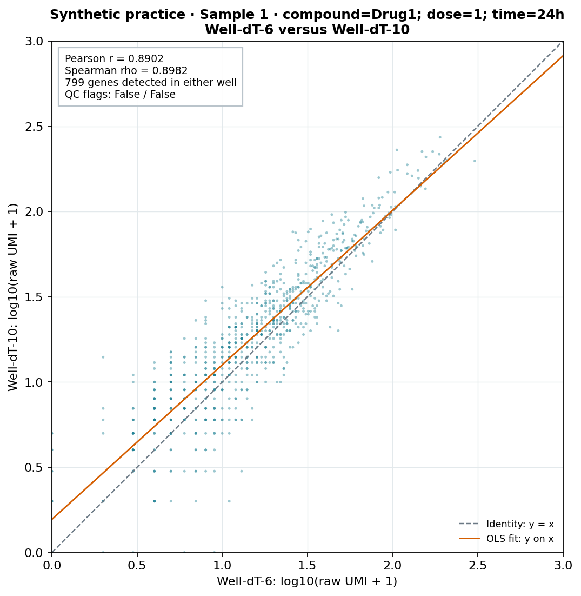

# Well-to-well repeatability

[Learning path](index.md) · [Prepare inputs](input-preparation.md) · [API reference](api-reference.md)

> **Before you start:** complete [Getting started](getting-started.md) and [QC](qc-workflow.md). This chapter's figures and numerical results are generated from the bundled **synthetic Sample 1** inputs. They are reproducible practice illustrations, not biological findings or the historical results in other chapters.

Compare expression profiles across wells before interpreting treatment effects. Use an all-well heatmap to inspect the plate, condition-specific heatmaps to inspect matched wells, and gene-expression scatter plots to understand individual pairs. This complements [mixed-species review](mix-species-workflow.md) and prepares you for [single-plate differential expression](single-plate-comparison.md).

<a id="overview"></a>

## 1. Define which wells are replicates

The all-well heatmap contains every pair of wells, including different treatments. Those cells show profile similarity; they are not all replicate comparisons.

For the replicate-pair table and scatter plots, wells must share **plate, compound, dose, and time**. For example, two Drug1 wells with different doses must not be pooled as replicates. Add other design variables, such as cell type, donor, or processing subgroup, when they define comparable conditions.

| View | Wells compared | What it answers |
| --- | --- | --- |
| All-well heatmap | Every well against every other well on one plate | Are there unusual profiles, broad groups, or blank-versus-cell differences? |
| Within-condition heatmap | Wells sharing compound, dose, and time on that plate | Are the matched profiles broadly consistent? |
| Replicate scatter | One eligible within-condition pair; one dot per retained gene | Which expression ranges or genes account for the pair's agreement or discrepancy? |

For a condition with `n` wells, the script evaluates all `n × (n − 1) / 2` unordered pairs. A condition with one well has no replicate pair. It still appears in the all-well heatmap and the condition index.

**The experimental unit still matters.** Technical wells may share one biological preparation. Gene dots are features, not independent biological replicates; pairwise correlations also share wells. Do not treat the number of genes or pair combinations as the biological sample size, and do not use these descriptive correlations to claim a treatment effect. Use the [multi-plate workflow](multi-plate-comparison.md) to assess cross-plate treatment-effect concordance. For plates from one batch, describe this as between-plate consistency; it does not establish experimental reproducibility under changed conditions. See the [terminology guide](input-preparation.md#repeatability-and-concordance).

<a id="method"></a>

## 2. Understand the expression scale and gene set

The default uses raw UMI counts transformed as `log10(count + 1)`. The added one permits zero counts; the log transform compresses the influence of highly expressed genes. This is not library-size normalization. Depth, detection sensitivity, treatment response, and technical variation can all affect the resulting pattern.

The gene set depends on the view:

| Calculation | Included genes | Treatment of zeros |
| --- | --- | --- |
| All-well heatmap | Detected in at least one well on the plate | A gene absent from both members of a particular pair remains if another well detected it. |
| Condition heatmap | Detected in at least one well of that condition | A gene absent from the entire condition is removed. |
| Pair scatter and pair-table statistics | Detected in either member of that pair | A gene with zero counts in both wells is removed. |

**A scatter's correlation may differ from the corresponding heatmap cell.** The expression transform is the same, but the included genes may differ. The script records the gene count for each view so this difference is visible. A pair uses the same gene mask for both correlation measures and its fitted line.

Pearson correlation measures linear association between the transformed profiles. Spearman correlation measures association between gene ranks, using average ranks for ties. A strictly increasing log transform preserves ranks, but many zero counts create tied ranks. The script reports both measures for every eligible pair; `--heatmap-method` chooses which one appears in heatmaps.

Fewer than three retained genes or a constant expression profile yields an undefined value. Such values are saved as missing, drawn grey in heatmaps, and omitted from scatter rendering. They are not silently assigned zero or one. The heatmap color scale spans −1 to 1.

<a id="run"></a>

## 3. Run the complete practice analysis

From the tutorial repository root, run:

```bash
python scripts/compare_well_repeatability.py \
  --data-dir data --sample sample_1 \
  --output-dir results/well-repeatability \
  --max-scatters 3 --synthetic
```

The script loads `data/sample_1/matrix/` and `data/sample_1/metadata.csv` through `drugseqpy.create_drugseq_from_files()`, joins on `barcode` with complete overlap, and uses unique sample IDs for the calculations. It requires exactly one plate, complete condition metadata, unique well IDs, and nonnegative integer counts.

All eligible pairs are computed regardless of `--max-scatters`. That setting caps the number of scatter figures, which can otherwise grow quickly. By default, the illustrative selection is the lowest-Pearson DMSO pair, the lowest-Pearson nonblank treatment pair, and the highest-Pearson nonblank treatment pair. Additional requested slots are filled in ascending Pearson order. This deliberately illustrates the range; it is not a representative sample or an unbiased comparison of conditions.

The default cap without an explicit option is six. `--max-scatters 0` writes the heatmaps and complete tables without scatter figures. Use a fresh output directory for each analysis; rerunning into an existing directory can overwrite matching files, while unrelated files from an earlier run may remain.

<a id="repeatability"></a>

## 4. Read the all-well heatmap



**All-well profile similarity.** This practice plate contains 48 wells and 800 genes detected somewhere on the plate. Wells are ordered by condition and then well number, with boundaries between conditions. The matrix is symmetric; its diagonal compares each nonconstant profile with itself and is not evidence of repeatability.

The synthetic cell-containing wells form similar profiles, while water wells have much sparser detection. Cross-treatment similarity can remain high because much of the transcriptome is shared. High overall correlation does not show that a treatment had no effect; low correlation does not identify its cause.

Review an unusual well with its UMI depth, detected-gene count, mitochondrial fraction, physical location, and metadata. Do not remove it only because it has the lowest correlation.

The complete numerical matrix is saved as `all_wells_correlations.csv`. `well_order.csv` records the displayed order and review flags.

On the website, open a figure to inspect the full-size well labels. The downloadable PNGs also retain the complete labels.

<a id="condition-heatmaps"></a>

## 5. Examine matched conditions separately



**DMSO control profiles.** These 12 wells share the same recorded control, dose, and time. The script also creates separate heatmaps for Drug1, Drug2, and water. `condition_index.csv` maps each numbered heatmap to its exact metadata values; a water heatmap is a blank-profile QC view, not a biological replicate analysis.

The synthetic run produces these descriptive pair summaries:

| Condition | Dose | Time | Wells | Pairs | Median Pearson r | Pearson range | Median Spearman rho |
| --- | --- | --- | --- | --- | --- | --- | --- |
| DMSO | 0 | 24h | 12 | 66 | 0.8301 | 0.7932–0.8558 | 0.8407 |
| Drug1 | 1 | 24h | 12 | 66 | 0.8749 | 0.8496–0.8902 | 0.8811 |
| Drug2 | 1 | 24h | 12 | 66 | 0.8294 | 0.8035–0.8510 | 0.8394 |
| water, blank-profile QC | 0 | 24h | 12 | 66 | −0.8494 | −0.9382–−0.7285 | −0.8597 |

Dose values above are the synthetic metadata values; use explicit, consistent units in a real experiment. The summaries use pair-specific gene sets, so they do not summarize the heatmap cells exactly. All 264 pair rows remain available, including blank pairs.

**Why are the blank-pair values negative?** Synthetic water wells detect very few, often different genes. Restricting a pair to genes detected in either member removes their many shared zeros and leaves mostly genes present in one well only. That selection can produce strong negative correlation. It does not demonstrate biological opposition between water wells. Compare detection depth and gene-set sizes before interpreting a sparse-profile correlation. These water pairs contain only 78–97 retained genes, whereas the cell-containing pairs contain 793–800.

Do not compare conditions solely by the largest median correlation. The gene universe, detection level, biological variability, and number of independent units all matter. The 66 pairs within a condition reuse the same 12 wells; their range is descriptive, not a confidence interval based on 66 independent replicates.

<a id="replicate-scatter"></a>

## 6. Inspect replicate gene-expression scatters

Each dot is one gene detected in at least one member of the pair. Both axes use `log10(raw UMI + 1)` with the same limits and a square aspect ratio. The dashed identity line is `y = x`; the orange line is an ordinary least-squares fit of y on x. Correlation does not measure agreement with the identity line: profiles can correlate strongly while differing systematically in magnitude.



**Lowest-Pearson control pair.** Well-dT-25 and Well-dT-33 are matched DMSO wells. Their Pearson r is 0.7932 and Spearman rho is 0.8138, using 800 genes. Inspect dispersion and depth together; this selection alone is not an exclusion decision.



**Lowest-Pearson treatment pair.** Well-dT-15 and Well-dT-27 share Drug2, dose 1, and time 24h. Their Pearson r is 0.8035 and Spearman rho is 0.8261, using 800 genes. Genes detected in just one well lie on an axis. Differences near the detection limit may contribute substantially to the pattern.



**Highest-Pearson treatment pair.** Well-dT-6 and Well-dT-10 share Drug1, dose 1, and time 24h. Their Pearson r is 0.8902 and Spearman rho is 0.8982, using 799 genes. This is the selected high-correlation example, not evidence that every Drug1 pair is better than every other condition.

The default figures have no jitter. `--display-jitter 0.007` can reveal overlapping dots with small, seeded visual offsets. The pair mask, Pearson/Spearman statistics, and fitted line always use the exact unjittered values. The figure states when jitter is enabled.

<a id="select-pairs"></a>

## 7. Select pairs explicitly

Read `replicate_pairs.csv` to find a pair by condition, well ID, sample ID, or correlation. Then pass its `pair_id` to the script. For example, the first pair in the unchanged synthetic dataset is:

```bash
python scripts/compare_well_repeatability.py \
  --data-dir data --sample sample_1 \
  --output-dir results/well-repeatability-selected \
  --pair pair-00001 --max-scatters 1 --synthetic
```

Repeat `--pair` to request several figures and set `--max-scatters` high enough for them. Pair IDs depend on the input well set and condition ordering; use the table from the same inputs. An unknown or undefined pair is rejected rather than silently replaced by another pair. `selected_pairs.csv` records each rendered pair, its selection reason, and its figure filename.

To show Spearman heatmaps, add `--heatmap-method spearman`. Pair tables and scatter annotations still report both correlation measures. Automatic illustration selection remains based on Pearson r, as recorded in `selected_pairs.csv`.

For a design with additional matching variables, supply all required condition columns:

```bash
python scripts/compare_well_repeatability.py \
  --data-dir my-data --sample sample_1 \
  --condition-columns compound dose time cell_type \
  --output-dir results/my-repeatability --max-scatters 6
```

This last command requires your own input metadata, including `cell_type`. Missing condition fields are rejected. If a condition field is absent because it is constant by design, add an explicit documented value to metadata instead of silently pooling unknown values.

<a id="flags"></a>

## 8. Retain and mark wells under review

An optional CSV can list wells already flagged during QC:

```csv
sample_id,reason
Sample 1_DEMO0001,Review recorded QC metrics and physical position
```

The ID above is only an example of the input format, not a recommendation to flag that synthetic well. Save your reviewed table as `review-flags.csv`, then run:

```bash
python scripts/compare_well_repeatability.py \
  --data-dir data --sample sample_1 \
  --flagged-samples review-flags.csv \
  --output-dir results/well-repeatability-flagged \
  --max-scatters 3 --synthetic
```

Flagged wells remain in every applicable calculation. Their heatmap labels are red, their scatter annotations show the flag, and the pair table records each member's status. A review flag is not an exclusion. If you later exclude a well for a documented reason, rerun on the reviewed input set and compare the results; removing wells may change both pair membership and the heatmap gene universe.

<a id="outputs"></a>

## 9. Saved outputs and checks

```text
results/well-repeatability/
├── run_settings.json
├── well_order.csv
├── all_wells_correlations.csv
├── condition_index.csv
├── condition-001_correlations.csv, ...
├── replicate_pairs.csv
├── condition_summary.csv
├── selected_pairs.csv
└── figures/
    ├── all_wells_heatmap.png
    ├── condition-001_heatmap.png, ...
    └── scatter-01.png, ...
```

`run_settings.json` records the transformation, gene-set rules, condition columns, heatmap statistic, pair count, undefined-value policy, display jitter, and whether synthetic labeling was requested. No original matrix is copied into these outputs.

Before drawing conclusions, check that the metadata define the intended matched conditions, the expected number of wells and pairs are present, raw counts are the intended expression input, and low-detection pairs have enough genes to interpret. Review `status` and `n_genes_pair` alongside each coefficient. There is no universal correlation cutoff for accepting a well.

The helper uses drugseqpy for loading and alignment and explicit NumPy/SciPy calculations for these plots. The package's `compute_within_plate_repeatability()` also supports Pearson and Spearman, but its default grouping is plate plus compound and its gene universe is the entire supplied matrix. Do not expect exact agreement unless condition definitions, expression scale, and gene masks match. See the [API reference](api-reference.md) and the [multi-plate repeatability section](multi-plate-comparison.md) for that complementary workflow.

<a id="troubleshooting"></a>

## Troubleshooting

**The heatmap and scatter give different r values.** Compare the retained gene counts. Heatmaps use genes detected anywhere in their displayed well set; scatter statistics exclude genes absent from both members of the pair.

**A blank pair has a large negative correlation.** Inspect the number of detected genes and the pair mask. Excluding shared zeros from two sparse profiles can leave mostly mutually exclusive detections.

**A pair is undefined.** Check for a zero or constant profile and very few retained genes. Undefined values remain missing; more figures cannot resolve insufficient information.

**A condition has no scatter.** It may contain only one well, have undefined pair statistics, or fall outside the figure cap. The complete pair table distinguishes these cases; `condition_index.csv` also lists singleton groups.

**A pair has high r but lies away from the identity line.** Correlation describes association, not equal expression or equal library size. Inspect total UMIs, the fitted slope and intercept, and relevant QC measures.

**A plate has many wells or genes.** The script guards against count matrices exceeding 512 MiB when made dense. Analyze a scientifically justified smaller well set or use a more memory-efficient implementation; do not silently sample genes and compare the changed coefficients as if they used the original gene set.

[← Mixed-species review](mix-species-workflow.md) · [Single-plate comparison →](single-plate-comparison.md)
